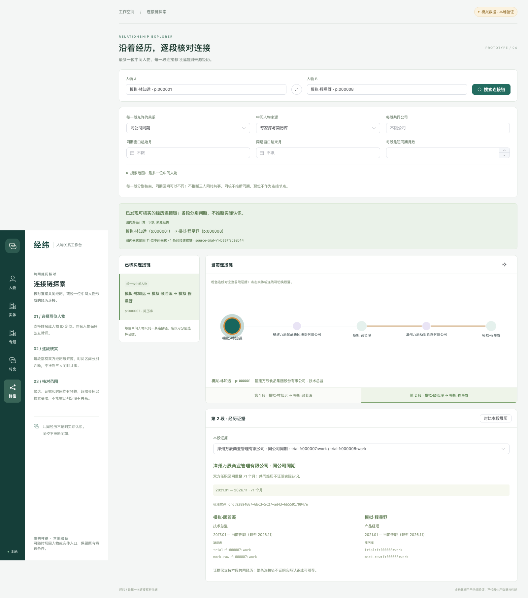

# v0.13 图内关系与路径计算验收

日期：2026-11-04。按用户确认的分工，将连接链从“图找候选、SQL／Python 判断关系”改为“图计算关系与路径、SQL 按引用提供详情”。本轮没有访问 Supabase，没有迁移、重置或覆盖已发布数据库／图空间；数据仍为虚构人物和经历。

## 职责与实际范围

| 工作 | 图模式的执行位置 |
| --- | --- |
| 连接链接口的直接关系、候选范围、连接到另一端 | NebulaGraph nGQL |
| 共同实体、关系类型、同期交集、最少月数、单侧窗口、当前任职 | NebulaGraph nGQL，按单条经历对计算 |
| 中间人物来源与有效性、经历有效性 | NebulaGraph nGQL |
| 各段经历事实 ID、两端事实属性 | 图返回并携带类型化证据 |
| 人物信息、实体展示名称、职位与来源定位 | SQL 按人物／事实 ID 读取 |
| SQL 原经历与图引用是否属于同一快照 | 按事实属性完整性校验；不重新计算路径或月份 |
| 普通人物列表、实体筛选、专题、完整两人对比和导出 | 保持原 SQL 服务，本轮未迁移 |

变更入口为 `POST /api/v1/relations/paths`，仍只支持直接或最多一位中间人物。不是任意深度、全局最优或引荐概率计算。原投影已含完整经历属性，复用 format_version=1，无需重投影或修改读模型。


`GraphPathService` 编排，`NativeGraphReader` 调图查询，`graph_relation_queries.py` 集中生成 nGQL。`format_evidence` 复用标签、说明和标识装配，不调用 Python overlap 或重新计算关系。旧候选引擎保留用于显式对照，故障不会自动切回 SQL。

## 有界查询与契约

先从参考人物的有效经历筛选实体，去重实体后沿人物—实体邻接按人物 ID 分页。每页 128 人，额外一人探测后页；再由图内实际共同经历谓词筛选，累积稳定候选前缀。另一端到该前缀的连接也在图内计算。

已知端点的证据匹配分别从两端人物取经历，在图内连接共同实体。不能用从热门公司反向展开全体人物后再过滤固定人物的方式代替。两段分别核实时段，不要求三人同期。未知日期可以同公司，不能认定同期；专业不替代职位，母子公司不自动等同。

保留候选、路径、事实、证据、时间预算，参考实体不超过 64，图返回总量不超过 20000 行、RPC 不超过 256 次。每批最多 5 位中间人物／10 段证据，每段多取一条检测截断。排序和截断与原路径契约保持一致。SQL 只装载图引用的事实，缓存仅限当次请求。

这些限制不等于图服务端磁盘扫描或中间展开量；`evidence_pairs_examined` 在新引擎表示已装配证据对数，`candidates_examined` 保留原字段但不冒充逐人核验数，另提供 `graph_candidates` 表示图内候选前缀。原生最终 LIMIT 和 SDK 超时不保证服务端立即停止。仍需真实分布、目标环境和并发保护验证。

图模式返回 `query_backend=nebula`，页面显示“图内路径计算 · SQL 来源证据”。旧辅助引擎返回 `nebula_sql`，纯 SQL 为 `sql`。接口形状兼容增加枚举与统计字段，通过 Pydantic → OpenAPI → TypeScript 生成，未手改生成类型。

权限、启动全量摘要、请求前后 ready 标记、不可变成对快照与既有预算错误语义继续有效。乱序、重复、缺失证据或图／SQL 属性漂移返回明确错误；预算不足不能伪装无关系。运行中不支持同版本原位修正，换批次仍需停服。

## 调试中发现的问题与修复

1. 初版单个 MATCH 经热门公司反向展开，重复任职进一步放大中间结果，万人观察出现 time_limit 和后续 503。容器检查均运行、健康、无重启；没有足够证据归因为 OOM，也未通过重启或调大全局资源掩盖问题。[首次失败原始记录](performance/graph-native-initial-failure.json) 保留，不能算通过。
2. 改为已知端点分别取经历、实体先去重、邻接分页后，9 类场景无接口错误，但发现证据超过上限时与 SQL 展示条目不同。原因是新引擎先截取再排序，旧契约先对含探测项的前缀排序再截取。修复排序顺序并增加小上限回归。[该轮问题摘要](performance/graph-native-prefix-failure.json) 保留，完整原始记录仍在本机 data/graph-native/observation-v2。
3. benchmark_graph.py 新增图错误或 time_limit 后停止后续场景的规则，保留部分报告；不在图不可用后继续执行全部场景。增加所有已返回路径和证据签名比较，避免只检查共同路径、遗漏不同的返回集合。

## 万人顺序观察

同一固定种子 42 模拟快照，10000 人、53521 条经历、1125 个实体，复用已发布 MySQL 库及图空间。macOS 26.5.1 ARM64、Python 3.12.14（backend/.venv）、MySQL 9.7.1、NebulaGraph 3.8.0／SDK 3.8.3。图容器限额沿用原环境（Graph 1 CPU／1 GiB，Storage 2 CPU／2 GiB）；保留其他本机 MySQL／Canal 服务。

2026-11-04T10:38:00Z 开始最终观察；ASGI 顺序 API，真实本机 MySQL TCP 与 Nebula RPC，没有 HTTP 并发。9 场景 × 3 引擎 ×（首次 1 次＋预热 7 次）共 216 次。首次不是清空系统缓存；7 次预热 P95 只供诊断。启动摘要检查另计，不包含在请求延迟。

| 场景 | SQL 预热 P50／P95 ms | 图内计算 P50／P95 ms | 旧图辅助 P50／P95 ms |
| --- | --- | --- | --- |
| 普通路径 | 9.291／10.392 | 33.500／45.144 | 24.393／26.809 |
| 热门公司 | 28.570／49.909 | 349.978／411.472 | 94.500／115.530 |
| 长履历 | 32.143／42.212 | 401.572／407.895 | 99.735／124.107 |
| 无结果 | 5.034／5.195 | 26.895／29.105 | 10.389／14.242 |
| 中间人专家来源 | 30.308／37.334 | 318.032／356.870 | 492.715／513.630 |
| 同期窗口／最少月数 | 30.699／40.784 | 410.410／462.169 | 126.668／159.057 |
| 同校 | 9.302／9.988 | 18.622／22.036 | 17.090／25.613 |
| 日期未知 | 26.207／35.283 | 19.008／21.025 | 669.216／773.150 |
| 候选上限 1 | 11.534／12.753 | 85.040／88.832 | 31.343／31.918 |

最终 216 次无接口错误、无 time_limit、无检测到的路径／证据差异；新图／SQL 全部已返回路径签名逐次一致。4 个搜索完整场景的直接关系与路径语义摘要一致，5 个受限场景保持 candidate_limit／path_limit／evidence_limit，不能据此声称穷尽全集。独立小样本基准用于另外核对正确性。

新图在日期未知时可从端点立即排除同期，在来源筛选场景也比旧辅助少做跨服务复核；这两项不证明普遍加速。多数场景仍慢于纯 MySQL，热门和长履历约 0.35–0.41 秒 P50。图 RPC、每 RPC 建池、查询规划和多经历匹配仍有开销；没有把图中执行关系计算等同于性能优秀。

后端源码 SHA-256：`9014561edb04f4322f3723c56e74afab6d1c186a564a59c8e7be4377bfc6fdb2`。[最终完整原始记录](performance/graph-native-10000.json) 含逐次响应摘要、SQL、阶段和受限原因。源 SQLite、默认演示文件及 MySQL 逻辑内容摘要均不变，后端标记检查通过。统计不证明图所有存储记录未变；本轮运行查询使用 GUEST，只对临时测试空间另行构建和清理。

## 正确性与浏览器

新增测试覆盖：禁止新图引擎调用 SQL 候选、资格、按人物全量事实读取和 Python 关系计算；实际 SQL 查询必须按图引用事实 ID。图返回属性漂移报错；候选／事实／证据预算保持不完整语义；分页跨越 128 人并保持过滤后的前缀，验证探测项顺序及实体上限。

实际图 500 人差分逐一验证 6 种关系范围 × 3 种来源，独立朴素算法计算路径和逐段证据，不调用生产关系函数。另保留人工场景、图快照修正、SQL 回归和冻结来源样例三模式验收。

| 检查 | 实际结果 |
| --- | --- |
| 全套后端，开启 MySQL／图环境／图业务专项 | 468 项通过、28 项需来源样例外部配置的用例跳过；312.21 秒 |
| 冻结来源样例 SQLite／MySQL／新图三模式专项 | 60 项通过，1.18 秒；包含上述跳过的 28 项 |
| 静态与契约 | Ruff、mypy（49 源文件）、OpenAPI 与前端类型生成、前端格式均通过 |
| 前端类型与生产构建 | 通过，Vite 3.58 秒；保留既有 G6 大包提示 |
| 默认 SQL 工作台浏览器 | 18 项通过、5 个可选专项跳过，45.7 秒 |
| 新图原演示工作台完整浏览器 | 19 项通过、4 个规模／来源专项跳过，49.7 秒 |
| 冻结来源样例浏览器 | SQLite／MySQL／新图分别 3 项通过，7.4／6.8／7.1 秒 |

全套新增 12 项原生图／分页测试（包含参数化）：500 人差分、禁止 SQL／Python 重算、属性漂移、小上限排序、预算及离线分页。实际数据库专项只构建并清理本次随机空间／账号，不更改已发布投影。浏览器数量按配置分别记录，不能相加当作互不重叠的独立用例数。

原始 [完整后端 JUnit](performance/graph-native-full-tests.xml)、[来源三模式 JUnit](performance/graph-native-source-trial-tests.xml) 和 [新图浏览器 JUnit](performance/graph-native-browser-workbench.xml) 保留。既有 Starlette/httpx 弃用提示未借本轮升级依赖处理。

来源浏览器记录为 [SQLite](performance/graph-native-browser-source-sqlite.xml)、[MySQL](performance/graph-native-browser-source-mysql.xml)、[图内计算](performance/graph-native-browser-source-nebula.xml)。实际检查新图截图，模拟标识、图内计算标记、两段连接与任职来源正常显示。所有本次创建的前后端服务已停止，图容器有意保留运行。



## 本机启动与复现

冻结来源样例（人物和经历仍虚构）已配置成 MySQL＋图内计算：

```bash
bash scripts/nebula.sh up
source data/graph-native/source-trial.env
bash scripts/dev.sh
# Ctrl+C 停服后才切换配置。
unset RELATIONSHIP_MYSQL_URL RELATIONSHIP_DATABASE RELATIONSHIP_NEBULA_MANIFEST RELATIONSHIP_GRAPH_ENGINE
```

原始演示也可先 `unset RELATIONSHIP_MYSQL_URL`，再加载 `data/graph-projection/workbench-v1/.env` 并设置 `RELATIONSHIP_GRAPH_ENGINE=paths`。这些本机忽略文件权限为 600，不提交凭据。

```bash
# 复现规模观察：使用新输出目录，默认 SQL／图内两组；可选旧辅助第三组。
source data/mysql-lab/scale-10000/.env
backend/.venv/bin/python scripts/benchmark_graph.py \
  --input data/benchmarks/r01-final/scale-10000.sqlite \
  --manifest data/graph-projection/scale-10000-v1/manifest.json \
  --output data/graph-native/my-new-observation --include-candidates

# 完整检查使用临时测试数据库／空间；不加载实际运行 manifest。
unset RELATIONSHIP_MYSQL_URL RELATIONSHIP_NEBULA_MANIFEST RELATIONSHIP_GRAPH_ENGINE
RELATIONSHIP_MYSQL_TEST=1 RELATIONSHIP_NEBULA_TEST=1 RELATIONSHIP_GRAPH_TEST=1 bash scripts/check.sh
```

当前完成技术分工原型，不是完整上线项目。真实上游关联／时间质量、SQL／图持续同步与成对发布、目标 Linux、并发、热门实体服务端展开、账号权限和生产恢复均待验证。下一阶段应以代表性数据明确目标负载，再评估图查询计划、连接复用、时段或邻接索引与部署资源，不能只因已引入图就宣称容量或延迟收益。
