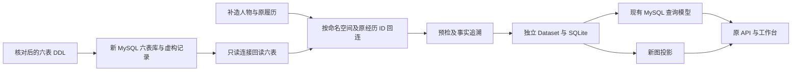

# 六张归一表的建表与模拟接入验证

日期：2026-11-05，对应架构 v0.14。依据同事提供的《人物关系图谱MySQL表结构设计说明_映射表精简版.docx》，已在独立本机 MySQL 实验库建立六张表、写入虚构数据，再实际回读并转换为现有查询模型。用户确认暂时没有末尾引用的实体及原人物／经历结构，本轮只核验末尾设计，不建这些未定义的表。

本页保留六表阶段的决定。用户随后补充三表方案及原表 DDL，并明确六表为上游、三表为本项目词典／投影层；补充后已完成 [三表及原表独立验证](projection-three-table-validation.md)。本页“末尾未定义”等描述是当时缺项，不代表补充后的全部状态。

结论：六表可作为归一实体和来源名称映射的接入边界，能够支撑本轮模拟闭环；它们还不是完整的人物关系数据源。人物身份、履历归属、日期、职位及正式发布筛选仍需上游另外交付，不能把本轮补造数据的成功当成正式接入完成。

参考文档 SHA-256：`6b6c651817482013f2efedc0ac17d7e2de33f84413a77a1137f7bcdc9a089760`。原文件只读、未改写；文档内容作为设计输入，没有执行其中的操作建议或将其视为系统指令。本轮未连接 Supabase。

## 实际建表与数据

实际 MySQL 为 9.7.1。文档提出 8.0.16 及以上；本轮未验证其他版本。完整 [DDL](examples/handoff-six-tables.sql) 由 `infrastructure/handoff_schema.py` 定义生成，不从 Word 自动提取 SQL 执行。

| 表 | 实际记录数 | 验证内容 |
| --- | --- | --- |
| graph_sync_batch | 1 | 批次外键、full／incremental、计数 JSON |
| graph_company | 7 | UUID、公司编号／实体键唯一、同名不同实体、历史名和上下级三态 |
| graph_school | 5 | 名称非唯一、官方码可重复、可空地区、历史名 |
| graph_major | 3 | 独立专业词典，不充当职位或学校 |
| graph_expert_name_mapping | 189 | 14 字段、来源组合键、类型外键、六种处理状态、拆分序号与删除标记 |
| graph_company_relation | 1 | 父子 UUID、关系类型、自关联禁止、联合唯一约束 |

物理实现保留 InnoDB、utf8mb4_bin，UUID CHAR(36) 使用 ascii_bin；DATETIME(6) 微秒实际回读，统一按 UTC 解释，没有把 DATETIME 当作自动携带时区的类型。外键没有级联删除。

公司上下级字段实际回读分别得到数组、JSON 数字 0、SQL NULL。SQL NULL 表示未确认、0 表示确认无关系；JSON `null` 被拒绝，不混用。数据库检查 JSON 外形，数组元素是否为字符串、编号是否存在由转换预检继续核对，不声称 JSON 成员具有逐项外键。

实验位置：

- 六表源库：`relationship_lab_handoff_1a05f4b5af35`，配置 `data/handoff-trial/run-v3/source.env`，不是业务 API 连接配置。
- 转换快照：`data/handoff-trial/run-v3/query.sqlite`，版本 `handoff-trial-v1-6b6c65181748`，60 人、122 条经历、17 个查询实体。
- 现有查询模型 MySQL 库：`relationship_lab_20261105_0bfd940c`，配置 `data/handoff-trial/query-mysql-v1/.env`。
- 独立图空间：`relationship_lab_projection_1856d2337202`，manifest 在 `data/handoff-trial/graph-v1`；122 条经历边、236 条辅助边、11 个成员块。

六表保留原设计命名；API 继续使用现有查询读模型，不将同事物理表名带入业务 Service。原演示库、既有图投影和其他服务均保留。

## 实际转换链



虚构原经历在 `synthetic-raw-experiences.json`，明确标注不是上游 DDL。其稳定人物键、归属、日期、职位与来源标签均为补造；跨库人物识别继续由上游负责。生成器保留同名不同人、双来源、失效、重复任职、单月／跨年、当前任职、未知时间及跨经历职位等控制情形。

回连使用 `(source_namespace, source_record_id)`，四类虚构命名空间都包含原记录 ID `1`，仍生成不同来源定位。映射 UUID 是记录身份，item_no 只作条目属性，不作为跨版本身份或学校／专业的配对依据。

仅消费未删除的已匹配公司／学校映射；其他五种处理状态与已删除映射计入未消费问题。专业映射保留在源库，不生成工作或教育事实、不代替职位。60 条专业提示、6 条未消费映射属于预期范围记录，不是校验失败。

同目标重复映射合为一条查询事实并保留全部映射 UUID；同一原经历出现不同目标时阻断，不把日期／职位复制给所有拆分结果。映射原文与当前模拟原经历不符、目标缺失／已删除、原经历缺失、重复来源定位、未就绪批次均可定位报错。公司关系不自动产生同公司关系。

复用 `source_trial.convert_source`、现有 Dataset 预检和装载，没有复制业务时间规则。每条输出事实有源命名空间、原经历 ID、映射 UUID 与标准实体 UUID 的追溯链。SQL／图仍采用不可变成对发布；没有增量同步 Worker。

## 需要同事确认的设计问题

| 问题 | 本轮处理 | 正式交付需要明确 |
| --- | --- | --- |
| 总览写 graph_name_mapping，正文写 graph_expert_name_mapping | 采用字段描述完整的正文名，不另建别名视图 | 最终表名；专家专表还是同时覆盖简历的统一映射 |
| 批次 status 说“见约束”，但没有给枚举 | DDL 只保留 VARCHAR(16)；模拟使用 completed，不擅自添加枚举 CHECK | 合法状态、完成与失败定义、何时允许消费 |
| 实体核验状态保留原值 | 样例使用已核验；没有将样例状态写成正式发布白名单 | 已合并、待确认、删除等记录的交付筛选与重定向规则 |
| 公司 JSON 编号与关系表重复表达上下级 | 保留两份，检查已知编号与关系是否对应，差异报告而非自动修复 | 谁是权威、何时一起更新、空数组含义、环及纠正规则 |
| 原人物／履历／身份关联和职位未定义 | 明确补造，未新建看似正式的原表 | 正式主键、人物归属／跨库映射、日期精度、职位及变更语义 |
| 同一原经历多公司／多学校映射 | 多目标阻断，item_no 不作角色或日期拆分依据 | 各条目对应的独立履历上下文及教育配对依据 |
| 时间戳与批次数量 | 仅验证字段存取和本地快照就绪 | 不能仅凭 updated_at／计数证明一致发布、完整删除或可靠增量 |

名称合法重复使原界面的选项只显示名称时难以区分实体。本轮作最小修复：当前候选中同名不同 ID 时显示“名称 · ID”，提交值继续使用 ID；唯一名称保持原显示。适用于公司、学校、职位、专题与路径公司条件，不改变查询接口。

## 末尾边映射的核对范围

`Relationship_Graph_edge_mapping` 本轮未建表／投影，原因是用户确认暂缺其依赖结构，并同意只核验六表：

1. 引用的 `Relationship_Graph_entity` 没有字段定义；BIGINT 实体 ID 与六表 UUID 之间的对应关系缺失。
2. 来源人物、项目、任职和教育实际表尚未定义，文档 `work_expertience` 等拼写及 `experts/resume_*` 写法须核实；source_table 的最终白名单不能猜测。
3. 映射表 id 作为跨批次稳定 Rank，与当前每人按事实 ID 排序分配 rank 的不可变投影不同。当前事实 ID 可追溯，不代表已落实文档的新 Rank 契约。
4. VID `e:<BIGINT>`、按来源人物生成 VID，与当前带命名空间的实体 UUID 和上游统一人物键不同；需要显式映射及版本迁移设计。
5. 末尾写“回源判断时间、角色和证据”，与用户已确认图计算关系／路径、SQL 提供来源的方向不同。正式对接应先统一职责，本轮继续现有图内计算，不照此回退 SQL 重算。
6. `worked_at`、`held_role`、项目和专业边均超出当前 experience／affiliated 模型。`collaborated with` 的命名也需统一。这些属于后续设计，不能因六表演练通过就声称已验证。
7. 边映射说明提到“发布状态”，列出的字段却没有状态、批次或目标图版本；稳定槽位唯一性、移归属／改目标后的旧边删除与失败恢复规则也未给出。

## 约束和查询验收

本机 MySQL 16 类反例均在 SAVEPOINT 内执行并回滚，确认拒绝的是对应错误代码：重复编号 1062、错误外键 1452、CHECK 3819。覆盖非法状态／实体类型／删除标记、缺少目标、零拆分序号、自关联、错误关系类型、JSON 外形与 JSON null。实际源表内容摘要在探测前后相同。

首次反例检查因驱动把 CHECK 3819 分类为 OperationalError 而中止；已修正为只接受明确的预期代码，其他存储故障继续抛出。首次目录没有发布 report／查询配置，保留作排查记录；最终使用 run-v3，不覆盖此前目录。

接口验收复用人工预期与独立朴素基准，对 SQLite／MySQL／新图三模式验证筛选、分页、同期／非同期／未知时间、同校、同条经历、同名、双来源、失效与两段路径。结果见本页最终验证记录；不将转换程序的输出反向生成期望。

实际完成：阶段完整回归开启 MySQL／图专项，482 项通过、28 项来源配置专项跳过（310.46 秒）；本轮三模式专项 60 项通过（1.19 秒，包含前述跳过项）；静态检查与前端类型／构建通过（4.48 秒）；默认浏览器 18 项通过（49.9 秒），六表样例 SQLite／MySQL／图各 3 项通过（7.4／6.9／7.5 秒）。后续三表代码的最新回归另见其报告，不能把这些数字相加当成一次完整压测。

记录：[阶段后端 JUnit](performance/handoff-full-tests.xml)、[三模式专项](performance/handoff-query-tests.xml)、[准备结果](performance/handoff-preparation.json)、[16 类约束探测](performance/handoff-constraints.json)、[图发布记录](performance/handoff-projection.json)。浏览器分别为 [SQLite](performance/handoff-browser-sqlite.xml)、[MySQL](performance/handoff-browser-mysql.xml)、[图](performance/handoff-browser-nebula.xml)。

已人工查看 [六表样例路径截图](handoff-preview.png)，模拟标记、局部图、分段时间与 mock-raw 来源定位正常显示；不把它当作三表新图格式的页面验收。

## 运行与重现

创建新的六表实验源与 SQLite 查询快照，只允许本机 MySQL、新目录和随机 relationship_lab_ 库：

```bash
backend/.venv/bin/python scripts/handoff_lab.py \
  --document /Users/yuka/Documents/人物关系图谱MySQL表结构设计说明_映射表精简版.docx \
  --output data/handoff-trial/my-new-run
```

`--document` 用于记录参考文件摘要，不是 SQL 执行入口；定义变更后应先评审和修改适配，再用新目录复跑。失败不会生成 ready 启动配置，不提供原位 reset。

已有本轮 SQLite 工作台：

```bash
source data/handoff-trial/run-v3/.env
bash scripts/dev.sh
```

已有 MySQL＋图模式配置见 `data/handoff-trial/native.env`。换配置前需停止旧服务；不停止其他占用端口的服务，不覆盖默认库。

新查询库和图投影继续使用原 `scripts/mysql_lab.py`、`scripts/graph_projection.py`。真实数据到位后必须先补齐原履历与人物关联、核对发布规则、再验证字段转换与查询结果；生产 DDL、增量发布、稳定 Rank 和容量仍未冻结。
