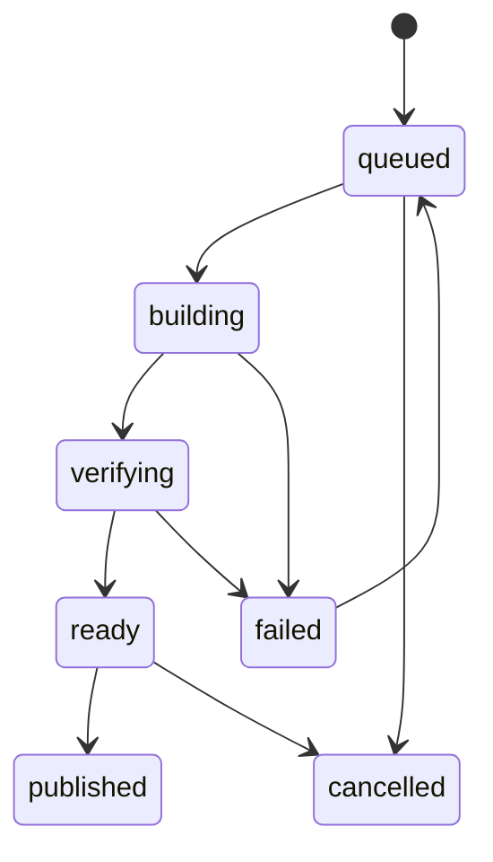
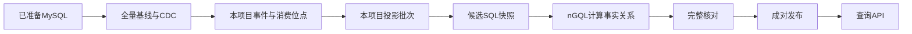

# 已准备好 MySQL 数据的更新采集与投影发布设计

版本 v1.17 ｜2026-11-12 ｜架构 v0.57.1 ｜在线人物及自动输入已部署，首次完整定时发布待验

## v1.17 服务器运行验收

用户反馈API已激活mysql-live，3位人物原表字段比对通过，实际自动输入准备成功，6525人物／25241事实。timer恢复，下次2026-11-13 04:30 CST，三个运行服务active、timer与recover均enabled、真实API健康。当前采用双源夜间全量只读采集和版本化发布，完整定时构建、切换及生产容量继续待验收，实际运行过程见docs/live-mysql-and-nightly-input.md。

## v1.16 在线人物及自动输入

当前低频运行实现每日04:30双源只读全量采集、输入准备及版本化发布，人物展示按已发布身份在线批量回MySQL。源采集在维护入口打开前进行，失败保留当前API，90分钟窗口涵盖采集和发布。新增prepare-input支持部署时单独核验自动输入。此前单源CDC提案作为数据量增长后的增量优化路线，当前实现的快照配套条件、字段保留、故障语义与部署验收见docs/live-mysql-and-nightly-input.md。服务器新补丁待安装，本机646项与隔离原生5人物4跳演练通过，生产容量继续待验。

## v1.15 夜间发布入口

已实现nightly.py／nightly_host.py，输入为封存real-graph-plan-v1，构建真实独立图并核验，维护503／停查询服务后切换query.env，启动并核对实际版本及数量再开放入口。用户指定每日北京时间04:30及90分钟窗口，定时入口有时区和剩余窗口核对、恢复预算及错过窗口跳过。plan/run/recover/status/prune与systemd／Nginx模板见docs/nightly-release.md。

任务记录与配置备份支持失败回退和中断恢复，ExecStopPost及开机恢复入口已提供。历史保留默认2份成功发布并保护当前和回退引用，清理限本程序管理的旧空间／账号，失败单独记录pending。50项专项通过，后端617通过／247跳过，Ruff／Mypy和离线锁检查通过。原生Nginx／Nebula及独立API演练覆盖更新、四跳、回退与恢复，systemd启停由子进程适配模拟，Ubuntu249单独解析验证通过。

当前夜间发布已具备冻结输入到服务版本的流程，MySQL CDC生成该输入及在线人物查询继续待接入，服务器实际启停和定时运行待部署验收。来源拓扑沿用v1.14，版本化发布选型沿用用户v0.54确认。

## v1.14 来源角色配置与合源迁移

用户确认夜间方案并说明正式环境将由当前两库合为一个来源。实体／映射与人物／经历读取保留逻辑角色，配置引用物理连接。当前单源CDC仍订阅实体／映射库，原经历联动保证继续适用。

已增加real-mysql-source-config-v1及真实采集--source-config，双库引用两个连接，同库引用一个连接。连接包含端口／CA路径及密码环境变量引用，旧采集CLI兼容，冻结续采校对双角色来源。当前采集仍按角色使用独立只读快照，配套binlog基线及同库单事务初始化尚待实际更新适配。在线人物仓储应共用角色配置并核对图的来源，当前API接入待实施。

正式切换在夜间维护时核对DDL及主键／映射，建立新实例的来源世代与全量／CDC基线，图和人物来源配置配套切换，回退组合同时保留。主方案v0.55记录已实现入口及边界。新增23项离线回归，完整后端567通过／247跳过，Ruff／Mypy通过，本轮未连接新源或修改线上。

## v1.13 夜间停服版本化发布

用户最新明确继续采用版本化发布，夜间可以暂停查询。单源CDC持续可靠采集，夜间检查待处理范围／跨月，有变化时固定完整事务截止点与配套原经历输入，进入维护并暂停查询API，构建独立候选图及发布材料。核验通过后原子切换使用配置，启动单API完成启动／健康／版本检查，再恢复入口。构建或切换失败时按上一完整发布恢复服务并保留失败记录与重试范围。

具体维护时刻、执行频率及最大持续时间尚未指定。前轮30分钟发布建议由夜间窗口替换。暂停API减少进程占用和查询争用，图空间、中间结果和恢复核验仍有内存开销，需测量峰值并控制历史保留及分批处理。当前UpdateProgram的固定范围、发布锁、候选核验与激活模式可复用，真实自动接入、在线人物MySQL、调度及失败回退协调仍待实现。

本轮只维护采用决定及核对已有入口，未改应用／服务器或新建定时配置，未新增运行测试。v1.12原地更新保留为历史候选。

## v1.12 原地更新与资源约束

用户关注版本发布内存并询问直接更新，评估保留一个运行图、CDC收集合并变更、定时原地修改事实及人物关系。若可接受维护窗口，改图前持久登记updating，统一关闭图查询准入并排空请求，逐批修改和重算，完整核验后登记ready及已应用截止点。故障保留updating、磁盘差分和恢复输入，恢复核验后再开放查询。

原地模式保留批次号、捕获／已应用位点、完成序号及恢复进度。按实体和人物对分批处理，控制中间结果，差分与旧数据落磁盘。当前派生Rank为快照局部序号，需稳定逻辑证据身份和Rank映射或人物对全部证据重建，事实Rank继续上游映射id。维护窗口、只读SQL证据及不可变图读取器适配详见主架构v0.53。

该候选以低频维护时的查询暂停换取单份运行数据及较小构建范围。具体内存、窗口时长、删除／多跳正确性与故障恢复待实测，用户尚未明确接受该窗口。本轮未修改应用／线上或新增测试。

## v1.11 持续采集与低频关系发布

用户最新要求更新频率较低并保持查询性能，推荐单源CDC持续持久接收实体／映射变更、后台定时合并事务批次、生成并核验预计算关系图，前台读取完整已发布关系并在线批量获取人物基本信息。建议初始每30分钟检查待发布变化，有变更才构建，具体间隔按时效和实际成本调整。原经历联动保证继续采用。

首期复用现有固定截止点与整图后台构建核心，后台串行任务、采集继续推进、失败保留旧发布并重试。范围增量构建按旧新共享实体设计，当前尚未实现。当前真实读取器固定发布目录，完整自动发布需衔接格式、配置和账号，连续查询切换需候选API独立端口启动核验、Nginx代理切换及旧请求排空。

正常关系新鲜度包含采集、等待批次、构建核验及切换耗时。页面展示图截至时间与同步进度，人物基本信息为当前MySQL值，关系证据绑定图版本。具体允许滞后和删除撤回语义待接入核验。本轮仅维护建议，未改应用／线上或执行新运行测试。

## v1.10 事实图更新与动态推导候选

用户询问关系每次直接计算的方式。候选图保存人物、标准实体及任职／学校／专业事实，查询按共享实体和任职时间等属性生成关系结果，人物展示批量回MySQL。实体／映射库单源CDC及上游联动保证继续适用，事件用于刷新实体、映射与配套经历的事实属性。

事实版本完成发布后查询以该版本推导关系，规则、基准月、删除撤回与采集延迟继续记录。现查询层依赖预计算人物边，新模式需改造直接列表、多跳与路径、证据和导出，并验证稳定分页及预算。4跳人物主链对应8条事实边，热门实体和重复证据展开成本待实测。具体依据与候选比较见主架构v0.50。

本轮为候选评估，未改应用及线上或新增运行测试。当前部署仍使用冻结SQL与预计算图。

## v1.9 查询延迟与后台维护建议

用户关注首次查询计算写图及失效重算耗时。本轮推荐实体／映射库单源CDC主动触发后台关系计算、核验及发布，查询读取完整已发布图并在线批量回MySQL获取人物展示。此建议待用户选择，v1.8按需缓存方案保留为前轮目标。

当前更新目标已支持新空间整图构建和完整核对。可先在已验证6525人范围核验后台持续发布与资源成本，后续依据容量实现按旧新共享公司／学校／专业合并影响的局部更新。当前局部增量图发布尚未实现。关系更新就绪前查询上一完整发布，展示关系截至时间及同步进度，人物展示为MySQL当前值，关系证据标明发布时点。严格追平会引入等待，具体允许同步时延和删除撤回语义仍待核定。

本轮为方案重评与文档维护，未新增运行测试或修改线上配置。主架构v0.49维护依据与边界。

## v1.8 按需图缓存与变更失效

用户明确首次查询计算关系并存入图，后续相同有效操作复用，人物展示在线查询MySQL。实体／映射库单源CDC联动保证继续有效。主架构v0.48维护完整流程，替换此前每次查询计算同期的未缓存解释。

第一版建议完整关系事务接收、去重及全局关系版本推进在同一控制事务内完成。各缓存记录绑定来源世代、关系版本、规则版本、基准月、中心人物、关系种类及覆盖范围。变更推进版本后，旧缓存逻辑失效，后续访问按需计算新批次并登记READY。全局版本同时覆盖新人物加入共享实体及旧新实体切换的影响，实际失效开销和首次查询成本待测。

图写入按尝试隔离，持租约及版本条件回读核对后登记READY，读取显式限定可用批次。零关系结果也记录完整覆盖。多跳逐层补齐同版本邻接，分页／路径／导出共用覆盖与版本语义。请求前后核对版本，CDC落后时显示同步状态，要求请求开始水位新鲜度时等待追平并处理超时。

现有UpdateStore的事务、去重及租约模式可复用，按需缓存控制与在线查询入口待实现。当前部署仍固定读取冻结SQL和预计算图，本轮只做源码核对及文档维护，新的并发／失效／多跳缓存测试待执行。以下保留旧版本设计及验证历史。

## v1.7 单源CDC与人物在线查询

用户确认所有影响关系的原经历更新会联动更新graph_edge_mapping并产生可捕获事件。据此，持续CDC只接实体／映射所在的test_derui_expert库，覆盖三实体表及graph_edge_mapping。人物与经历原库按查询、构建需要读取。v1.6双源CDC接入建议退役。

完整事务持久化及旧新引用用于确定刷新范围，构建时读取配套经历并封存实际输入及采集时间，重试使用同一输入。单源位点记录映射／实体状态，配套经历读取另有实际数据摘要和时间记录。人物展示请求批量按原主键回MySQL。现有冻结真实发布继续作为当前运行事实，在线查询和自动发布待实施。

用户补充同期由本项目在查询时计算。当前程序在图构建阶段预计算company_overlap，查询时计算需要覆盖1至4跳每段连接、两人路径、证据与导出。worked_at已提供任职对应标准公司的映射，按具体任职事实的区间交集判断同期。细节维护于主架构v0.47。当前三事实类型契约及运行代码已核对，本轮既有离线回归62项通过，实际新链路待实现和验证。

以下保留v1.6评估历史及更早单库实验依据，当前采集拓扑以本节为准。

## v1.6 真实测试部署后的接入评估

查询服务已在测试服务器完成冻结真实发布的公网验收。用户要求继续考虑更新功能与来源MySQL的接入，沿用首次一致性全量＋持续CDC＋完整事务微批方向。实体与权威映射源为47.113.185.127/test_derui_expert，人物／经历源为39.96.40.93/expert_recommend_real_staging_run_20260713_145630_15247。

代码核对发现MySQLSource要求同一数据库，UpdateStore只有一个checkpoint，更新CLI capture读取ReplaySource。实际MySQL协议入口当前为隔离实验脚本。SourceSnapshot的data_mode仅支持mock，更新核心的standalone-update-v1与当前真实读取器real-graph-build-v1还需衔接。具体差距和代码依据维护于[主架构v0.46](query-system-architecture.md#v046-测试部署验收与真实mysql更新接入)。

实施时按来源分别持久化身份、位点及完整事务，候选固定两路截止点并保存其来源摘要。两路来源独立提交时，配套人物／经历或映射可能先后到达，需要核对引用、归属与有效性，再生成成对SQL／图版本。当前人物范围由权威映射引用决定，新增映射的补取必须对齐构建截止点。日期规范与显式隔离审计沿用真实构建规则，新增缺失引用应核对双源到达状态。

原真实快照记录了源身份、TLS和采集时间，未记录与一致性快照对应的binlog游标。接入需建立新的可衔接基线。先在应用服务器只读核对两源网络、TLS、版本、binlog配置、日志保留、账号授权与表范围，再确定实际快照与采集机制、服务托管及成对发布流程。本轮完成代码差距评估，真实双源CDC与自动发布仍待实现和验收。

以下v1.5及更早章节保留单库实验和设计依据，当前运行条件以本节及主架构v0.46为准。

责任更正。用户确认graph_edge_mapping由同事生成和维护，名称映射JSON是其生成材料。本项目直接读取已准备好的MySQL映射及原表，Rank使用上游id。前轮下游名称文件接收／版本触发和Rank分配账本建议由[主架构v0.34](query-system-architecture.md#v034-上游映射维护确认与cdc边界)替换，主链路使用首次全量＋持续CDC＋完整事务微批。

当前实现。numeric-authoritative-v1已直接消费上游graph_edge_mapping，MySQLSource已通过MySQL 8.4.13一致性初始化及真实binlog读取验证。262人、13表228列和五轮Nebula更新、完整SQL对账及27607两跳三元组通过，细节与范围见[本轮原生记录](mysql-latest-native-validation.md)。原numeric-v1及文件事务回放保留兼容。

边界说明。首次来源全量建立基线，后续从持久化CDC状态自动选择固定to_seq。当前MySQL适配要求ROW／FULL镜像及列元数据，非压缩／非局部JSON，使用文件位置恢复。协调连接在隔离实例持短全局读锁，读取端为只读复制账号。source.sqlite从rows_at(to_seq)生成，与图使用相同来源状态。当前实验入口已运行，正式来源DDL、调度、HA、续租和容量仍需各自验收。

下文MySQL三表DDL及20项记录继续保留v0.27设计，运行核心实际使用私有SQLite状态，尚未将这些MySQL控制表部署到正式库。v0.30.1审计记录见[审计报告](update-program-audit.md)，最新72项更新专项及后端500通过／240跳过记录见本轮报告。

2026-11-09用户明确采用首次一致性全量＋CDC采集＋本项目微批发布。上游负责测试环境建表和模拟数据，本项目负责读取、采集和SQL／图版本更新。v0.30.1实现依据为说明补充版(2)的BIGINT及逻辑名称映射表；2026-11-10收到的文件映射版为最新目标，具体接入材料见[测试数据交接](data-handoff.md)。下文既有CDC事务设计继续保留，映射维护责任和输入范围以上述更正与主架构v0.35为准。

## 本轮前提与职责

用户确认graph_sync_batch由同事设计，用于Supabase到MySQL的上游同步。本项目自建更新控制表，负责MySQL到人物关系查询快照／图投影的处理进度。本轮按上游MySQL已经提供可消费数据评估，后续已提交事务按该数据契约消费。实际远程数据库尚未交付这一运行事实继续保留。

本项目读取必要的已准备业务表并维护自己的控制库、待发布SQL状态和图。上游graph_sync_batch不作为本项目的任务、消费位点或发布开关。本方案也不要求上游为了下游再新增完成批次表或Outbox。

## 选型结论

已确认采用首次一致性全量快照＋MySQL binlog CDC＋本项目微批投影发布。CDC负责增量定位、更新前后值及删除事件；微批负责合并重复影响范围、图计算、完整核对及成对发布。控制表记录的是本项目选定的一段已提交变更范围。

已准备好数据后，等待上游归一完成批次的依据退出本轮选型。完整的更新前后值和删除表达有助于定位旧新公司／学校／专业及人物，避免周期扫描大量明细来推断变更。源总量不直接证明CDC一定更快，真实增量规模、日志流量和构建成本仍需测量。

| 准备好数据后的情景 | 推荐方案 | 本项目的处理 |
| --- | --- | --- |
| 持续新增简历、任职／教育纠正及软删／硬删 | CDC持久采集＋微批发布，主方案 | 完整捕获事务，合并影响范围，按本项目版本发布 |
| 源按天提供不可变整库或导出 | 定时一致性快照差分 | 对主键与内容做完整差分，按明确完整范围识别删除，构建相应发布版本 |
| 只有SELECT权限，无法读取日志 | 周期一致性快照差分，或具备完整更新／删除契约的增量轮询 | 采集成本和可见延迟按实际数据量验证；本项目仍自己记录批次 |
| 团队已有可复用CDC平台 | 复用平台，接入同一事件协议 | 数据变更语义与投影任务保持统一，减少重复基础设施 |
| 大公司／热门专业合并、映射大规模纠正 | CDC发现变更后封成专门构建批次 | 估算完整证据范围及资源预算，失败候选隔离，保留完整旧发布 |

Canal与Debezium均可作为CDC候选。已有Canal环境记录使其适合优先做独立兼容性演练，选型仍需按实际MySQL版本、TLS、认证、行镜像及日志特性测试。首次快照与提交位点衔接、事务边界、重试恢复是必测项。[Canal ClientAPI](https://github.com/alibaba/canal/wiki/ClientAPI)、[Canal QuickStart](https://github.com/alibaba/canal/wiki/QuickStart)、[Debezium MySQL](https://debezium.io/documentation/reference/stable/connectors/mysql.html)

CDC账号单独授予所需复制权限，API查询账号继续只读。优先要求ROW binlog及完整行镜像，并按目标连接器验证；日志保留要覆盖允许中断时间。日志缺口、来源世代不明或不兼容DDL进入暂停／重新全量核对流程。

## 本项目的三张控制表

物理定义见[控制表DDL](../infra/mysql/schema/query-update-control-v1.sql)。安装在本项目独立控制库，使用InnoDB及UTC会话；本文件只含三条CREATE TABLE。它们不属于正式来源15表，也不属于图业务模型。

| 表 | 职责 | 关键字段 |
| --- | --- | --- |
| rq_cdc_checkpoint | 保存已可靠接收的源位点及采集器租约 | stream_id、source_generation、source_identity_sha256、baseline_cursor、capture_cursor、captured_tx_seq、capture_state、lease_token／lease_until |
| rq_cdc_event | 持久保存可重放的行事件、旧新值与事务归属 | stream_id、source_generation、tx_seq、event_index、source_event_id、source_tx_key、commit_cursor、source_table、operation、source_pk、before_row／after_row |
| rq_projection_batch | 本项目投影任务、切片范围、重试及发布结果 | batch_id、idempotency_key、trigger_kind、base_batch_id、from_tx_seq／to_tx_seq、end_cursor、reference_month、status、lease_token、版本／摘要／SQL与图目标／核对报告 |

### 消费位点

stream_id标识一条逻辑MySQL来源及固定表白名单。source_generation标识本次全量基线与日志历史世代，重建基线时新建世代。source_identity_sha256绑定来源身份与采集配置，避免连接到同名的其他来源。主从切换须验证日志连续性，不能简单按主机变化或时间戳推断。

baseline_cursor是初始一致性快照对应的日志截止点，capture_cursor是已经可靠落入本项目控制库的最新完整事务截止点。游标JSON应携带kind、协议版本及连接器所需的GTID或文件／位置等字段，具体格式由适配器验证，时间戳仅用于观察延迟。

captured_tx_seq是本项目在checkpoint行锁保护下分配的事务顺序号。与该事务的事件一起提交，避免使用业务更新时间或自增事件ID的最大值作为完整性边界。初始快照对应序号0，后续相关事务为1、2等。只包含非关注表的事务可以推进日志游标而不分配新相关事务序号。

### 变更事件

source_event_id由来源世代与连接器提供的稳定日志事件／行位置计算，唯一索引保证重放去重。source_tx_key标识源事务，不能使用Canal拉取请求的batchId替代。一个拉取批次可能跨事务，也可能只包含某事务的一部分。

主键为stream_id＋source_generation＋tx_seq＋event_index。commit_cursor绑定该事务提交后的截止点，事务内事件共用同一个提交截止点。事件按事务完整落地；旧值用于旧端点与旧证据清理，新值用于更新本项目SQL状态及新事实。行数据属于受控SQL存储，姓名仍不写图，日志与报错应避免输出人物自由文本。

### 本项目投影批次

每个CDC批次处理(from_tx_seq, to_tx_seq]范围，结束位置必须是完整源事务。idempotency_key包含来源世代、基线发布引用、范围、基准月、模型与规则版本，重复调度返回同一任务。trigger_kind区分initial、cdc、month_rollover和reconcile，月份推进可以在事务范围为空时独立触发。

expected_release_revision／expected_release_digest绑定任务开始时的激活版本。base_batch_id关联上一已发布控制任务，首个CDC基线可以为空。ready／published要求目标SQL、图空间、版本、完整摘要及核对报告已登记；这些字段的存在不能替代实际回读核对。

DDL约束枚举、范围、关键非空、唯一键和外键。合法状态迁移、游标语义、同世代连续范围和实际构建正确性还须由Worker与发布器实现。ready状态只有发布前已完成核对的候选可进入。

## 采集、构建与发布流程

1. 采集器建立一致性全量基线及其日志截止点C0。采集边界使用连接器支持的快照机制或经验证的等价方案。基线数据对应一个可重现SQL状态，持续写入由日志覆盖，连接器快照过程中需要的权限与锁影响单独核验。
2. 采集器按事务边界接收事件。在一个本项目控制库事务中锁定checkpoint、验证当前租约令牌、去重并写入完整事件、推进capture_cursor和captured_tx_seq。提交成功后才向CDC传输确认。
3. 调度器从当前发布截止点到已经持久化的完整事务位置形成微批。时间窗、事务数、事件数和字节数共同约束封批。大事务达到预算时暂停并报告，事务完整性继续保留。
4. Worker从上个可重现SQL状态应用截止到to_tx_seq的事件，形成独立候选SQL。回读不得混入该截止点之后的实时源行；完整after镜像或按位点维护的本项目SQL镜像提供该状态。完成构建后SQL冻结。
5. 从候选事实生成新图；人物关系由nGQL计算，Python负责编排。初版完整构建用于小样例正确性演练，百万级目标需验证受影响范围构建与新版本组装，不能直接放大样例全量构建频率。
6. 完整核对事实、派生边、源引用、SQL／图摘要与基准月，写入候选清单及核对报告，控制任务转ready。达到容量预算时失败候选隔离，完整性条件继续有效。
7. 发布器沿用现有停服、文件锁与原子激活指针。实施时增加预期激活版本和任务租约令牌检查，确认候选仍基于当前基线，才切换成对SQL／图。轮询控制任务队列是本项目内部调度方式，源变更仍由CDC采集。

## 幂等、并发与崩溃恢复

- 采集与构建均采用lease_owner、lease_until及单调递增lease_token。工作提交须核对令牌及数据库时钟下租约有效性，租约过期后的旧Worker无法提交任务状态。
- 每次构建尝试使用batch_id＋lease_token定位独立SQL／图资源。旧Worker即使继续执行网络写入，也只会触达自己那次未发布候选。重试重新构建独立目标，避免并发续写同一空间。
- CDC重复投递由稳定source_event_id去重；事件与消费位点同事务持久化。确认失败可以重放，去重后保持当前消费位点单调前进。持久接收和图发布分别推进，图构建失败后保留事件供重试。
- 同一来源世代的批次以已发布截止点顺序发布。并发候选的基线过期时重新组装或取消，不能把旧基线候选覆盖更新的激活版本。
- 当前原子激活文件是发布事实依据。发布指针已成功替换、控制表published登记尚未提交时，重启按激活目录、bundle_digest及版本反查控制任务并补记。数据库与文件之间采用可恢复协调，避免把它们描述为同一事务。
- ready候选但指针尚未切换时可以重试核对和发布；来源世代或日志连续性不明时暂停采集并重建基线。DDL作为控制事件持久记录，兼容性预检通过前阻断后续投影发布。
- 事件清理根据最早仍需保留的恢复点、重试任务和回退版本决定。仅依据当前最新捕获位置删除事件会破坏历史重放能力，需要周期基线压实与保留策略。

现有API只认识已发布不可变SQL／图。持续变化源与本项目候选状态各有独立资源。relationship_release_guard继续用于发布SQL漂移核对，它与上述三张更新控制表各有职责。

## 场景评估

| 已准备MySQL中的变更 | CDC及控制批次的处理 |
| --- | --- |
| 新增人物和履历 | 同一事务事件完整接收；构建新事实及其关联人物证据 |
| 工作目标由A改为B | before定位旧A／人物／事实，after定位新B，清除失效证据并在图中重算旧新影响范围 |
| 日期或在职状态纠正 | 更新具体经历，在图中重算受影响同期证据 |
| 软删除或物理删除 | 根据标志或delete before镜像回收旧事实支持的证据，保留其他有效经历支持的关系 |
| 姓名更正 | 更新SQL展示状态，姓名不写图，成对版本继续核对 |
| 热门专业合并 | 收集旧新UUID所有影响事实，独立估算和构建；采集快不代表图发布快 |
| 跨月但无源行变更 | 调度month_rollover批次，推进基准月并处理在职同期证据 |

## v0.27控制表交付与验证边界

本轮交付三张控制表的DDL、职责、事务边界、重试与发布恢复设计。新建无外部网络的MySQL 8.4.13容器完成20项检查，容器已回收。检查覆盖三表实际创建、事件与位点共同提交／回滚、事件和任务去重、范围／旧值／发布字段约束，以及带租约令牌条件的更新示例。

验证游标、候选目标和发布字段均为明确合成值；检查中登记published只是控制表操作示例，没有执行实际SQL／图构建或激活发布。结果见[控制表验证记录](data-sources/mysql-update-control-v1-validation.json)，本地副本为data/query-update-control/run-v1/report.json。当前实测仅覆盖MySQL 8.4.13，其他目标版本仍需执行同类检查。

本节保留v0.27当时的实施记录。v0.30已完成独立采集核心、微批与发布协调，真实CDC连接器、定时调度及查询API数字发布适配待完成；现有SQL／图数据及服务的运行模型以既有发布记录为准。此次表结构检查不构成CDC端到端、源日志恢复、百万级构建或生产并发验证。控制表也尚未安装进当前运行库。

## 采用确认后的实施顺序

| 步骤 | 本项目实现内容 | 完成条件 |
| --- | --- | --- |
| 1 数字来源适配 | 显式测试表映射、BIGINT实体类型键、实际有效性字段与映射物理删除、新图／清单版本 | 不同类型同数值ID互不碰撞，来源与事实引用独立基准核对 |
| 2 首次一致性全量 | 生成可重复读取SQL状态并绑定日志截止点，构建事实及四类人物关系 | 全量期间的并发提交由后续CDC衔接，SQL／图回读一致 |
| 3 可靠采集 | 接入选定采集器，落实事件与位点同事务、稳定键去重和租约 | 重复投递、确认丢失、重启和源回滚均有明确结果 |
| 4 微批投影 | 按完整事务范围构建独立候选SQL／图，登记任务及核对结果 | 更正和删除使失效证据消失，其他有效证据保留 |
| 5 发布协调 | 核对基线版本／令牌、停服激活、发布登记与重启补记 | 任一步失败保持可恢复，API引用成对版本，旧游标按版本失效 |

首版构建方式与性能预算按样例分布实测，完整性条件保持。热点实体的平方级关系及连续微批成本需要独立观察，具体封批间隔和可见延迟在测量后确定。

## 上游模拟数据的验收场景

下列场景为后续待执行清单，实际预期由源输入与独立人工／朴素基准确定。

| 模拟操作 | 预期核对 |
| --- | --- |
| 公司／学校／专业各出现id=1，另含大于2^53的合法BIGINT | 类型隔离、数字精度和事实引用正确 |
| 全量读取过程中提交新增或纠正事务 | 快照截止点与CDC连续，无重复或遗漏 |
| 同一事务修改人物、经历和映射 | 完整事务封批，候选状态与提交结果一致 |
| 新增任职／教育及多个经历证据 | 四类人物关系、来源引用、同教育行归组正确 |
| 公司目标A改为B，日期／在职状态变化 | 旧新影响范围和同期证据正确重算 |
| 实体或事实deleted_at变化、名称映射物理DELETE及恢复 | 依实际来源失效，保留其他有效关系，恢复后重新验证 |
| 源事务回滚 | 关系结果与消费截止点不包含回滚变化 |
| 重复投递、采集／构建重启、租约过期旧Worker提交 | 幂等去重、位点可靠、失败任务可恢复 |
| ready前故障及激活指针替换后登记故障 | 半成品隔离，发布事实与控制登记可以协调恢复 |
| 跨月、日志缺口、不兼容DDL | 月份任务独立触发；缺口或结构变化按受控基线重建处理 |

验收结果须同时覆盖图关系和API证据回查。新来源适配与CDC场景独立启用，默认演示回归使用匹配的数据模式与端口。
