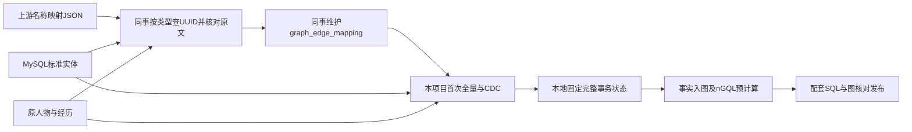
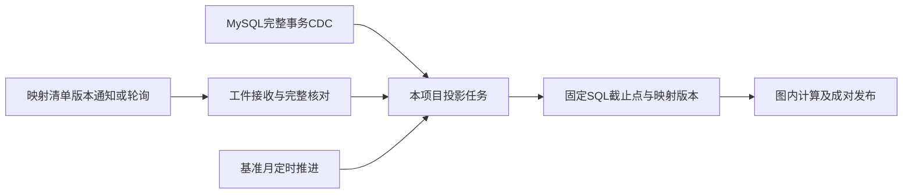

# 文件映射版 MySQL 交付方案与应用评估

2026-11-10 ｜架构 v0.35 ｜权威映射与MySQL协议已本机实测，正式来源及数字API待接入

采用记录。用户在比较两版后说明上游发布频率预计较低，明确“可以使用这一版”。本项目据此采用五张MySQL表＋版本化名称映射JSON作为后续来源方案。具体发布周期、更新可见时效及轮询间隔仍待运行条件明确，以下兼容性缺口继续作为实施事项。此次补记为采用决定更新，实测证据保留原范围。

维护责任更正。用户明确graph_edge_mapping由同事维护，文档“图边生成程序”指生成该表内容。按上游数据已准备好的前提，本项目直接消费权威映射表、标准实体及原人物／经历，Rank使用上游id。此前下游文件触发、私有Rank分配账本和本项目生成源映射表的提案由[主架构v0.34](query-system-architecture.md#v034-上游映射维护确认与cdc边界)替换。JSON的UUID解析及原文校对属于上游生成映射表过程，本项目可保留可选审计引用。首次来源快照、持续CDC截止点和本地查询SQL快照分别解释。

实现补充。v0.35新增numeric-authoritative-v1与MySQLSource，按最新字段说明创建本机13表228列，262人均衡虚构履历经真实binlog驱动五轮图发布并完整核对，27607两跳三元组及11人工场景通过。详情见[本机原生验证](mysql-latest-native-validation.md)。下文v0.32探测与文件接收假设保留历史范围，名称表强依赖已在新模式移除，实际DDL、状态及多目标粒度仍需正式核定。

## 1 核对范围与结论

本轮读取《副本人物关系图谱MySQL表结构设计说明_文件映射版.docx》的全部正文和9张表格，SHA-256为eafd2c32b398ab4a09d26b2b2e90df3d1d78ad8ca874593dd82eddfd358d4b1d。对照此前已确认的说明补充版(2)、当前独立数字更新程序和历史UUID查询服务，分别判断结构、业务关联、文件发布和程序兼容性。

这版将名称匹配的可用结果物化为版本化JSON文件，MySQL保留实体、上游同步记录和事实映射。文件中的UUID通过对应实体表的uuid列解析到整数id，图使用带类型的整数VID。这条关联链具备可实现性，名称匹配过程及审核历史留在上游的分工也符合本项目消费归一结果的职责。

当前剩余缺口为上游多目标事实粒度、稳定id生命周期及跨表可消费提交约定，numeric-authoritative-v1已移除名称表依赖并适配权威映射，旧numeric-v1保留历史契约。责任已明确由同事维护，文件单独变化在落实到MySQL权威映射后通过CDC进入下游。上游文件质量要求继续用于其生成过程，不再作为下游独立输入的必备协议。

原文、逐表差分及离线探测见[核对记录](data-sources/mysql-file-mapping-review-eafd2c32.json)。此次未修改原Word、应用源码或运行发布。探测使用虚构输入、临时私有SQLite状态和图替身，没有访问现有MySQL／Supabase／NebulaGraph。

## 2 新版实际结构

| MySQL表 | 实际列数 | 主要职责 |
| --- | ---: | --- |
| graph_company_entity | 13 | 标准公司，本机整数id与上游uuid分别保存 |
| graph_school_entity | 14 | 标准学校，名称、编号、地区及来源标识 |
| graph_major_entity | 10 | 标准专业，名称、编号及来源标识 |
| graph_sync_batch | 10 | 同事的Supabase→MySQL同步血缘与数量记录 |
| graph_edge_mapping | 11 | 原经历／人物／实体目标与稳定图事实Rank |
| 合计 | 58 | 五张归一／投影相关表 |

共用管理字段为5个，三张实体各增加uuid，章节列数与实际字段行一致。旧版graph_expert_name_mapping和graph_company_relation退出MySQL清单。与上一版7表76列相比，移除21列、新增3列uuid，得到5表58列。

这五张表不提供人物姓名、任期、职位、学历等原始履历。专家／简历原表继续按既有已确认结构回连。如果仍按原8张人物／经历表一起交付，逻辑总范围为13表228列。该数量由既有170列加新58列推算，新文档没有重新提供原8表DDL。

graph_company_relation退出当前查询业务范围的直接影响有限，因为当前关系规则不使用组织层级。同一child_company_codes数组包含子公司及分公司时，仅凭数组无法恢复两种关系类型，后续组织层级业务需要另外明确来源。公司上下级不自动形成同公司关系。

## 3 数据逻辑如何串起来

文件键123定位原经历行，UUID由同事解析为对应类型的MySQL实体整数id，再写graph_edge_mapping.standard_entity_id。本项目从该表取得来源人物、原行、字段、边类型和事实id，回连原经历取得属性，核对实体有效性并构建图。事实Rank直接使用上游graph_edge_mapping.id，学校和专业仍按同一原教育行归组。

UUID保留上游实体身份，实体整数id用于本库关联和图VID，事实id用于具体事实引用。JSON读取及UUID解析位于上游，本项目正常查询及更新以其权威映射表为依据。

### 整数ID的生命周期发生了变化

上一版沿用来源numeric_id，新版明确由MySQL AUTO_INCREMENT生成，并按唯一uuid重复同步。未来同步必须保持同一uuid对应既有整数id，备份恢复和重新导入也要保留该对应。不同测试库可能给同一uuid分配不同整数，版本与来源库需要绑定，不能将两库生成的图键直接混用。

uuid和业务code都设置唯一约束时，两个约束可能命中不同记录。同步应以uuid核对身份，并对code冲突明确失败，不能把任意唯一键命中都解释为同一实体。MySQL的ON DUPLICATE KEY UPDATE会由主键或唯一索引冲突触发更新，官方也提示多唯一索引情形需要谨慎处理。[MySQL官方说明](https://dev.mysql.com/doc/refman/8.0/en/insert-on-duplicate.html)

## 4 应用前必须定稿的关联问题

### 4.1 多目标与事实Rank的粒度

文件示例允许一条原经历对应两个UUID，但graph_edge_mapping仍描述为每条记录对应一个来源字段槽位，并只有一个standard_entity_id。当前适配器还要求同一来源、表、原行、字段只有一条槽位。

例如原行124匹配公司A和B，单行的一个standard_entity_id无法同时表示两个目标。文档末尾已提醒多个UUID需结合原经历及业务规则判断，这一约定还需要落实为可执行的事实粒度。复制两行并分别赋予Rank5001和5002，需要明确该表的粒度变为“经历字段与目标的一条事实”，以及唯一键、纠正、撤销和恢复如何保持身份。此前单槽位目标纠正沿用Rank的约定，也需要与新增目标、删除一个目标的行为统一。

建议在定稿时选择明确的单目标范围，或设计稳定槽位与目标事实的两层身份。若支持多目标，一种候选是固定逻辑槽位并为槽位内每个目标分配稳定事实ID，图Rank继续使用事实ID。它属于后续设计建议，需要补齐DDL／分配责任和人工预期，当前不能当作已有实现。

分配两条事实后还须确定日期和职位归属。UUID数组只证明名称匹配结果，无法单独证明整段任期和职位都适用于每个公司。没有相应业务规则或原始细项时，保留异常并阻断该候选的完整发布，不能直接给两个公司复制整段履历。

### 4.2 已确认同事维护graph_edge_mapping

用户已明确该表由同事生成和维护。本项目读取其完整行及增删改，保留原id作为Rank，并复制必要来源状态形成配套查询SQL。上游负责把文件审核、撤回和改关联落实到该表，并保证交付结果与对应原文及实体一致。

本项目保留自己的CDC／微批／发布控制状态，事实映射编号由上游提供。此前本项目私有账本分配Rank的方案作为历史提案退役。现有JSON快照／JSONL事务仍为本项目回放材料，与上游名称映射文件分别解释。

### 4.3 同一教育经历的学校与专业

分别读取school_name和major文件，但必须用来源表及原教育行ID配对，禁止跨教育行组合。一个学校或专业映射尚待确认时，文档规定该字段来源记录暂不输出，需要说明字段间是否允许独立有效。原学校映射撤回不等于另一份专业文件中的有效专业也被撤回，同专业规则仍按实际有效事实成立。

## 5 上游文件版本与SQL协调的原评估

范围更正。以下文件manifest、完整范围及原文校对要求属于同事生成graph_edge_mapping的上游过程，保留原评估供追溯。其中对下游工件接收和激活清单的文件扩展提案已撤回。当前下游以MySQL映射表为权威结果，微批绑定完整事务截止点，文件单独变化不直接改变下游图。

### 5.1 清单应表达完整范围

文档已有临时版本、SHA256、整版本切换和失败保留旧版，这些约定适合采用。仍建议把清单字段落实为可校验格式，并至少明确以下信息。

| 信息 | 用途 |
| --- | --- |
| format_version、mapping_version、generated_at | 区分文件格式与实际结果版本 |
| source_project_id、上游sync_batch_id | 来源血缘，引用同事上游同步记录 |
| 每个文件的source_table、source_field、entity_type | 明确表／字段／实体类别，消除文件命名歧义 |
| scope或等价完整性说明 | 表达该来源字段的完整有效结果，还是仅一个增量片段 |
| 每文件record_count、字节数、SHA256 | 完整下载、解析及数量核对 |
| 分片列表及完整覆盖约定 | 防止遗漏分片或跨分片重复键 |
| 配套输入快照或兼容边界 | 配对标准实体、原始履历与映射结果 |

文件生产者不一定掌握本项目MySQL读取位点，因此SQL截止点、所选实体uuid→id对应及原文核对结果也可以由本项目接收记录补充。最终投影任务应固定SQL快照／CDC截止点、mapping_version与清单摘要、契约指纹、基准月，保留实际输入用于重放。上游sync_batch_id是血缘参考，不能独自证明原始履历也属于同一数据状态，也不要求所有实体行的最近sync_batch_id相同。

### 5.2 完整有效结果中的消失如何处理

第一版只输出全部有效拆分项均已匹配且实体可用的记录，因此发布文件可以视为有效映射集合的一次完整物化。旧版有键123，新版完整同范围文件没有123，含义是该字段当前没有已发布的有效映射，其旧事实应撤回并重算受影响关系。原人物和原经历仍按各自SQL状态保留。

上述判断必须建立在整个新版本完整、清单核对成功和范围明确的前提。下载失败、文件缺失、少一个分片、部分覆盖或处理中临时文件均应导致接收失败，不能当作合法空文件清除旧关系。空的有效结果也应显式登记空文件与记录数0。

若某UUID不在配套实体快照中，或实体已删除，文档要求不生成有效边并记录异常。建议在完整发布层明确该异常是否阻断。对于已声明输出全部合法UUID的正式文件，引用不一致通常应阻断候选并保留旧发布，避免记录异常后仍宣称图完整。预期被过滤的无效记录应在上游已发布结果集合中得到一致表达。

### 5.3 全部文件一起切换

复制到独立版本目录，逐个校验并完成关联核对后，再原子更新映射版本入口。一个投影批次固定持有所选版本，不能处理工作映射时读v1、处理学校映射时读v2。发布前后同名文件被覆盖即使最终恢复正确内容，也可能造成混合输入，因此版本目录需要不可变。

映射manifest与本项目图发布manifest各有格式和目录，前者属于输入工件，后者绑定SQL与图输出。当前load_active只允许既有输出文件集合，不能直接把输入清单填入图发布环境变量或作为ready图清单使用。未来应显式纳入映射版本引用／摘要及保留策略。

## 6 历史文件工件通道提案

v0.34更正。以下内容基于下游直接读取文件的旧假设，保留供追溯。当前主链路采用首次全量＋持续CDC＋固定范围微批，源映射审核变更由同事写入graph_edge_mapping后被采集，不新增必备文件接收通道或rq_mapping_release。

新版存在标准表未变化、仅映射审核或撤回变化的场景。该变化发生在映射文件，MySQL binlog可能没有对应行事件。因而建议更新链路调整为以下组合。

这里轮询的是小型文件清单或其发布入口。其职责属于本项目输入工件发现，graph_sync_batch仍由同事管理。CDC继续处理数据库增删改，映射文件变化独立产生任务。文件通知丢失时可以用清单版本核对补发现。CDC本身围绕MySQL日志采集数据变化，文件系统的版本变动需要额外传输和接收协议。[Debezium MySQL文档](https://debezium.io/documentation/reference/stable/connectors/mysql.html)

同一SQL截止点、同一基准月、不同mapping_version必须允许形成新批次。建议将映射接收状态和已发布状态分别记录，并把清单摘要与映射版本加入批次幂等键、候选输入和激活校验。可以新增本项目工件接收记录，例如rq_mapping_release，并扩展现有批次与发布产物。该结构属于设计建议，本轮没有安装或实现。

来源契约版本描述表／列／文件结构，mapping_version描述数据结果变化。不能把每次映射内容变化都编码为SourceContract.fingerprint变化，否则现有结构漂移保护会要求每次都重新建立来源基线。

## 7 当前程序的实际兼容性

| 位置 | v0.35实现 | 后续边界 |
| --- | --- | --- |
| update/contract.py | 新权威模式使用独立指纹，无名称匹配表及状态依赖 | 正式DDL与状态核定 |
| update/projection.py | 来源id作为Rank、类型VID及同条经历规则，原模式兼容 | 多个活跃目标占同槽位仍拒绝 |
| update/mysql_source.py | RR一致性初始化、真实binlog完整事务、持久后确认 | 已测MySQL8.4.13及基础非压缩ROW模式，其他部署待验 |
| update/store.py／service.py | from_seq／to_seq、rows_at及独立发布 | 调度、续租、长期保留及HA待完成 |
| update/artifacts.py | source.sqlite与图同状态发布 | 数字HTTP／前端待接入 |

本机协议、原生图及路径读取器实测见最新报告。以下离线探测为v0.32当时结果，用于解释改造依据，不能作为v0.35仍失败的结论。

### 实际离线探测

| 场景 | 当前程序结果 |
| --- | --- |
| 既有数字契约基线 | 生成6个节点及6条事实 |
| 移除name_mapping逻辑表 | INVALID_CONTRACT |
| 一个槽位出现两个已匹配目标 | NAME_MAPPING_MISMATCH |
| 同一槽位放置两条不同Rank映射 | DUPLICATE_SLOT |
| 实体逻辑行增加uuid | 原投影结果相同，当前适配器未做文件UUID解析 |
| 仅外部映射文件变化，SQL位点／基准月不变 | 新一轮process返回None，没有新批次 |

最后一项使用临时SQLite状态和图替身完成两次实际调用，验证了当时假设下文件未接入批次触发。责任澄清后，该文件本身属于上游材料，权威映射表未改时不触发图更新符合当前边界。原探测结果保留，不代表真实CDC验证。

另有10个一次性机制示例核对UUID→整数查找、类型隔离、超过JavaScript精确整数范围的字符串键、重复键、原文变化、缺目标、失效目标及多目标查找。它们属于本次评估脚本，未接入应用适配器，未分配多目标Rank或推断经历归属。

当前更新专项54项重新执行通过，保留既有TestClient弃用提示。本轮未执行真实MySQL、图或新版文件到查询API的端到端验证。

## 8 上游文件格式和规模处理

下列内容适用于同事生成、校验及归档文件。下游正常消费权威MySQL映射表，其规模仍需按实际来源行数、关系证据和构建成本评估。

Python默认JSON解码遇到重复键会保留最后一个值，文件SHA256正确也无法发现该语义覆盖。因此接收端必须在解析时检测重复键，还要核对分片间重复键，避免后续合并静默覆盖。[Python JSON说明](https://docs.python.org/3.12/library/json.html#repeated-names-within-an-object)

来源键应为可无损回连原BIGINT主键的十进制字符串，明确规范化格式。需要检测123和0123等可能碰撞的键，避免默认转换后悄悄合并。UUID列表需要格式、去重和实体类型校验。内容变化与字节变化分别对待，SHA256校验原文件，标准化条目差分用于定位实际影响范围。

百万级文件需要分片或流式接收，并构建本项目私有索引，按表／字段／原行查找及做旧新版本差分。当前默认全量回放64MiB、快照10000行及图证据10000条预算只覆盖小样例，不能用它们说明百万级映射文件可直接处理。数据文件按版本解析和核对，查询请求读取准备好的SQL及图，数据不打包到前端。

文件不携带原名称映射记录ID，仍能通过来源表／字段／原行、原文、UUID和文件版本追溯有效结果。若要定位某条上游审核记录，需要通过这些逻辑来源信息回查审核系统。保留原文件及其摘要有助于重现当时结果。

## 9 当前应优先补齐的事项

| 优先级 | 内容 | 完成标准 |
| --- | --- | --- |
| P0 | 上游映射的行粒度及id规则 | 单目标／多目标、纠正、撤回、恢复和不重用规则有样例 |
| P0 | 多目标任期／职位归属 | 原经历或明确业务规则可以解释每条有效事实 |
| P0 | 原行／实体／映射的可消费边界 | 同事务或跨事务安全消费约定明确，原文变化能使旧映射正确失效或重新确认 |
| P0 | 实际DDL与图计算位置 | 完整*_entity表名、实际状态及删除规则落实，查询时计算残留改为入图预计算 |
| P1 | CDC采集与幂等恢复 | 初始化连续衔接、事务完整、重放、断线及故障验收 |
| P1 | 数字查询与容量 | SQL／图同版本取证、代表性负载和热门实体构建验证 |

维护方已由用户明确，本项目直接消费源id并保留版本化来源状态。上游文件清单与生成质量由同事按其程序维护，可作为问题审计材料。

## 10 后续正式接入

权威模式和真实MySQL协议已完成本机虚构验证，13表测试DDL、平衡履历和原生图结果见[原生报告](mysql-latest-native-validation.md)。正式接入继续核对上游实际DDL、状态原值、稳定ID及多目标和跨事务就绪语义，再对目标连接／权限及数据重跑初始化／CDC／发布验收。

数字查询API、前端接入、长期调度及目标规模性能继续单独落实。历史54项更新专项和v0.32兼容性探测保留原范围，v0.35新增18项后更新专项72项、后端500通过／240跳过，不能把虚构样例及本机协议成功等同正式数据或生产容量验收。
