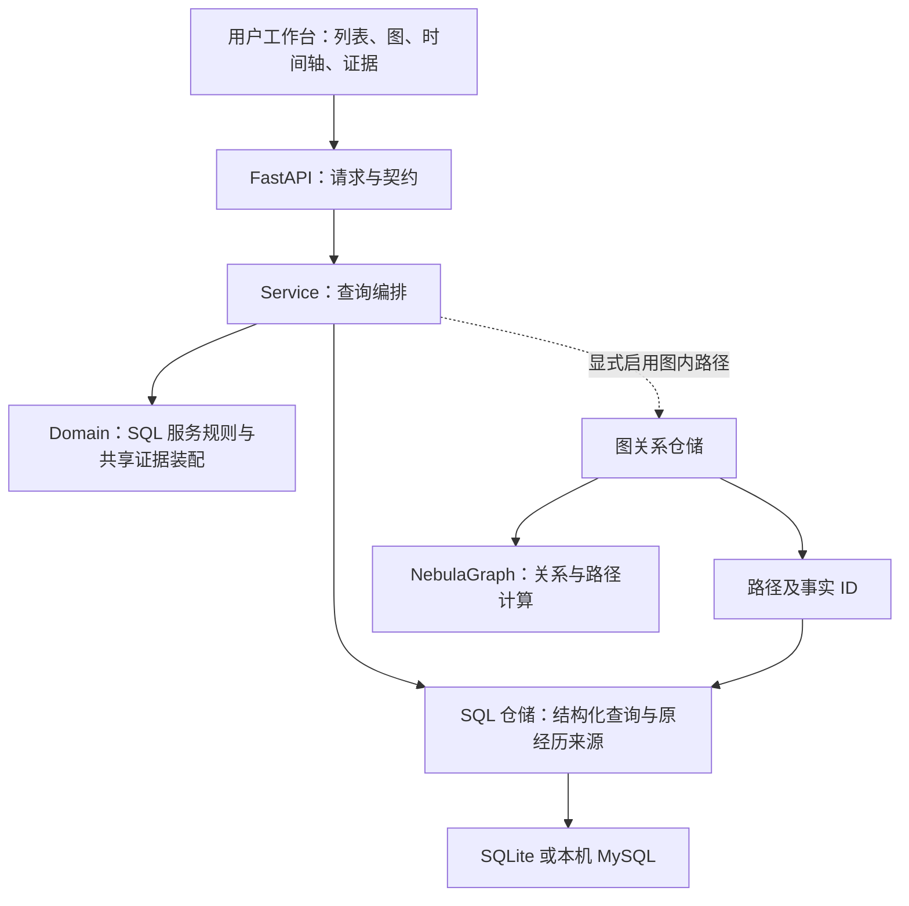

# 人物关系查询项目现状报告

报告日期：2026-11-03，最后维护2026-11-09，对应架构版本v0.25。

最新变化v0.25完成查询性能改造并激活新的只读SQL发布源。请求校验读取固定发布标记，批量图取证保持逐人物对配额，图候选游标与SQL背景筛选配合补足当前页。相同63人内容首屏中位耗时306.377→132.686毫秒，SQL语句44→11，图执行调用88→20。1100候选星形样例完整分页与65个职位匹配的两页结果通过，34项新图与性能组合专项通过。正式数据契约、热门实体平方级构建及生产负载按后续交付条件重评。[性能与范围记录](performance/uuid-query-v025.md)

最新变化（v0.24）：已将本机运行服务迁移至 [UUID 物化人物关系图](uuid-graph-migration.md)。新空间执行已确认 DDL，人物无姓名，SQL 回查姓名与经历；列表、证据、对比、展开、关系导出和两段路径消费已保存人物边。虚构快照包含63个来源人物节点、15个实体、178条事实及2576条人物证据边，未跨库合并。新 SQL 是八张原表＋四张最小 UUID 表，不等于最新15表正式适配。旧快照保留回退，无 Supabase 访问；真实数据、正式发布／删除契约、生产权限／增量／容量仍待验证。以下各版本测试和“当前”描述保留为该轮历史记录，最新判断以本段、迁移报告及主方案为准。

本报告持续维护当前判断，历史测试按版本保留；当前集成验收见 [v0.15 原表模式](source-api-validation.md)，历史图规模与耗时见 [v0.13 验收](graph-native-validation.md)。技术决定统一维护在 [主架构方案](query-system-architecture.md)。

最新变化（v0.16，2026-11-06）：完成 [修正后完整重建与停服版本切换](source-release-validation.md)。原 A SQL／图只读保留，另建 B 验证失效、公司／学校纠正、上游人物归属变化与更名；真实 HTTP 演练 A→B→拒绝混合批次→回退 A。新增激活记录、文件锁、文件摘要与运行版本固定。稳定标识和完整批次正式规则仍待同事确认，详见 [问题清单](stable-identifiers-and-publishing-questions.md)。不是生产增量、自动故障转移或零停机发布。

最新变化（v0.15，2026-11-05）：新增显式 source-slots-v2 原表模式，已将八张原表、三张词典／映射和新 VID／稳定 Rank 接入 API 与工作台。直接通过 SQL 子查询读取原表，不再为本模式装载 demo_*；连接链由图计算、SQL 提供原经历证据，其他查询继续复用 SQL／Domain。新模式和默认演示分开配置；不修改冻结实验 SQL／图，未访问 Supabase。两个入口、同名区分、时间轴、两段路径、分页、条件恢复和错误重试已通过浏览器专项。生产增量、正式数据与容量尚未验证。

后续变化（2026-11-04）：已只读核对 Supabase 归一处理表并形成 [接入评估](supabase-source-assessment.md)，架构文档更新为 v0.11.1。归一结果与原经历需分别取得，职位归一待定；业务代码与下述测试记录仍为 v0.11，正式人物数据尚未接入。

再后续变化（v0.12）：按用户“当前字段不定稿、云端绝不修改”的要求完成 [只读采样与本地模拟源演练](source-trial-validation.md)，SQLite／MySQL／图辅助专项通过，修复专题默认实体 ID。下文历史规模记录不等于本轮重测；正式人物数据仍未接入。

最新变化（v0.13，2026-11-04）：用户已确定“图计算关系／路径，SQL 提供人物及原经历证据”的分工。本轮在连接链接口落实图内直接关系、同期窗口、中间人物连接和事实引用计算，SQL 不再重新筛候选或计算这些路径；普通列表、专题、完整对比仍 SQL。验收和当前性能见 [图内路径计算](graph-native-validation.md)，取代下文 v0.11 对当前路径引擎的描述。未访问 Supabase，也未接入真实人物数据；不能把职责调整等同于生产加速或上线完成。

最新补充（v0.14，2026-11-05）：已按同事 [六表说明建表并完成模拟闭环](handoff-schema-validation.md)，随后结合新三表方案和用户原表 DDL，完成 [三表／八张原表及新 VID／稳定 Rank 独立图验证](projection-three-table-validation.md)。用户明确六表是上游、三表是本项目词典／投影层；当前 API 图格式未切换。发现并规避了本机可空复合索引导致的外键漏检，正式版本仍需复测。真实数据和生产更新未接入，以下历史规模数字不等于新三表容量结果。

## 1. 当前判断

项目已经形成可在本机运行的业务原型，具备人物查询、实体筛选、关系证据、图展示、履历对比和有界连接链闭环。SQLite、实际 MySQL 和实际 NebulaGraph 均已用于模拟数据验证，MySQL 已做至 10 万人物，图投影已做至 1 万人物。

当前处于“业务原型完成多轮扩展，候选原表结构已完成模拟端到端集成”的阶段。可用于演示、核对业务规则和继续实验；尚未达到真实数据上线条件。已收到候选结构，正式筛选版本、代表性数据、目标 Linux 和生产负载尚未到位，不能给出百万级容量结论。

已知业务来源规模为专家不足 10 万、简历超过 200 万并增长；这不是已去重的人物数量。人物身份统一、跨库关联、公司／学校／职位归一由上游数据库人员负责，本系统接收其结果。原始两份 Word 文档只作为思路参考，其表结构不作为当前接入依据。

## 2. 已完成的业务能力

| 能力 | 当前实现 | 边界 |
| --- | --- | --- |
| 人物入口 | 定位人物，查直接相关人物，查看履历及来源证据 | 同名依稳定 ID 区分，不自动合并身份 |
| 实体入口 | 公司、学校、职位多选，组合来源和任职时间筛选 | 类别内 OR、类别间 AND；公司／职位／时间由同条经历匹配 |
| 直接关系 | 曾任职同一公司、同公司同期、同校 | 职位只作背景条件；同校不推断同期，不推断实际认识 |
| 关系证据 | 共同实体、双方经历、时间和来源定位，支持共同窗口和最短同期月份 | 时间缺失不补全；当前任职按明确基准月计算 |
| 两人对比 | 双方履历、月份时间轴、共同经历、同期展示 | 教育未知时间独立呈现，前端不重新计算关系 |
| 实体专题 | 公司／学校专题，按条件查看关联人物和经历 | 当前页人数不当作全库或在职人数统计 |
| 列表和关系图 | 选中联动、证据查看、换查询中心、有界展开 | 列表分页与图上限独立；局部图最多 100 节点、200 边 |
| 条件保存 | 当前浏览器保存、恢复条件后重新查询 | 非团队共享；不保存旧分页游标和结果快照 |
| 导出 | 当前页 JSON／CSV、局部图 PNG，保留模拟与范围标识 | 无全库导出；连接链尚未纳入保存／导出 |
| 间接关系 | 直接或至多一位中间人物的连接链，每段可回查证据 | 没有任意深度、全局最优路径或认识概率评分 |
| 交互状态 | 加载、空结果、失败重试、过期响应保护、预算截断提示 | 失败不伪装成无结果；取消浏览器请求不等于后台立即终止 |

## 3. 技术栈与代码架构

采用前后端分离、单后端服务的结构。前端调用统一接口，后端分成请求、业务编排、关系规则和数据访问层；更换数据来源时尽量保留业务规则和接口。

| 部分 | 当前技术与职责 |
| --- | --- |
| 前端 | Vue 3、TypeScript、Element Plus、AntV G6；负责工作台和局部关系图 |
| 后端 | Python、同步 FastAPI 路由、SQLAlchemy；当前无需异步框架或任务队列 |
| 接口契约 | Pydantic → OpenAPI → 前端 TypeScript 类型生成 |
| 默认存储 | SQLite，适合本机演示和正确性验证 |
| SQL 实验存储 | 本机 MySQL 9.7.1，独立模拟库，复用 SQL 查询规则 |
| 图实验存储 | NebulaGraph 3.8.0、SDK 3.8.3；独立容器、空间和卷，显式启用 |
| 环境与检查 | backend/.venv、uv.lock、package-lock.json；pytest、Ruff、mypy、Playwright |

代码入口与职责：

| 位置 | 作用 |
| --- | --- |
| [app.py](../backend/src/relationship_query/app.py)／[routes.py](../backend/src/relationship_query/api/routes.py) | 装配 SQL／图仓储、注册接口和错误处理 |
| [services](../backend/src/relationship_query/services) | 查询、路径、图装配和证据展示编排 |
| [domain](../backend/src/relationship_query/domain) | 数据校验、关系规则、时间与执行预算 |
| [infrastructure](../backend/src/relationship_query/infrastructure) | 读模型、SQL 访问、快照、图投影和 SDK 边界 |
| [frontend/src/components](../frontend/src/components) | 工作台各展示组件 |
| [scripts](../scripts) | 安装、启动、检查、模拟导入及性能观察 |

默认通过 `bash scripts/dev.sh` 启动后端 127.0.0.1:8000 和前端 127.0.0.1:5173；已有端口占用会报错。Python 安装和运行使用项目虚拟环境，不依赖全局包。具体初始化／启动说明见 [README](../README.md)。

## 4. 数据接入准备

已经交付 [逻辑交接说明](data-handoff.md)、[虚构样例](examples/logical-dataset.json)、只读预检命令、人工预期结果、独立差分基准和快照纠正测试。预检检查重复标识、引用、类型、来源、时间矛盾，并输出可定位的 JSON 报告；不自动合并人物或补全日期。

已有经历失效、公司／学校归一纠正、上游人物映射变化的快照演练。SQL／图采用成对不可变快照：图投影回读对账后才发布 ready manifest；启动核对版本、基准月和完整内容摘要，运行中不原位修改。换版本需停 API 后切换，旧游标失效。

v0.13 图模式直接计算关系和路径，再按事实 ID 读取 SQL 来源并核对属性；旧成员块候选模式只作显式对照。没有预计算全库人物对。依赖故障、批次不匹配和预算不足分别处理，不静默切换后端或返回假空结果。

这些准备验证了原型逻辑输入，尚未实现正式上游表字段映射或生产增量同步。真实接入需要最新结构、字段语义、样本和更新契约，不能只更换连接字符串。

## 5. 已有验证证据

### 历史完整回归（v0.11，最新见 v0.13 验收）

| 检查 | 已记录结果 |
| --- | --- |
| 后端（显式开启 MySQL、图环境和图业务专项） | 424 项通过，250.48 秒 |
| 后端静态检查、接口生成、前端格式／类型／构建 | 均通过 |
| 默认 SQL 浏览器 | 18 项通过，2 项可选专项跳过 |
| 图辅助浏览器 | 19 项通过，1 项规模专项跳过 |
| 独立正确性 | 人工预期、500 人差分、分页／候选及关系证据核对、快照修正 |

以上按测试模式分别运行，浏览器数量不能直接相加作为独立用例数；常规回归默认跳过需要实际数据库的专项。详见 [完整验证记录](prototype-verification.md)。

### 各阶段规模实验

| 阶段 | 模拟规模与方法 | 已得到的结论 |
| --- | --- | --- |
| v0.8 R01 SQLite | 1 万／10 万人物，约 5.35 万／53.10 万经历；672 次顺序接口观察，另有规模浏览器观察 | 建立热点与长履历诊断，完成有界候选 SQL 调整 |
| v0.9 MySQL | 同两档快照与 SQLite 对照，672 次顺序接口观察，实际本机 MySQL TCP | 验证方言、分页、证据、超时和计划；修复热门关联半连接物化导致的超时 |
| v0.10 图环境 | 小型虚构事实、读写删、认证、保留卷重建 | 本机原生 ARM64 三服务环境和持久化验收通过 |
| v0.11 图候选 | 1 万人物、53521 经历，MySQL／图辅助共 144 次顺序接口对照 | 无已核对语义差异，但当前图辅助预热 P50 在 9 场景中均更慢 |
| v0.13 图内计算 | 同一万人快照，SQL／图内／旧辅助共 216 次顺序接口 | 无接口错误，图内与 SQL 已返回路径及证据一致；多数场景仍慢于 SQL |

这些规模实验分属不同代码版本，不将次数合计后当作最新版本完整压测。规模接口使用 ASGI（进程内调用真实路由）和实际数据库连接，浏览器回归另走本机 HTTP；尚未进行持续 HTTP 并发负载测试。

代表性记录：v0.9 的 10 万人普通公司筛选 P50 13.131ms、热门公司 193.085ms、长履历关系 27.711ms；v0.11 的 1 万人普通路径纯 MySQL／图辅助 P50 为 8.813／23.578ms，来源筛选为 24.710／512.727ms。每场景只有 7 次预热样本，不能当作生产延迟承诺或 SLA。

旧辅助的成员块归并与 SQL 资格复核已从新引擎移除，RPC、每次建池及图内经历匹配仍有开销。无图配置保持 SQL，配置图后默认图内计算。图投影仅验证至 1 万人物，不与 SQL 的 10 万人观察混淆。最新详见 [图内计算](graph-native-validation.md)，历史证据见 [R01](performance/r01-results.md)、[MySQL](performance/mysql-results.md)、[图候选](graph-query-validation.md)。

## 6. 剩余工作与主要限制

1. **正式数据尚未接入。** 最新结构、稳定人物／实体／经历键、来源关联、日期精度、有效状态和完成批次均需核对。真实数据质量和分布可能改变读模型与索引。
2. **生产容量未知。** 没有目标 Linux、公司指定数据库版本、持续并发、连接池争用和百万级验证。当前不能承诺全库时延或资源规格。
3. **大证据响应需处理。** 已发现长履历两人对比产生约 18.25MB、13804 条证据；完整保留以避免静默丢失，极端浏览器渲染尚未验证。
4. **图的生产实现尚待验证。** 图计算关系／路径、SQL 提供结构化筛选与来源的方向已确认；本轮先在连接链落实，具体接口覆盖、图查询计划、连接复用、索引成本及启动摘要仍需评估。新图多数场景仍慢于 SQL，不能宣称普遍加速。
5. **更新仍是快照演练。** 尚无生产增量 Worker、CDC、纠正重放、自动对账或发布恢复闭环；现有 Canal 未接入。
6. **使用范围仍为本机。** 未建设公司登录、数据权限、共享收藏、审计、生产部署、监控告警和备份恢复。MySQL 只读事务不等于生产账号权限隔离。

既有 G6 构建包体提示和测试客户端弃用提示保留记录，尚未作为本轮业务功能扩大处理。Redis、消息队列、全文／语义搜索、更深路径和关系评分均未纳入当前实现。

## 7. 建议推进顺序

**没有真实数据时：**先补真实 HTTP 的单并发及 5／10 并发受控实验，观察错误率、连接等待、SQL／图耗时和资源；另行设计大证据分页或按需加载，明确完整性契约后实现。图连接复用和批量 RPC 可做独立对照，不预设优化后一定优于 SQL。业务扩展可从路线图的 R02（路径保存／证据报告）或 R03（图操作）中选择，尚未自动启动。

**正式结构到位后：**优先 R09 字段映射、只读预检和人工结果核对；收到代表性样本后执行 R10，统计经历量、日期缺失、热门实体、查询分布并验证计划。证据充分后再决定生产 MySQL 读模型、图分工、缓存和资源，随后按更新契约推进 R11 增量／纠正闭环。

接入所需最小材料是最新 DDL／字段说明、脱敏代表性样本、人物及实体归一映射、时间和失效语义、全量／增量及完成批次说明。数据身份识别与归一工作继续由上游负责。
