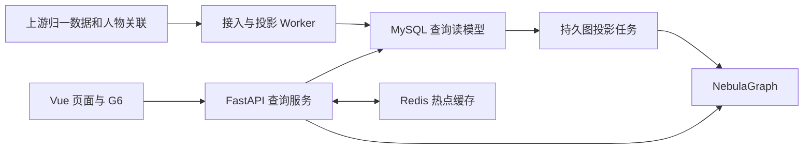

# 人物关系查询系统架构草案

版本 v0.59.4  
最后更新 2026-11-13  
本轮决定按用户反馈逐步部署，前端在应用测试服务器构建。已记录应用服务器Ubuntu22.04.5／x86_64、root会话和工具状态。应用业务规则沿用v0.44。  
状态2026-11-13首次04:30定时更新成功，全流程日志约4分46秒，实际公网新版本real-921e1ee2e6476b0925bb-202611、mysql-live、6711专家／0简历、14355实体／27715事实、最多4跳。发布目录为data/nightly/jobs/db0c33dfb59a46539da5d00a29ff617e/release。姓名／业务编号搜索和分层图修正已部署，当前Nginx静态根为frontend/dist-layout-v059-label-fix，入口index-B_uaB6X5.js。用户反馈nginx／query／tunnel均active，nightly timer下次2026-11-14 04:30 CST。助手实际公网浏览器已验证新入口和指定四跳样例，源码安装、服务器构建、前端切换及本次公网验收完成。服务器操作通过用户终端逐步执行。

公网最终复验直接使用已部署页面与实际API，覆盖姓名／业务编号选择、完整系统ID无候选、人物1000全部共同经历四跳20人／62节点／64边、分层画布、真实Canvas点选聚焦及恢复、标签开关、PNG下载和390窄屏触摸详情，页面错误为空。聚焦人物名单行侧置，实体及关系文字按需显示，实际桌面和手机截图已查看。证据见data/graph-layout-v059/public-label-final-20261113。既有完整浏览器42通过／26跳过属于v0.59验证记录，标签补充修正8项相关回归和类型／构建通过。本次真实样例验收范围按当前发布记录，大规模容量继续按已确认方案验证。

2026年11月13日用户确认执行提测准备前4项，建立Git忽略规则与待提交文件审核、main源码仓库与qa-20261113-01标签、部署运行文件一致性核对以及README／运行文档校正。149个运行文件与历次交付档案一致，用户在应用服务器执行相同摘要清单后反馈全部通过。清单随源码保存于docs/releases/qa-20261113-01.sha256，提交及部署关联材料保存在data/qa-baseline/20261113，代码提交标识通过Git读取。既有测试样例及验收范围沿用前述记录。

本方案面向专家库不足 10 万、简历库超过 200 万且持续增长的数据规模。目标是接收数据库人员提供的归一数据，实现从人物查关联人物、从公司学校职位筛选人物，以及关系证据展示。人物身份统一、跨库去重和实体归一由上游负责。本文的对象和索引均为查询设计建议，不代表已有表结构。

后续可选方向见 [扩展候选路线图](extension-roadmap.md)。用户已完成 R01、本机 MySQL 验证、图环境、模拟业务图接入及 v0.12 来源样例演练。R09 正式适配尚未实施；本轮工具和验证不作为正式上游接口。

真实数据库技术验证先使用模拟数据推进。范围与环境决定见 [技术验证计划](technical-stack-validation.md)，证据见 [MySQL 验证报告](performance/mysql-results.md)、[图查询验收](graph-query-validation.md)。2026-11-04 新增 [Supabase 归一源评估](supabase-source-assessment.md)；Linux 测试服务器目前无法使用。

## 方案维护约定

本文是本项目持续维护的架构方案。后续提供新表、样本、运行环境或业务要求时，在此文件内重新评估并更新相关章节，保留修订记录，不另起一份互相冲突的主方案。

### 已确认条件

| 条件 | 当前结论 | 依据 |
| --- | --- | --- |
| 提测代码基线 | 本地main仓库及qa-20261113-01提测标签，运行文件摘要清单与实际前端入口关联 | 用户2026-11-13授权执行提测准备前4项，服务器149个运行文件摘要已由用户反馈全部通过 |
| 系统职责 | 消费归一结果，实现人物关系查询与展示 | 用户确认 |
| 上游职责 | 人物身份、跨库重复和关联问题由数据库相关人员处理；公司、学校、职位由上游归一 | 用户确认 |
| 查询入口 | 从人物出发、从公司学校职位出发均需要 | 用户确认 |
| 前端交互 | 三个业务导航、显式提交、列表与共同经历优先，辅助能力通过上下文入口访问 | 用户2026-11-09确认改版计划 |
| 接口生命周期 | 页面改版逐项登记入口迁移、停止调用、兼容性问题及退役条件，后端后续独立逐步退役 | 用户2026-11-09明确要求 |
| 后端方向 | Python 为主或暂无统一要求，当前按 Python 设计 | 用户确认 |
| 来源规模 | 专家不足 10 万，简历超过 200 万，持续增长；统一去重后的人数尚未统计 | 用户确认 |
| 当前数据条件 | 可只读查看 Supabase 处理中标准表／映射和视图；最终筛选版本尚未交付，归一结果与原经历需分别取得，职位归一待确认 | 用户 2026-11-04 确认及只读检查 |
| 本轮环境 | 应用及图服务器均为Ubuntu22.04.5／x86_64；应用Python3.12.14、Node22.23.4，图服务NebulaGraph3.8.0及Docker共存 | 用户部署反馈及v0.59.3实际公网复验，当前状态见README |
| 远程来源准备 | 公司测试MySQL 47.113.185.127:3306，实际账号及库为test_derui_expert；本机命令行TLS只读连接成功，已取得三实体表真实快照及相关表DDL／计数 | 用户2026-11-11提供及本机DBX参数核对；v0.40.3，早期root认证失败见v0.40.2 |
| 更新评估前提与批次归属 | 本轮按上游MySQL已提供可消费数据评估；graph_sync_batch负责同事Supabase→MySQL同步，本项目自建下游控制表 | 用户2026-11-09澄清；本前提用于选型评估，实际远程库尚未交付 |
| 测试环境分工及更新链路 | 同事维护graph_edge_mapping，当前部署采用双源全量只读快照、夜间版本化图发布及在线人物MySQL展示 | v0.57部署、v0.59.1首次实际定时发布成功，持续CDC对接真实发布为后续路线 |
| 当前更新开发条件 | numeric-authoritative适配与真实版本发布已接入，夜间自动采集、候选构建、核验及恢复已部署 | 实际发布real-921e1ee2e6476b0925bb-202611，6711专家／27715事实 |
| 候选上游来源 | Supabase company-resolution-test，PostgreSQL 17.11；当前为只读结构／聚合评估，不等于应用 PostgreSQL 接入 | 2026-11-04 MCP 读取 |
| 本轮硬约束 | Supabase 不允许任何数据／结构／权限／配置修改；当前字段可能筛选，只取样例理解形态，后续生成与验证全部本地执行 | 用户 2026-11-04 确认 |
| 图与 SQL 职责 | NebulaGraph提供物化人物关系与路径，发布SQLite提供背景筛选及经历证据，MySQL提供在线人物展示 | v0.57在线接入及v0.59.3指定真实样例公网复验 |
| 人物关系生成时机 | 夜间按固定输入构建并核验独立关系图，维护窗口暂停查询，版本切换后复用已发布关系 | 用户确认及2026-11-13首次实际定时发布成功 |
| 多跳目标范围 | 单人物关联查询参数1至4、默认1，按最多人物关系跳数召回候选，排除自身及路径内重复人物，每位候选选择稳定最短链 | 用户2026-11-11确认计划；v0.40已在数字图和UUID图实现，替换v0.37默认3／交互最大5的初步建议 |
| 测试部署目标 | 应用部署121.43.176.65，NebulaGraph部署内网172.16.0.154并与Milvus共机，应用通过systemd SSH转发访问图 | 用户逐步部署反馈，当前前端及后端已完成指定真实样例公网复验 |
| 同专业人物关系前提 | 同专业查询可选择要求双方已有同校关系，按人物对及每段连接检查；学校和专业可来自不同教育经历 | 用户2026-11-11最新澄清；v0.44可选查询前提替换v0.43严格同教育行提案 |
| 人物姓名与业务附属信息 | 姓名、城市、个人职位及业务编号在线回人物MySQL，图保存业务身份和关系计算字段，经历证据绑定发布版本 | v0.57部署、3位人物原表字段比对及后续公网复验 |
| 人物候选搜索字段 | 候选按姓名或业务编号前缀匹配，选择及后续查询通过系统人物ID定位 | 用户明确移除完整ID检索，v0.59.3实际公网验收通过 |
| 关系图阅读方式 | 分层布局、选中人物突出证据链、关系标签按需显示，密集全图缩小时收起普通标签，放大或悬停查看 | v0.59及标签修正已部署，v0.59.3实际公网截图和交互复验通过 |
| 当前实现的历史来源基线 | 精简版(3)的三张UUID实体表、graph_name_mapping和is_deleted用于现有模拟适配与已发布快照 | v0.24／v0.25实现依据，目标来源已由2026-11-09确认的新文档替换 |
| 当前采用的目标来源 | 文件映射版摘要eafd2c32，5张MySQL表58列；名称映射JSON由同事用于生成权威graph_edge_mapping，本项目消费必要MySQL表及原经历 | 用户2026-11-10采用并澄清；多目标粒度与上游ID生命周期仍需明确 |
| 上游发布频率 | 用户预计发布频率较低，具体周期及下游可见时效尚未量化；按版本接收、核对后批次发布适合当前条件 | 用户2026-11-10说明，作为文件映射版采用依据 |
| 原经历与映射联动 | 上游保证影响关系的原经历变更会体现为graph_edge_mapping可捕获更新事件，后续采用实体／映射库单源CDC，人物库在线查询及构建按需读取 | 用户2026-11-12明确确认，替换v0.46双源CDC接入建议 |
| 来源部署拓扑 | 当前实体／映射和人物／经历分别来自两个MySQL，正式环境将合为一个来源；以逻辑读取角色绑定物理连接配置 | 用户2026-11-12说明正式合源，v0.55采集配置入口已实现 |
| 夜间维护时间 | 北京时间每日04:30启动，任务总窗口90分钟，预留恢复预算，错过定时窗口跳过 | 用户确认及2026-11-13实际发布成功，timer下次2026-11-14 04:30 CST |
| 同公司同期处理 | 夜间按任职区间预计算company_overlap并物化，在线关系查询复用，同公司前提来自权威任职映射 | 用户后续确认夜间停服、版本化发布，替换此前按需缓存讨论，现有时间规则沿用 |
| 目标实体列类型 | 三张实体为MySQL自增BIGINT id＋唯一来源uuid，standard_entity_id为BIGINT，事实Rank为正有符号64位BIGINT | 同事负责按uuid同步与映射整数目标，本项目消费该表数字引用，替换上一版来源numeric_id机制 |
| 简历原表结构 | 简历主表及三类经历表与已提供专家 DDL 一致，expert 对应改为 resume；后续不再重复索取同一结构确认 | 用户 2026-11-06 明确确认；不代表跨库人物已统一或真实数据已交付 |
| 实体与投影层关系 | 同事从文件UUID查标准实体整数id并维护graph_edge_mapping，本项目使用其standard_entity_id和id／Rank，VID按实体类型区分 | 用户明确维护责任；原独立词典方案继续废弃，本项目不承担源映射编号分配 |
| 历史材料 | 早期两份Word只用于理解设计思路，当前来源按后续逐次确认及最新交付重评，旧结构和部署描述不用于补造新契约 | 用户明确要求；最新文件另见v0.32 |

图负责关系／路径、SQL 提供结构化查询与来源的职责方向已确认；后文具体接口覆盖、查询模型、索引、缓存、展示预算和性能目标仍待真实数据与目标部署环境验证。已完成的本机原型及环境实验在各版本章节单独记录；实现可以根据证据调整，不因已写入本文而固定不变。

### 新数据到位后的重评

收到新表或样本后先执行以下评估，再据此更新方案。缺少的信息标为待确认，不用旧 Word 表结构补全。

1. 核对最新数据契约：正式 DDL、注释、人物键及跨库关联、实体键、经历键、公司职位同条经历关联、时间精度、状态、删除和实体合并语义；记录来源及版本。
2. 统计真实分布：去重后人物数、各类经历数、每人经历分布、实体关联人数 P95/P99/最大值、时间缺失率、重复经历与增量规模。容量评估以经历、索引和边数为依据。
3. 明确业务负载：高频筛选组合、排序、完整性要求、路径层级、使用人数、峰值并发、更新可见时效和权限范围。
4. 核验运行条件：已有 MySQL、NebulaGraph、Redis、搜索服务的版本、资源、只读访问方式、可复用能力与运维边界。
5. 验证查询：建立同条经历、时间重叠、重复记录、超级实体等样例基准，检查 SQL 计划和图中间展开量；有代表性数据和环境后再做目标规模压测。
6. 修订架构：决定复用上游只读实例还是独立读模型，调整 SQL 与图的分工、物理模型、索引、预计算、缓存、同步和部署规格；明确新增、保留、调整或放弃的决定及原因。
7. 更新证据：记录测试环境、数据版本、规模、负载、结果与限制。未执行的测试继续标为待验证；小样本结果不能直接写成生产容量结论。

每次实质修订更新版本、日期和修订记录。已确认条件与设计建议分开维护；明确记录哪些条件已被新证据替换。

### 修订记录

| 版本 | 日期 | 变化 | 验证状态 |
| --- | --- | --- | --- |
| v0.59.4 | 2026-11-13 | 用户确认提测准备前4项，完善忽略与审核、初始化main仓库及提测源码标签、关联149个部署运行文件摘要和公开构建产物、更新README及运行文档入口 | 本地交付清单逐文件一致，用户服务器149文件校验通过；提交标识和实际发布信息保存于提测关联记录 |
| v0.59.3 | 2026-11-13 | 用户反馈标签修正版切换、三项服务active和timer就绪；助手直接公网新入口验证搜索、四跳62节点／64边、聚焦恢复、标签、PNG及手机触摸，页面错误为空，截图已查看 | 本次部署与指定真实样例最终复验完成；材料public-label-final-20261113，后续容量验证沿用既有范围 |
| v0.59.2修正候选构建 | 2026-11-13 | 用户反馈两份源码摘要OK、备份替换完成，服务器候选dist-layout-v059-label-fix构建成功，入口index-B_uaB6X5.js／图组件GraphCanvas-6K1ga1Xw.js、耗时12.26秒，与本机一致 | Nginx修正版切换及实际公网视觉复验待执行 |
| v0.59.2补充修正上传 | 2026-11-13 | 用户反馈GraphCanvas单文件修正已上传/tmp并SHA256校验OK | 下一步核对原源码、备份替换和服务器独立候选构建，切换与公网复验待执行 |
| v0.59.2 | 2026-11-13 | 用户反馈前端切换及timer恢复，助手实际公网功能验收通过；视觉检查发现四跳聚焦标签拥挤，补充单行人物名侧置、实体及关系标签按需显示 | 原部署功能通过；补充修正在本机8项相关回归、类型／构建及真实接口预览通过，单文件修正服务器待部署 |
| v0.59后端激活 | 2026-11-13 | 用户反馈维护重启通过，姓名／业务编号搜索返回50／1，实际新夜间版本、mysql-live、6711人物／27715事实，维护入口解除 | 后端已激活；候选前端Nginx切换、timer恢复和公网浏览器验收待执行 |
| v0.59服务器候选构建 | 2026-11-13 | 用户反馈15文件安装、timer暂停，服务器vue-tsc／Vite构建成功，候选dist-layout-v059、入口index-wEBlF0mC.js、耗时11.89秒 | 入口与本机验证产物一致，后端重启及搜索验收、Nginx切换、timer恢复待执行 |
| v0.59.1 | 2026-11-13 | 用户提供首次实际04:30定时发布成功日志，全流程约286秒，退出恢复检查idle；助手公网核对新版本real-921e1ee2e6476b0925bb-202611、mysql-live、6711专家／27715事实 | 定时发布及新版本在线可见已确认；维护阶段时长未用全流程窗口代替，分层布局补丁激活和新版本业务专项继续待反馈 |
| v0.59部署进展 | 2026-11-12 | 用户反馈layout-v059包已上传且归档SHA256校验OK，准备暂存、逐文件核对及源码／站点配置备份 | 上传校验完成，安装、服务器构建和激活待执行 |
| v0.59暂存备份 | 2026-11-12 | 用户反馈15文件校验和备份完成，暂存layout-v059.3inhsk6x、备份before-layout-v059-wc43kvnc | 下一步暂停夜间触发、安装和服务器候选构建，常驻激活待执行 |
| v0.59 | 2026-11-12 | 实现按人物跳数摘要分层和自适应间距，后端证据链聚焦／恢复全图，关系文字按需显示，缩放时保持图形与文字可读尺寸，路径固定间距横排 | 默认浏览器42通过／26跳过，包含新增4项布局及交互回归；本机前端读取测试服专家1000四跳真实结果，20人／62节点／64边、无截断及页面错误，桌面／手机截图已查看；服务器部署待执行 |
| v0.58.3 | 2026-11-12 | 用户要求去掉完整人物ID搜索，在线MySQL与共享SQL候选匹配收敛到姓名／业务编号，前端提示同步，真实浏览器用例改用业务编号／姓名选择 | 后端651通过／247跳过，Ruff／Mypy、前端类型／构建及改动格式检查通过；本机实现，服务器部署及真实浏览器复验待执行 |
| v0.58.2 | 2026-11-12 | 核对人物选择少的原因，前端建议请求固定50、缺少继续分页，范围为已发布有效人物，当前6525专家／0简历；完整ID及姓名采用前缀，纯数字1000与完整p:expert:1000匹配不同 | 源码与实际公网只读核对，裸数字ID缺口已记录，本轮为解释与核对 |
| v0.58.1 | 2026-11-12 | 用户激活常驻query并通过三／四跳HTTP验收，助手公网独立核验同条件1201.16／3310.77ms、HTTP200、20人且画布完整，timer恢复 | 预算修复部署及指定条件公网验收完成；首次完整夜间发布和大规模并发继续待验 |
| v0.58 | 2026-11-12 | 复现人物1000全部共同经历三／四跳耗时和执行失败，改用原生终点遍历及最短前缀收敛，修复在线分页重复召回，增加预算分类及聚合诊断 | 后端651通过／247跳过，原生链21通过／1跳过，真实5696完整最短链SQL核对通过，服务器补丁待验收 |
| v0.57.1 | 2026-11-12 | 用户反馈在线人物与自动输入验收后timer已恢复，下次11月13日04:30；三个服务active、timer／recover均enabled、真实API健康 | 部署与在线／输入验收完成；首次完整自动发布及大规模容量继续待验 |
| v0.57 | 2026-11-12 | 实现人物在线批量回MySQL，覆盖选择、详情、图标签、中间人物、对比、取证、展开和导出；夜间自动全量采集／输入准备后衔接既有发布，新增prepare-input入口及私有配置脚本 | 本机离线与隔离MySQL／Nebula／Nginx原生联调，服务器新补丁待部署，详见docs/live-mysql-and-nightly-input.md |
| v0.57服务器验收 | 2026-11-12 | 用户反馈源码和私有配置接入、在线模式激活、3位人物MySQL字段比对通过，实际prepare-input成功，6525人物／25241事实，单次准备66.465秒 | 用户终端反馈；timer恢复及首次完整04:30定时发布继续待验收 |
| v0.56.2 | 2026-11-12 | 用户反馈timer与开机recover均enabled、恢复执行success／0，下次11月13日04:30，服务器维护入口已演练通过，本次候选输入已准备 | 用户终端反馈；首次完整夜间发布、业务验收及持续MySQL输入供给待完成 |
| v0.56.1 | 2026-11-12 | 记录用户逐步部署反馈，更新包已校验、备份并安装27文件，uv同步及夜间CLI通过，继续配置双源与夜间参数 | 用户终端反馈；维护路由、定时器和实际发布尚待验收 |
| v0.56.1部署进展 | 2026-11-12 | 用户反馈双源及04:30／90分钟配置通过、发布器idle，应用服务器只读连通两个MySQL且两角色各6张必需表可见，server_uuid及TLS指纹与此前一致 | 用户终端反馈；证书链校验false，当前数据封存、维护路由及发布验收待完成 |
| v0.56.1输入准备 | 2026-11-12 | 用户反馈本次采集及nightly-input准备成功，6525人物、25241事实，新增2公司及2任职事实，隔离及零日期计数与此前一致；plan识别real-32c7c46af8287ce504df-202611候选更新 | 用户终端反馈；输入为手动采集封存，新图构建、Nginx维护入口及定时验收待完成 |
| v0.56.1维护入口 | 2026-11-12 | 用户反馈Nginx维护模板加载成功，正常入口200，短时维护页面503／API503及MAINTENANCE码通过，清除标记后页面200且原真实版本健康 | 用户终端反馈；systemd安装、定时启用和完整发布继续待验收 |
| v0.56.1任务安装 | 2026-11-12 | 用户反馈三个systemd文件安装及解析通过，日历下次11月13日04:30 CST，启动90分钟／退出6分钟、unit已加载，nginx／query／tunnel均active | 用户终端反馈；定时启用和首次完整发布待执行，自动采集供给继续待接入 |
| v0.1 | 2026-11-03 | 按已确认职责与来源规模形成技术选型、查询策略、代码架构及落地顺序 | 设计草案；未接入新表，未压测 |
| v0.2 | 2026-11-03 | 设为持续维护主方案，补充已确认条件、数据到位后的重评步骤与修订要求 | 文档维护；技术建议仍待真实数据验证 |
| v0.3 | 2026-11-03 | 实现 FastAPI＋SQLAlchemy＋SQLite 本地原型、两个查询入口、G6 局部图和证据详情；增加生成契约、启动脚本与测试 | 已验证项及测试限制见 `prototype-verification.md`；未接真实数据 |
| v0.4 | 2026-11-03 | 增加逻辑交接说明、共享校验与只读预检、人工预期及固定种子 500 人差分、停服快照修正演练；修复空集合导入产生默认行的问题 | 验证结果见 `prototype-verification.md` v0.4 补充；未接真实数据 |
| v0.5 | 2026-11-03 | 按用户选择扩展两人对比工作台、共享时间轴和公司／学校／职位多选；保持旧单选接口兼容 | 156 项后端与 8 项浏览器测试通过；详见验证记录；未接真实数据 |
| v0.6 | 2026-11-03 | 按用户选择增加公司／学校专题、共同公司与同期窗口／月数筛选、本机保存条件、当前页 JSON／CSV 与局部图 PNG 导出 | 199 项后端与 14 项浏览器测试通过；详见 `prototype-verification.md` v0.6；未接真实数据 |
| v0.7 | 2026-11-03 | 按用户选择增加有界间接关系探索、逐段来源证据和连接链图；SQL 执行与 Python 核对共同受预算约束 | 232 项后端与 18 项浏览器测试通过；详见 `prototype-verification.md` v0.7；未接真实数据 |
| v0.8 | 2026-11-03 | 实现 R01 隔离模拟数据、21 场景接口诊断、Chrome 规模观察、冻结 SQL 参照及热门路径候选优化 | 254 项后端、18 项常规浏览器通过；两档规模浏览器另通过；报告见 `performance/r01-results.md`；没有生产容量结论 |
| v0.8.1 | 2026-11-03 | 补充真实 MySQL／NebulaGraph 模拟数据验证计划及本机资源核查；代码仍为 v0.8 | 仅核查环境；数据库接入、正确性与负载验证均未执行 |
| v0.9 | 2026-11-03 | 复用共享 SQL 仓储接入本机 MySQL、独立快照导入、跨引擎对照及热门关系计划调整 | 实际 MySQL 9.7.1，1 万／10 万模拟人物；见 `performance/mysql-results.md`；图与生产容量未验证 |
| v0.10 | 2026-11-03 | 建立独立 ARM64 NebulaGraph 3.8.0 环境、官方 SDK、凭据与生命周期命令、虚构 CRUD 及持久化验收 | 仅环境验收；详见 `nebula-environment.md`；API 未切换为图查询，无图规模／容量结论 |
| v0.11 | 2026-11-03 | 新空间模拟投影、事实 rank、只读账号、有序候选分块、SQL 资格与证据复核、批次保护及接口接入 | 人工／500 人基准与 1 万人对照，见 `graph-query-validation.md`；图辅助当前更慢，默认 SQL |
| v0.11.1 | 2026-11-04 | 只读核对 Supabase 5 张归一表和 5 个视图，记录回连、拆分、合并、发布状态及缺项；原经历需分别取得、职位待定 | 仅文档与来源评估；证据见 `supabase-source-assessment.md`；未接真实人物、未实施 PostgreSQL 仓储，代码保持 v0.11 |
| v0.12 | 2026-11-04 | 一次限量基础表 SELECT、本地冻结样例、模拟原经历与归一关联的薄转换、三模式全链路；修复专题默认实体 ID | 专项 60 项通过、三个模式各 3 项浏览器通过；详见 `source-trial-validation.md`；不冻结上游字段或证明真实数据接入完成 |
| v0.13 | 2026-11-04 | 连接链接口改为图内关系类型、同期窗口、中间人物和逐段事实引用计算，SQL 仅装配详情；保留显式旧候选引擎作对照 | 当前验收及性能限制见 `graph-native-validation.md`；历史 v0.11 数字不代表本版 |
| v0.14 | 2026-11-05 | 六表实际 MySQL 建表和虚构源回连；三表＋八张原表及新 VID／稳定 Rank 独立验证；同名实体选项显示 ID | 证据见 `handoff-schema-validation.md`、`projection-three-table-validation.md`；现有 API 新图格式迁移及生产更新未实施 |
| v0.15 | 2026-11-05 | 新原表／三表模式接入 API、工作台及新 VID／稳定 Rank；只读 SQL 子查询复用契约，图内路径和原表证据联动；配置与快照保护 | 验收见 `source-api-validation.md`；仅显式本机虚构模式，默认演示保留，生产持续更新及容量未验证 |
| v0.16 | 2026-11-06 | 模拟修正副本完整重建独立 SQL／图，停服文件锁与原子激活记录，失败候选隔离、原批次回退及运行版本固定 | 实际 HTTP 与 SQL／图演练见 `source-release-validation.md`；稳定标识和批次规则待同事确认，不是生产增量或在线发布 |
| v0.16.1 | 2026-11-06 | 废弃旧独立三表设计，按更正精简版(2)重整 UUID 实体直投、三类边、12 列归一映射及字段规范 v3.0；记录类型与文案冲突 | 仅文档与字段覆盖核对；运行代码仍 v0.16，新结构尚未建表／投影／联调 |
| v0.16.2 | 2026-11-06 | 用户确认 standard_entity_id 与引用 UUID 主键同型，定为 CHAR(36)；字段规范升 v3.1，移除 P0-1 类型待确认项 | 文档／决策更新；程序、数据库与图尚未迁移 |
| v0.16.3 | 2026-11-06 | 按精简版(3)更新 *_entity 表名、删除 entity_key、11 列归一映射与上下级 JSON 0 语义；记录用户确认的简历 DDL 对应规则，字段规范升 v3.2 | 仅文档／字段核对；15 表 250 列。新模型未建表／投影／联调，运行代码仍 v0.16 |
| v0.16.4 | 2026-11-06 | 按当前同名文件仅源重写字段规范 v4.0，确认映射 12 列及 is_deleted；分开整理约定与源文缺项，移除外部 DDL 补充和源表反查附录 | 仅本地文档核对；七表 81 列，未执行新结构数据库／图验证，运行代码仍 v0.16 |
| v0.16.4 | 2026-11-06 | 用户确认并在最新 Word 补回 graph_name_mapping.is_deleted，映射恢复 12 列；字段规范 v3.3，同步三类边有效性、附录和已确认记录 | 文档／字段核对；15 表 251 列。应用、SQL／图及服务未变更 |
| v0.17 | 2026-11-06 | 按用户要求确定 uuid-facts-v1 物理 DDL：person／company／school／major、三类经历边、Rank 回查、控制节点与无属性索引基线；精简每边 11 属性的旧候选 | 本机独立空间 DDL 与 10 项查询／约束检查通过，临时空间已清理；没有新 API 适配、MySQL 回查或生产验证 |
| v0.18 | 2026-11-06 | 按用户补充增加入图预计算 same_company／company_overlap／same_school，明确双事实证据、独立人物关系 Rank、完整发布与重算 | 独立图样例 A 14／B 10 条证据边符合完整人工预期并回读一致；空间已清理。API／MySQL 回查、生产构建器与容量未验证 |
| v0.19 | 2026-11-06 | 用户补充 same_major，模型升 uuid-relations-v3；专业 UUID 相同，不要求同校或同期 | 独立样例 A 15／B 11 条证据完整对账，各7项检查通过；运行应用仍v0.16 |
| v0.20 | 2026-11-06 | 人物姓名不得入图；模型 uuid-relations-v4 使用无姓名事实 DDL，展示回 SQL | 两个新空间各9项通过，15／11条关系不变；旧应用／旧图未迁移清理，SQL展示未验证 |
| v0.21 | 2026-11-06 | 用户明确需要业务编号、工作及教育信息；澄清姓名禁入不等于禁止所有业务属性，整理必需／可选与存放建议 | 仅文档；当前 DDL 和已验证模型仍 uuid-relations-v4，未变更服务／数据库 |
| v0.22 | 2026-11-06 | 完整字段v2.0与uuid-relations-v5，加入业务编号、标准code、职位、教育属性和经历组键 | 新图每空间12项通过，15／11条关系不变；无真实源／API迁移 |
| v0.23 | 2026-11-06 | 按当前v5 DDL重写MySQL字段对应文档v5.0，区分图写入／构建关联／SQL回查，附录15表251列 | 本轮仅文档；核对42个图属性及源列覆盖，Word逐页排版检查；无数据库或服务操作 |
| v0.24 | 2026-11-06 | 用户授权修改当前使用的图，迁移至 UUID 标准实体、无姓名人物节点、经历附属属性及四类入图物化人物边 | 独立 SQL／图完整对账后切换服务；独立原表基准、API 和专项浏览器验证。旧快照保留，无 Supabase 操作；正式源契约和生产能力仍待验证 |
| v0.25 | 2026-11-09 | 用户要求推进下一步，完成轻量SQL发布检查、逐人物对有界批量取证及图候选游标分页 | 新建本机SQL发布源与只读账号，图复用完整已验证快照。新图与性能专项34项通过，1100候选完整分页，冻结响应对照与耗时观察见性能报告 |
| v0.26 | 2026-11-09 | 用户授权模拟远程来源；新增UUID清单v5、端点／CA绑定、远程TLS只读连接并接入API与发布验证 | 独立MySQL 8.4.13容器51项专项通过，结束回收容器。正式15表、真实远程网络和生产容量待验证，见remote-mysql-validation.md |
| v0.26.1 | 2026-11-09 | 用户询问MySQL更新处理；评估轮询、CDC、批次通知与事务Outbox，补充采集／发布分层及关系重算建议 | 本轮仅方案评估及官方资料核对；自动同步、CDC消费和增量图构建均待实现与验证 |
| v0.26.2 | 2026-11-09 | 用户要求按项目具体情景确定更新方式优先级；近期首选完成批次轮询，持续低延迟更新需求明确后再评估CDC，Outbox需上游配合 | 仅情景分析与推荐顺序；上游完成契约、真实更新频率、允许延迟和构建容量仍待确认，方案尚未落地 |
| v0.27 | 2026-11-09 | 用户纠正graph_sync_batch归属，并要求本项目自行设计、按上游数据准备好评估；推荐一致性全量＋CDC＋本项目微批发布，新增三张控制表DDL及独立设计 | 控制表DDL与事务例在隔离MySQL验证；CDC连接、采集／投影Worker及发布协调器仍待实现，验证记录见mysql-change-sync-design.md |
| v0.28 | 2026-11-09 | 用户提供说明补充版(2)询问字段改动影响；逐行对照发现表名、11处ID类型及5处删列变化，登记与已确认UUID／删除／预计算规则的冲突 | 仅文档差分与离线虚构输入探测；新版完整接入及最终结构确认待完成，当前运行快照保留 |
| v0.28.1 | 2026-11-09 | 用户确认表名、BIGINT及移除is_deleted均按新版采用，更新目标契约、删除处理方向与数字ID命名空间要求 | 本轮为决定记录和文档修订；数字来源适配、新图构建及完整回归待实现 |
| v0.29 | 2026-11-09 | 用户确认全量＋CDC＋本项目微批发布，并明确上游负责测试表和模拟数据；整理新版BIGINT测试交接、实施顺序及验收场景 | 本轮确认实施方向和接入准备；沿用既有20项控制表约束记录，未新增CDC或图更新运行验收 |
| v0.30 | 2026-11-09 | 用户明确无测试库，先实现易维护独立程序；新增版本化来源配置、数字适配、事务回放持久化、微批、图目标及独立发布恢复 | 40项离线专项、后端468通过／240跳过，静态检查通过；真实采集、原生图与查询API新模式待联调 |
| v0.30.1 | 2026-11-09 | 审计独立更新程序，修复六项问题，增加可重复本机真实图验证及本次资源回收 | 54项专项、后端482通过／240跳过、五轮原生图通过；真实MySQL／CDC及数字API待接入 |
| v0.31 | 2026-11-10 | 前端三个任务入口、显式查询、列表证据优先、教育归组、上下文辅助能力与接口影响台账 | 后端482通过／240跳过，默认浏览器29通过／15跳过，UUID三项通过，类型／格式／构建通过，发布及回退包已归档，首次用户试用待组织 |
| v0.31.1 | 2026-11-10 | 用户反馈人物与证据撑长页面；桌面限高、正文内部滚动、标题页脚保留及窄屏抽屉适配 | 四尺寸32条证据／32条经历专项通过，接口影响和完整浏览器结果见frontend-redesign-impact.md |
| v0.31.2 | 2026-11-10 | 用户确认经历边标签、悬停摘要、点击定位来源及文字开关；重复边分开绘制并复用事实接口 | 连线专项、完整浏览器及静态检查结果见frontend-redesign-impact.md |
| v0.32 | 2026-11-10 | 全文核对文件映射版5表58列，梳理UUID→本库整数ID链路、多目标／Rank及SQL配对缺口；提出CDC＋映射清单＋微批组合 | 6项当前程序探测、10项独立机制示例及54项既有更新测试；未实现新适配或执行实库端到端验证 |
| v0.32.1 | 2026-11-10 | 用户说明上游预计低频发布，明确采用文件映射版；保留关联契约与新适配待完成项 | 采用决定及交接文档更新，沿用v0.32验证边界 |
| v0.33 | 2026-11-10 | 用户询问三项规则处理方式，提出目标事实稳定身份、私有账本、歧义阻断与组合输入发布方案 | 规则建议及文档一致性检查，未实现或执行新运行测试 |
| v0.34 | 2026-11-10 | 用户明确同事维护graph_edge_mapping，收敛为只读消费上游权威映射，替换下游文件触发／Rank分配建议；澄清全量、CDC截止点和发布SQL快照 | 对照claim／rows_at／source.sqlite代码路径，文档检查；真实CDC与新版实表适配待实现 |
| v0.35 | 2026-11-10 | 按用户授权创建最新版13表及均衡虚构履历，新增权威来源和真实MySQL初始化／binlog适配，完成五轮原生图更新及全部两跳差分 | 262人1055事实、27607两跳三元组、11人工场景；更新72项、后端500通过／240跳过，独立报告记录边界 |
| v0.36 | 2026-11-11 | 用户澄清需要四跳及更深的N跳查询，登记跳数解释、变长路径契约、图遍历与逐段证据扩展建议 | 文档更新及现有代码核对；N跳程序、接口和前端尚待实现，无新增运行验收 |
| v0.37 | 2026-11-11 | 用户要求跳数阈值、性能目标和资源估算，补充按负载假设分级的交互／异步方案、官方资源参考及压测方法 | 容量规划建议及官方文档核对，阈值与配置待代表性数据压测；现有两跳结果沿用原范围 |
| v0.38 | 2026-11-11 | 将已验证262人均衡模拟源接入数字HTTP及前端，成对SQL快照／原生图发布并切换当前开发服务 | 原生图完整回读、HTTP及浏览器验证，详见balanced-frontend-source.md；N跳及生产容量继续待验证 |
| v0.39 | 2026-11-11 | 用户提出单人物发起多跳查询，参数下限及默认1、上限4，明确候选召回与逐段证据范围 | 现有接口及均衡人工场景只读核对，方案可行；本轮文档更新，运行程序扩展与N跳验收待完成 |
| v0.40 | 2026-11-11 | 实现单人物1至4跳、图内稳定最短链、逐段取证及前端辅助流程，登记契约兼容与成对交付 | 后端514通过／247跳过，专项18通过，默认／数字／UUID浏览器37／7／3通过；独立测试图回收，小图性能记录及发布材料见data/multihop-v040 |
| v0.40.1 | 2026-11-11 | 用户提供公司测试MySQL入口，先检查连接和真实来源条件 | 默认3306的TCP连接建立后MySQL握手断开，驱动2013；端口／网络入口及表契约待核对 |
| v0.40.2 | 2026-11-11 | 用户确认端口及无白名单后重试，识别服务版本、认证插件与自签名TLS | 项目驱动两次返回1045认证拒绝，目标表契约待读取；凭据通过交互输入 |
| v0.40.3 | 2026-11-11 | 核对本机实际账号后只读连通公司测试库，获取三实体表一致性快照及真实结构／计数 | 12831实体基本身份检查通过，映射28049条仅expert，实际人物图及CDC权限待验收 |
| v0.41 | 2026-11-11 | 按指定staging人物源与实体库构建真实关系图，新增权威多目标适配、显式异常隔离及规模预算 | 原生图19326节点／25239事实／331783关系证据全量与独立SQL通过，GUEST四跳通过；后端523通过／247跳过 |
| v0.42 | 2026-11-11 | 将真实图＋SQL快照接入现有HTTP及前端，真实模式贯穿健康、错误、页面和导出，切换当前默认来源 | 后端531通过／247跳过，真实浏览器3通过、旧演示37通过／25跳过，当前8000／5173已核对；源1905年日期待上游核对 |
| v0.43 | 2026-11-11 | 用户纠正同专业必须同校，提出同教育行四事实配对、多校归属及统一查询发布方案 | 历史提案，已由v0.44可选前提替换 |
| v0.44 | 2026-11-11 | 按用户最新说明实现可选同校前提，逐段图内筛选，前端默认勾选及存量兼容 | 后端544通过／247跳过，真实HTTP25次与SQL基准通过；真实浏览器4通过，旧演示37通过／26跳过，静态／构建通过 |
| v0.45 | 2026-11-11 | 整理双服务器测试部署命令，原生架构NebulaGraph、SSH转发、冻结输入重建及成对发布 | 本机语法／Compose／实际打包与SQL完整性通过，服务器部署待执行 |
| v0.45.1 | 2026-11-11 | 用户指定服务器构建前端及交互部署，记录Ubuntu22.04.5／x86_64／root和npm缺失 | 用户后续反馈后端依赖35包检查及前端构建通过 |
| v0.45.2 | 2026-11-11 | 记录图服务器Docker与资源，将初始化及构建安排在应用服务器经SSH访问图服务 | 图服务器条件为用户反馈，SSH、图部署及业务验收待执行 |
| v0.45.3 | 2026-11-12 | 记录应用内浏览器公网访问错误，安排当前HTTP、监听和日志只读核对 | 服务端此前验证通过，公网故障及业务验收待完成 |
| v0.45.4 | 2026-11-12 | 公网恢复后验收业务，修复公网HTTP保存条件的randomUUID兼容问题 | HTTP14次通过，公网浏览器3通过／1复现问题，本地38通过／26跳过，修复预览通过，服务器补丁待更新 |
| v0.46 | 2026-11-12 | 记录修复版服务器激活及最终公网验收，核对双源MySQL更新接入差距 | 公网浏览器4项通过；双源CDC、关联范围补取、真实发布衔接及无人值守调度待实现和验收 |
| v0.46.1 | 2026-11-12 | 用户明确人物展示应在线查询来源MySQL，核对当前冻结SQL读模型与目标差距 | 源码读取链路核对完成，当前仍读source.sqlite；在线展示回源改造待实现 |
| v0.47 | 2026-11-12 | 确认上游联动保证，收敛单源CDC＋人物在线回查，并记录同期查询时计算要求 | 更新与真实读取既有离线回归62项通过；单源实际接入、人物在线回源及同期运行时计算待实现 |
| v0.48 | 2026-11-12 | 用户明确首次查询计算关系写图、后续复用，设计版本失效、按需重算及多跳完整性 | 已核对查询／图权限／更新状态入口；本轮为方案维护，按需缓存及实时MySQL链路待实现和验证 |
| v0.49 | 2026-11-12 | 用户关注首次查询及失效重算延迟，重评后台预计算、范围更新和按需补算 | 后台关系维护为推荐方案，尚待采用；本轮只核对现有构建代码及官方模式说明，未新增运行测试 |
| v0.50 | 2026-11-12 | 用户询问直接计算关系，评估仅保存人物到实体事实、查询时推导人物关系 | 候选模型及现有入口核对，当前真实规模动态查询性能待测；本轮无代码／线上修改 |
| v0.51 | 2026-11-12 | 根据低频更新与查询性能要求收敛后台批次发布建议，补充双实例切换与同步时效 | 推荐采集持续／发布低频、查询复用完整关系图；参数为建议，后台接入与双实例切换待实现 |
| v0.52 | 2026-11-12 | 用户询问关系计算字段入图位置，核对现有经历边属性及真实封存计划 | worked_at12272／studied_at7606／studied_major5361属性已核对；本轮只读核对及文档维护 |
| v0.53 | 2026-11-12 | 用户关注版本化内存，评估单图原地批次更新、读写门控和低内存差分 | 已核对全量列表、固定发布保护及派生Rank入口；维护窗口为候选，内存峰值和恢复待实测 |
| v0.54 | 2026-11-12 | 用户明确夜间暂停查询、继续版本化发布，收敛停服构建与单实例恢复流程 | 采用条件已确认；定时入口、真实更新链路、失败回退与内存峰值待实现／实测 |
| v0.55 | 2026-11-12 | 用户确认夜间方案及未来合源，采集入口增加逻辑角色到物理连接的配置 | 新增23项离线回归，后端567通过／247跳过，Ruff及Mypy通过；真实新源及完整自动链路待验 |
| v0.56 | 2026-11-12 | 实现04:30／90分钟夜间维护、独立图构建切换、失败回退、恢复及历史保留 | 新增50专项，后端617通过／247跳过，原生Nginx／Nebula演练及systemd249解析通过；服务器实际启停与输入供给待接入 |

## v0.56 夜间发布功能实现

用户要求实现夜间停服和版本化发布，随后明确北京时间04:30开始、最多90分钟。新增update/nightly.py及nightly_host.py，复用真实冻结输入、build_real_graph.py构建及全图／独立SQL核验、RealGraphBuild清单、发布锁和现有query.env入口。提供plan／run／recover／status／prune命令，配置示例为docs/examples/nightly-release-config-v1.json，手册docs/nightly-release.md。

定时入口按Asia/Shanghai校验04:30至06:00窗口，systemd定时器Persistent=false，构建预算默认80分钟并预留停止、恢复和启动核对时间。先复制固定输入到独立任务目录，维护标记通过Nginx页面与API503检查后停止查询服务，构建并核验候选，原子切换发布环境文件，单API启动并核对real模式、版本、基准月及人物／事实数量后恢复入口。相同内容、月份及来源身份跳过，来源实例变化继续发布。

持久任务记录、原配置摘要、发布路径及维护标记支持构建／启动／核验失败回退和进程中断恢复。恢复入口由下一次run、ExecStopPost及开机恢复服务调用，外部配置变更会保留并记录，恢复失败保留维护状态供继续处理。恢复预算及systemd超时提供运行保护，外部依赖故障时实际恢复仍以健康检查为准。

历史保留默认最近两份成功发布，并保护当前、回退、最新任务候选及准备输入引用。资源回收限定本程序jobs下有任务记录的旧release及对应图／账号，检查受保护发布共享资源后清理，保留审计记录和日志。清理失败独立登记pending，可通过prune重试。httpx直接声明为运行依赖，锁版本沿用0.28.1及其余已有包，离线lock --check通过。

新增infra/nginx维护站点／页面及三个systemd文件，沿用当前8088、修复版前端目录和127.0.0.1:8000。实际systemd模板在Ubuntu22.04／systemd249.11解析及04:30上海时区calendar检查通过，测试容器解释器路径使用LinuxPython占位验证，未实际启动本项目systemd服务。

新增50项夜间与主机适配回归通过，完整后端617通过／247跳过，1项既有Starlette依赖弃用提示，Ruff及Mypy通过。真实SQL文件参与仓储核对，图及systemd为专项测试替身。另用已封存真实6525专家／25239事实推进基准月202612独立原生演练，Nginx1.18、NebulaGraph3.8及实际API验证维护503、新版本切换、1至4跳、模拟构建失败回退和中断恢复，一次发布观察119.283秒；systemd生命周期在本机由子进程适配模拟。原生旧空间／账号清理适配另行实测通过。测试图和账号、Nginx容器均回收，原有真实图保留，native-v1材料标为退役。截图已查看，记录data/nightly-release。

本轮夜间发布接收已准备好的real-graph-plan-v1输入，真实CDC生成该输入、在线人物MySQL及正式合源迁移继续待接入。当前API与服务器未修改，部署仍按用户反馈逐步进行，实际服务器启停、重启恢复与90分钟维护验收待执行。

## v0.55 双来源读取与正式合源配置

用户确认按v0.54夜间暂停查询、版本化发布实施，并说明当前更新读取来自两个数据库，正式环境将合成一个来源。本项目保留实体／权威映射、人物／原经历两个逻辑读取角色，物理连接由配置绑定。当前CDC仍按已确认联动只监听实体／映射库，人物库按需读取和在线展示。来源读取数量与CDC订阅职责各按该约定执行。

### 已实现的采集配置

backend/src/relationship_query/update/source_config.py定义real-mysql-source-config-v1，connections保存host／port／database／user、可选password_env及tls_ca_file，entity_source及person_source引用连接名。密码使用交互输入或环境变量引用，配置格式保持严格校验。CA相对路径按配置文件目录解析，TLS默认校验证书及主机并限定最低TLS1.2，历史显式insecure-tls保留兼容。

scripts/capture_real_graph_sources.py新增--source-config入口。测试环境entity_source与person_source分别引用两个连接，正式同库时均引用一个连接；同实例不同schema可分别配置同host与port、不同database。旧--person-database命令沿用既有测试连接。冻结文件续采预先核对两个角色的host／port／database，来源不符时使用新目录，避免混入其他来源的输入。

示例为docs/examples/real-mysql-source-config-v1.json，当前记录测试地址且密码交互输入。正式同库配置示意如下，地址、账号及库名仅为示例。

```json
{
  "format": "real-mysql-source-config-v1",
  "connections": {
    "production": {
      "host": "mysql.internal.example",
      "port": 3306,
      "database": "relationship_source",
      "user": "graph_reader",
      "password_env": "RELATIONSHIP_SOURCE_PASSWORD",
      "tls_ca_file": "certificates/mysql-ca.pem"
    }
  },
  "entity_source": "production",
  "person_source": "production"
}
```

原采集、字段白名单、来源范围、原ID、输出文件格式和真实构建入口继续使用。当前按角色分别建立只读一致性快照，即使两角色引用同连接配置，采集仍有两个读取会话及各自记录时间。统一库的单事务基线及配套CDC位点须在实际更新适配中衔接，本轮采集输出仍未记录与快照配对的binlog位点。后续在线人物仓储应复用同一人物角色配置并与发布来源核对，当前查询API尚未接入这些连接。

### 正式来源迁移

正式环境到位后先核对实际表列、人物／经历主键、实体id、映射引用及状态。逻辑来源expert／resume和原ID的含义保持核验，主键重分配时按新契约构建独立图，防止跨源身份误配。

在新实例建立来源世代及一致性快照／CDC基线，新服务器UUID及日志历史对应独立游标。迁移操作在夜间维护窗口完成，候选图和在线人物来源配置成对检查、切换并启动验收，旧图与旧人物来源配置作为同一回退组合保留。物理连接配置变化可复用图计算与发布逻辑，表列契约或ID语义变化需相应适配和对账。

### 本轮验证与边界

新增backend/tests/test_real_source_config.py的23项离线回归，覆盖双库／单连接角色、真实采集入口使用数据库替身、CLI旧新入口、原人物／经历ID保留、非法配置、端口类型、CA路径、密码引用及跨来源续采拒绝。更新与真实读取相关112项通过，完整后端567通过／247跳过，存在既有Starlette依赖弃用提示。Ruff格式及检查通过，Mypy合并检查backend/src与采集脚本88个源文件通过，CLI help通过。

本轮未连接新MySQL或修改服务器、当前源指针及冻结图。采集连接配置已实现，真实CDC服务、在线人物查询、夜间调度／停服／切换／回退及正式合库端到端验证仍待实施。部署手册继续按用户逐次反馈推进。

## v0.54 夜间停服与版本化批次发布已确认

用户最新澄清继续采用版本化发布，可在晚上暂停查询服务。该决定作为当前实施方向，v0.53单图原地更新候选及v0.51双API连续切换建议保留为历史评估。日常查询读取完整预计算关系图，人物基本展示按此前确认在线回MySQL，实体／映射库持续CDC及原经历联动保证继续采用。

### 夜间流程

1. 在维护窗口开始前检查待处理变更及基准月推进，有待处理范围时准备固定批次输入。具体夜间时间、允许持续时长及执行频率后续配置，前轮30分钟发布建议由夜间窗口替换。
2. 入口进入维护状态，等待已有请求结束，暂停relationship-query服务。Nginx保留维护页面与明确API维护响应，CDC采集、SSH图隧道和NebulaGraph服务按其独立职责运行。
3. 用固定完整事务范围及配套原经历数据构建独立候选图和必要发布材料。经历字段与派生关系绑定同一候选输入，按事实及独立SQL证据核验并生成完整版本清单。
4. 核验通过后记录上一完整发布引用，原子切换应用使用的新发布配置，启动单个查询API并等待启动核验、health及meta通过，再开放查询入口。
5. 构建失败时按上一完整配置恢复服务，激活后启动／业务核对失败时回退上一完整发布并重新检查。记录捕获位点、待处理范围与已发布位点，失败范围可追溯重试。
6. 成功恢复后按保留策略清理历史图空间、账号及失败尝试资源，保留可用回退材料和必要审计。清理先核对当前／回退引用与任务状态，避免后台任务误删所需资源。

### 资源与内存

夜间暂停API可释放其进程占用并减少查询与构建争用。构建与恢复阶段串行执行，旧版及新候选图仍占用对应图空间资源，实际内存峰值需测量。保留周期按资源与恢复目标配置，控制历史空间累积。批次化读取／写入、中间数据落磁盘及摘要核验按内存预算处理，当前calculate_relations全量列表及真实启动全图回读仍为需测量和优化的入口。

关系截至时间与人物当前基本信息在界面表达。夜间发布正常完成后，日常查询复用新图的关系及路径，后续源变更进入下次维护范围。首次一致性基线与CDC位点衔接、真实模式更新发布格式、人物在线MySQL、nightly调度／超时恢复等需实施和验收。

本轮已核对现有UpdateProgram的固定范围、发布锁、候选核验、激活指针和失败记录入口，仅更新采用决定与部署方案。未修改应用代码、服务器或定时配置，未新增运行测试；当前线上仍为既有冻结发布。

## v0.53 单图原地更新与内存约束候选

本节保留当时原地更新候选，用户后续明确采用的夜间停服版本化发布见v0.54。

用户询问直接更新当前图的方式，并关注版本发布的运行内存占用。本轮评估保留单个运行图、低频定时批次原地修改事实和人物关系的方案。采集继续采用实体／映射库单源CDC及已确认的原经历联动保证。若接受低频维护窗口，可采用统一查询门控覆盖批次修改与核验，窗口时长和实际采用待明确。

### 内存开销的实际来源

额外图空间增加存储及运行资源，构建和查询占用还与缓存、输入解析、中间结果和并行API实例有关。官方存储配置说明提示图空间有基础内存开销，实际峰值需按本项目容器和查询测量。[NebulaGraph 3.8存储配置](https://docs.nebula-graph.io/3.8.0/5.configurations-and-logs/1.configurations/4.storage-config/)

现有calculate_relations将所有人物关系收集为列表后排序和分配Rank，RealGraphRepository解析完整source-snapshot及graph-plan，并在启动时完整回读图到Python。采用低内存原地更新时，应按受影响实体／人物对分批读取、计算和写入，用本地控制库或临时文件保存差分、恢复数据及校验摘要，控制大实体的单批中间结果。双API发布为v0.51连续切换建议，单图维护窗口候选采用单API及受控写入组件。

### 建议批次流程

1. 合并一段完整事务范围，按旧新映射确定涉及的公司、学校、专业与人物事实，固定配套原经历输入。准备磁盘任务清单、差分及受影响旧数据，记录批次、截止点、步骤和租约。
2. 持久记录updating并关闭图查询准入，等待已进入的图查询请求结束后开始改图。请求覆盖列表、1至4跳、两人路径、证据、展开及导出。跨进程准入与活动请求排空采用共享协调。
3. 分批更新事实节点／边，在图中重算涉及范围的派生关系，完成新增、属性修改和旧证据删除。映射从X改到Y覆盖旧新实体，同一关系的其他有效支持事实继续核对。
4. 核对本批事实与关系范围、双事实引用、数量和摘要，完成对应SQL证据读模型的同步处理，登记ready并推进已应用位点／完成序号，再开放图查询。
5. 失败或进程退出时保留持久updating状态及磁盘恢复数据，恢复程序按幂等差分重放／补算或还原后核验。重启先读取恢复状态，核验完成后恢复查询。

NebulaGraph 3.8官方系统设计说明列出了事务及隔离语义限制，因此整批事实和多类人物关系的完整可见性由应用门控及恢复协调实现。[NebulaGraph 3.8系统设计说明](https://docs.nebula-graph.io/3.8.0/8.service-tuning/3.system-design/)

保留轻量批次号、CDC位点、完成序号和updating／ready状态用于恢复及请求核对。正常查询使用已算好的人物关系，批次修改期间返回明确更新状态或受控等待。分页游标绑定完成序号，跨批次分页按既有失效语义重新查询。人物基本展示在线MySQL的接入仍需实现。

### 当前代码必须适配的边界

当前关系Rank按type和人物对在整图排序后局部分配序号。原地局部重算需要按关系类型、人物对、标准实体及左右事实Rank建立稳定证据身份，持久映射到图Rank，或完整重建受影响人物对的全部证据。任职事实Rank继续沿用同事graph_edge_mapping.id。局部重算需核对同一人物对跨多个实体的证据，重试必须使用确定的边身份。

RealGraphRepository和NumericGraphClient按不可变SQL／图版本及固定摘要核验，现source.sqlite也为只读固定证据模型。原地模式需新增对应运行仓储及可变批次核验，衔接在线人物MySQL、证据来源、查询门控和受控图写权限。更新控制表先记任务进度，整批核验完成后推进已应用位点，原有捕获位点独立推进。

维护窗口期间的关系查询暂停为该候选的明确取舍。若要求修改期间连续返回一致完整关系，需要额外的数据隔离和发布协调。当前低频条件下建议先实测单图窗口的修改量、持续时间、内存与故障恢复，再决定该取舍。

本轮仅核对代码及官方运行语义并维护方案，未修改图数据、应用源码或服务器配置，未新增原地更新或内存测量测试。现有运行仍为冻结图及SQL，原地批次模式和维护窗口均尚未实施。

## v0.52 关系计算字段存放于经历事实边

用户询问人物源库的任职时间等可用于计算关系的字段能否入图及具体位置。当前图模型已经在具体经历事实边存储这些计算属性，人物来源与业务编号位于person节点，机构标准名／code位于相应实体节点，姓名等展示信息继续由SQL提供。图支持节点和边属性，同一对端点可用不同Rank区分多条事实。[NebulaGraph 3.8数据模型](https://docs.nebula-graph.io/3.8.0/1.introduction/2.data-model/)

| 存放位置 | 当前字段 | 来源与用途 |
| --- | --- | --- |
| person节点 | source_system、serial_number；VID携带来源人物id | 按来源身份定位原人物，后续在线MySQL回查展示 |
| worked_at任职边 | experience_key、start_month、end_month、is_current、position_title；Rank为映射id | 绑定人物某条任职与标准公司，同期区间及公司／职位同条经历判断 |
| studied_at就读边 | experience_key、start_month、end_month、education_level、is_regular_enrollment；Rank为映射id | 绑定人物某条教育与标准学校 |
| studied_major专业边 | 同教育属性及experience_key；Rank为映射id | 绑定人物某条教育与标准专业，按同一经历键关联学校事实 |
| company_overlap人物关系边 | entity_vid、left_fact_rank、right_fact_rank、overlap_start_month、overlap_end_month | 保存计算后的同期结果和支持它的双事实引用 |

任职起止时间绑定具体任职记录，同一人物可在同一家公司有多段经历，分别使用上游映射Rank保留。当前日期按月份YYYYMM入图，源精确日期保留在MySQL及封存输入，未知日期为NULL，is_current只在来源状态明确表示在职时成立。学校／专业的同条教育筛选与人物同专业查询可选同校前提分别沿用v0.44语义。

本轮核对DDL uuid-facts-v3.ngql、person-relations-v3.ngql及NumericProjectionAdapter._experience_fact，并只读统计已验证真实发布graph-plan.json。worked_at12272条包含experience_key／start_month／end_month／is_current／position_title，studied_at7606及studied_major5361条包含已列教育属性，合计25239事实。该封存计划对应已核验图，服务器实际发布也依据同一冻结输入构建。本轮未重新访问远程图。

后续单源CDC联动事件触发配套原经历读取，将计算字段纳入候选事实输入，后台按同一批次更新事实及派生人物关系并核验发布，人物基本展示在线回MySQL。现有构建时同期计算已经直接使用图中任职属性，更新节奏及在线展示接入继续遵循v0.51待实施建议。本轮未改DDL、应用或线上数据，未新增运行测试。

## v0.51 低频批次更新与查询性能平衡

用户强调人物关系更新频率较低，希望保持查询性能。当前推荐继续保存四类预计算人物关系，实体／映射库单源CDC持续可靠接收变更，按较低频率在后台合并构建并发布。普通查询读取完整已发布图及其事实依据，人物基本信息按ID批量在线回MySQL。来源规模和查询实时计算的实际性能结论仍需实测，本轮按用户的性能优先级选择推荐方向。

### 建议运行节奏

- 初次沿用已经核验的真实关系图作为基线。持续采集负责完整事务、去重、位点和待处理状态，采集与图发布各自推进。
- 建议先按每30分钟检查待发布变更，有相关变更才构建，合并同一人物／经历及实体的多次纠正。30分钟为初始讨论参数，实际间隔按允许延迟、构建耗时及资源观察调整。跨月基准月推进单独触发。
- 每轮固定一段完整事务范围，读取上游已就绪的配套经历，封存实际输入及时间。构建过程中采集继续接收后续事务，下一批继续处理。
- 后台串行执行构建，限制资源竞争，任务仍在运行时将后续变更合并到待处理范围。失败保留完整旧发布和事务记录，重试使用可追溯输入及新尝试资源。

当前6525人及331783关系证据已经具备整图构建和完整核对基线，现有NebulaTarget可作为第一阶段后台重建核心。后台整图构建的实际资源开销、服务并发影响和持续更新耗时仍需测量。后续数据量或更新成本上升时，再实现受影响旧新公司／学校／专业的范围重算及一致版本发布。局部增量图发布目前尚未实现，完整对账仍需保留。

### 发布期间的查询

后台构建新图期间查询绑定上一完整发布，完成事实、关系及独立核验后发布新版本。该方式使图计算与查询处理各自执行，版本化替换属于物化读模型的发布策略。[Materialized View模式](https://learn.microsoft.com/en-us/azure/architecture/patterns/materialized-view)

当前API启动固定一个发布目录并执行完整图核验，历史发布流程包含停服及重启。若要求版本切换保持连续查询，需补充双实例发布。候选API在独立loopback端口加载新发布并完成启动／健康／版本核对后，切换Nginx代理至新实例，旧实例等待已有请求结束再退出。每个请求始终绑定一个图版本。双实例、配置回退、游标跨版本处理与资源预算需要实际部署验证。

关系事实及证据绑定图发布版本，人物当前基本信息在线查询。页面显示关系截至时间、已采集／已发布进度、构建与失败状态。正常情况下关系新鲜度包含采集延迟、封批等待、构建核验和切换耗时；失败重试时继续显示实际版本时间。具体关系允许落后多久尚未量化。映射撤回、人物删除和跨月处理需要在接口与发布测试中核对，在线基本信息变化和关系发布时点分别表达。

本轮只核对现有固定批次构建及发布入口并维护建议，未修改应用代码或线上配置，未新增运行测试。实际单源CDC服务、在线人物MySQL仓储、后台调度、真实发布格式衔接及双实例切换待实现。

## v0.50 仅事实图与查询时关系推导候选

用户进一步询问每次查询直接计算人物关系的方式。本节作为候选评估，v0.48按需关系缓存与v0.49后台预计算建议保留供比较，最终采用待明确。

候选图保存person、company、school、major，以及worked_at、studied_at、studied_major事实边，事实带来源经历键、映射Rank、任职时间和必要状态。一次同公司查询从已指定人物出发，匹配人物→公司←人物。同期在该事实配对上判断时间交集，同校与同专业同理，可选同校前提通过学校事实见证核验。查询结果直接装配返回，姓名、城市等展示字段按人物ID批量回MySQL。NebulaGraph MATCH支持此类共享目标模式及多段路径查询。[NebulaGraph 3.8 MATCH说明](https://docs.nebula-graph.io/3.8.0/3.ngql-guide/7.general-query-statements/2.match/)

本项目已有事实边及日期属性，uuid_projection.relation_query当前就是按事实计算派生关系的构建入口。可复用规则思路，查询版本需将查询锚定到请求人物及预算范围，并适配直接列表、证据、分页、1至4跳、两人路径、展开与导出。uuid_graph目前读取same_company／company_overlap／same_school／same_major，迁移需要增加事实图查询模式和对应校验清单。当前发布25239条事实及331783条人物关系证据提供基线，后者为当前预计算结果计数。

在该候选模型中，CDC负责更新标准实体和权威映射事实，原经历联动事件触发日期／状态等事实属性刷新。事实发布后下一次查询按相应版本重新推导关系，关系结果按本次条件自然产生。仍需处理事实同步延迟、删除撤回、月份推进、同版本读取及在线人物展示与关系依据的时点。当前整图快照／版本机制可用作早期事实图发布参照，事实增量发布需独立实施。

性能方面，直接查询从人物定位到共享实体并返回候选，计算结果直接返回，首次请求的工作集中于遍历、时间判断及展示回查。重复请求承担同类计算。若某公司有1000人且每人一条任职，事实边为1000条，对应同公司无向人物对为499500个，此为模型示例。事实图存储规模与实际经历数量相关，热门实体查询仍可能展开较多候选。

人物关系1跳经过两条事实边，4跳主链对应8条事实边，逐段继续核对关系种类、同期、同校前提、去重和人物最短链。物理路径长度与业务人物跳数分别计数，全部资格筛选后形成稳定分页。多段证据重复与热门公司／学校／专业会影响展开量，复杂查询的实际耗时需在相同语义下测量。现有小邻域预计算查询耗时不能代替新模式性能结论。

还可评估全MySQL方式，按人物ID和标准实体索引关联graph_edge_mapping，再结合原经历执行条件判断。该方式同样需要跨库读取与多跳候选控制。当前已有图环境且支持多跳，事实图候选值得与预计算图在真实6525人发布上对照，具体包含普通与热门实体、1至4跳、同期及同校前提、空结果、分页和并发。

本轮仅核对源码、官方模式查询说明并维护方案，未新增动态事实图测试或修改当前部署。当前数据源仍为冻结SQL与预计算关系图，在线人物回源及新查询模式待实现。

## v0.49 面向查询延迟的更新方案重评

用户指出v0.48可能增加查询延迟并询问其他方式。首次查询同步执行MySQL候选收集、经历回查、关系计算、图写入和核对，会将多段工作纳入请求耗时。统一关系版本失效还会扩大后续重算范围。本轮建议以后台维护已计算关系、前台读取已发布图为低延迟方向，人物展示仍在线批量查询MySQL。该建议待用户选择，v0.48按需计算需求保留作为前轮明确目标。

建议流程为实体／映射库单源CDC持久采集，后台任务合并同一影响范围的更新，读取配套经历并计算关系，核对后发布新图版本。查询读取一个完整已发布图，再按人物ID批量回MySQL获取展示字段。当前已验证图可以作为后续迁移基线，查询接口接入在线人物仓储仍需实施。将派生查询结果提前计算并通过独立流水线维护，属于物化读模型的应用方式。[Materialized View模式](https://learn.microsoft.com/en-us/azure/architecture/patterns/materialized-view)

影响范围按CDC旧新映射及实体组织，覆盖同一公司的全部相关任职、同校及同专业共享实体。A由公司X改到Y需同时更新X和Y相关关系，日期纠正重算对应任职支持的同期证据，删除一条事实时核对其他支持事实。变更收集合并后主动完成后台计算，数据版本用于发布核验。局部边更新和跨范围原子可见性需要实现批次／版本协调，多跳与分页读取同一有效发布状态。

现有NebulaTarget每轮新建空间、写全部事实、调用calculate_relations并全图回读，已具备整图后台重建的核心。按当前6525人冻结样本和用户低频发布条件，可先复用其后台成对构建流程，测量实际同步耗时与资源，再核定局部更新范围及实现。现有代码尚未实现局部增量图发布。小样本构建耗时不能外推百万简历或热门专业成本，相关容量需独立验证。

补充候选为常见人物／实体后台预热、少见范围按需补算。此方式仍需覆盖记录及明确首次计算状态，多跳搜索逐层补齐成本继续存在。采用后台预计算时，新发布就绪之前查询使用上次完整关系版本，并显示关系截至时间和同步进度，人物展示使用MySQL当前值。关系依据应标明发布时点。若要求关系体现刚提交的源变更，需等待后台处理追平，具体可接受同步时延尚未量化。删除／撤回语义及对旧关系的展示范围需在接入验收时核定。

本轮仅维护延迟评估和建议，应用源码、线上配置与运行图未修改，后台持续更新、在线人物查询和局部更新均待实现及测试。

## v0.48 查询驱动的关系计算、图缓存与更新失效

用户进一步澄清完整目标。查询时在线读取MySQL必要数据，首次计算关系并存入图。相同操作再次执行时复用仍有效的关系，人物展示仍回MySQL。原数据变化可能影响已缓存关系，需识别并重新计算。此前把同期查询时计算理解为每次执行都重算的解释由本节更正，用户要求包含持久复用。

### 查询流程与缓存范围

1. 请求检查当前来源世代、关系版本、规则版本及基准月，确认采集状态可用。按人物和所需关系种类查完整缓存记录。
2. 命中READY且版本有效的记录，读取其图关系和事实引用，按本次条件筛选、分页或遍历，人物展示按来源主键批量回MySQL。
3. 缓存缺失或过期时，按graph_edge_mapping取得中心人物关联实体，再查共享实体的候选人物和映射。按需批量读取原人物、任职／教育经历，复用现有规则计算基础关系与事实证据。
4. 取得构建租约，记录唯一尝试代号，将结果写入独立缓存批次并回读核对。控制状态按预期版本及租约令牌登记READY后，查询才可复用。版本已变化时重新选择当前输入重算。
5. 返回结果及实时人物信息，保留关系依据、版本和计算时间供详情与导出核验。

建议优先缓存人物某关系种类的完整直接邻接与证据，查询筛选基于该缓存执行。缓存键绑定来源世代、人物、关系种类、规则版本、基准月和关系版本，稳定事实引用使用上游映射id及来源经历主键。若实现选择只缓存条件范围内的结果，缓存键和覆盖清单必须携带全部影响资格的条件，包括组织、同期窗口、同校前提及来源等。

第一分页完成仅证明该页计算完成。完整候选范围核对通过后登记该覆盖范围READY。达到预算时保留可恢复状态并明确返回处理中或受限结果。无关系的完整结果同样记录READY及零计数，后续空结果可以复用。反向查询的完整性依赖对应中心人物覆盖状态，例如已算出A-B并不代表B的全部邻接已完成。

### 更新失效与第一版取舍

实体／映射库继续为唯一CDC来源，上游原经历联动保证已经确认。关系相关完整事务持久接收、去重与关系版本推进在同一控制库事务中完成。第一版建议采用全局单调关系版本，由关系相关实体／映射变化推进。旧版本缓存逻辑失效，后续被访问时再计算，旧物理边由保留策略回收。该选择适合先核验完整性，成本是一次关系更新会使其他人物的旧缓存也失效；实际命中率和首次计算耗时需测量。

这样可覆盖影响双方及共享实体的更新，包括A改离任日期影响A-B同期、A由公司X改到Y影响旧新两家公司、B新加入公司X影响已缓存A的候选集合、实体合并及映射删除。精细到实体依赖版本可作为后续优化，第一版先验证统一版本的正确性和成本。用户仅修改姓名、城市等展示信息时，人物在线查询取得当前值；上游若同时产生保守关系事件，允许对应缓存失效。

变更撤回一条事实时重新核对其他事实对同一人物关系的支持，完整重算结果决定有效边。基准月和规则版本变化也触发新缓存键，在职同期随基准月推进。姓名保持由MySQL提供，图缓存保存关系及计算所需的依据和事实引用。

### 查询与更新并发

每个缓存键只允许当前租约持有者发布。图写入按尝试隔离，完整回读通过后由控制状态条件提交READY，查询显式读取该记录指定的批次。现有固定图空间全边读取语义需要为缓存读取增加版本／批次约束。图写入、控制状态登记和CDC失效各有独立步骤，失败保留可重试记录。

请求计算或读取前后核对关系版本，响应组装期间版本变化时重试或返回更新中。CDC处理存在延迟，缓存有效性边界为已捕获的上游就绪变更。若接口要求覆盖请求开始时源库已提交变更，应读取来源日志水位并等待采集追平后判定命中，超时明确返回更新状态。联动就绪之前的原库变化与已就绪映射之间仍按上游交付边界解释，页面提供采集状态及关系计算时间。

### 多跳与候选完整性

单人物1至4跳按层确保待展开人物所需邻接缓存已完成且版本一致，再向下一层推进。两人路径搜索同样处理尚未计算的邻接。未计算邻接有显式覆盖状态。达到预算时返回处理中／受限状态，完整空结果要求相应搜索范围已经覆盖。相同规则贯穿证据、展开、路径和导出，分页资格核对在生成游标之前完成，游标绑定关系版本。

### 现有代码可复用点及实施边界

MySQLSource及UpdateStore提供持久接收、去重和租约的既有模式，按需缓存需要独立的覆盖／尝试／READY控制记录，既有发布状态用于历史整图发布。NumericProjectionAdapter及日期规则可用于经历规范化和事实依据，uuid_projection.relation_query及现有证据结构可作为计算参照。QueryRepository.persons接口已经提供批量人物读取形态，实际RealGraphRepository当前仍打开source.sqlite，需要接入在线MySQL仓储。

图缓存由专门写入组件使用目标空间的数据写权限，当前查询GUEST账号负责读取，账号职责在接入中配置。NebulaGraph的USER角色支持空间内数据读写，GUEST角色提供读取权限。[NebulaGraph 3.8角色说明](https://docs.nebula-graph.io/3.8.0/7.data-security/1.authentication/3.role-list/)

本轮为代码核对与方案修订，未修改应用源码或执行新的数据库／缓存测试。现有服务器仍使用冻结SQL及预计算图。后续需验证首次／命中／空结果、更新前后、删除与恢复、新人物加入、并发与崩溃、分页与多跳完整性、CDC中断／追平及热门实体首次计算成本。此前62项通过为v0.47既有离线回归。

## v0.47 上游联动保证与单源CDC

本节保留单源联动确认及当时计算解释，查询后写图复用的完整目标以v0.48为准。

用户确认影响关系的原经历变更会联动写入graph_edge_mapping并产生可捕获更新事件。后续CDC采集范围收敛为47.113.185.127/test_derui_expert的三类标准实体及graph_edge_mapping，人物库39.96.40.93/expert_recommend_real_staging_run_20260713_145630_15247负责在线人物展示和构建所需经历的按需读取。本轮采用该保证，v0.46双源CDC位点管理建议退役。

映射更新事件须保留事务、旧新引用及持久位点，事件触发涉及原经历的刷新和关系重算。按批读取配套人物／经历并保存该次构建实际采用的数据及摘要，记录采集时间。单源binlog截止点描述实体／映射库状态，人物原表读取的时间与内容由本次构建记录明确。候选使用封存输入完成重试与对账。人物展示在请求时按人物ID批量回源，字段变化及删除处理需贯穿选择、列表、详情、图标签和导出。

用户先提议上游新增同公司同期类型，随后补充同期应由本项目在查询时计算，按后一条继续设计。当前graph_edge_mapping以worked_at映射描述人物某条任职对应的标准公司。现有图构建代码uuid_projection.relation_query已用任职时间计算company_overlap，查询代码uuid_graph读取对应物化边。下一步同期改造需在查询阶段对同公司任职候选执行时间交集判断，复用已有日期、在职、基准月及证据规则，覆盖直接查询、1至4跳逐段判断、两人路径、展开和导出。

同期计算要求双方各一条任职指向同一标准公司，取各自有效任职区间交集。同一人多段任职按具体事实配对，明确在职使用查询有效基准月，缺失时间遵循既有未知处理，返回支持该关系的双事实证据。性能验收需要涵盖热门公司及多跳中间候选，分页前完成同期资格判断。

本轮已核对SourceContract、NumericProjectionAdapter、real_input、uuid_projection和uuid_graph入口。当前来源契约支持worked_at／studied_at／studied_major三类事实。后续若另行交付新增edge_type，按实际字段与语义升级版本契约。既有更新程序与真实仓储离线回归62项通过，含一项依赖弃用提示。本轮只维护方案及运行既有回归，在线MySQL展示、真实单源CDC和查询时同期计算待实现和验证。

## v0.46.1 人物展示在线回源要求与当前存储

用户询问expert_recommend_real_staging_run_20260713_145630_15247的数据是否被存储，并明确人物展示信息应在关系查询时在线查询MySQL。后续展示读取按此要求改造，当前代码和服务器配置仍使用冻结SQL读模型。

当前真实采集按graph_edge_mapping的有效引用选择人物及工作／教育经历，采集人物id、serial_number、name、city、job_name及适用身份字段，以及对应经历必要列。实际发布包含6525专家和25239条有效事实，采集范围为all-authoritative-mapping-references。发布目录中的source-snapshot.json保存规范化输入，source.sqlite保存展示、筛选和事实回查读模型。应用服务器路径为/srv/relationship-map/data/releases/test-20261111-v1。RealGraphRepository继承NumericRepository，后者以只读SQLite URI打开source.sqlite，当前人物姓名、背景、经历与关系证据装配都经过该读模型。API运行配置只指定发布目录。

graph_edge_mapping由同事维护，描述人物原经历字段到标准实体的对应及边类型，提供事实Rank。图构建据此产生worked_at／studied_at／studied_major，再按已有业务规则预计算same_company／company_overlap／same_school／same_major。查询服务从Nebula读取人物候选及路径，再由SQL读模型装配展示。姓名保持由SQL提供。

前期选择冻结SQL是为真实图验证、独立对账和SQL／图配对发布，该选择与本轮明确的在线人物展示要求存在差距。后续应以来源身份和原主键批量回MySQL获取人物展示字段，覆盖详情、搜索入口、图标签、导出及删除状态处理。姓名／城市等展示字段与任职／教育事实分别处理，涉及关系资格、背景筛选与分页的字段需要核对实时读取和已发布图的时点语义。图构建所需的版本输入和审计材料继续按更新链路设计。

本轮只核对采集与读取源码并记录要求，在线回源、真实账号配置及其HTTP测试待实现和验证。

## v0.46 测试部署验收与真实MySQL更新接入

用户反馈修复版已切换至/srv/relationship-map/frontend/dist-http-save-v1，Nginx校验及重载成功，入口assets/index-jdcDm5My.js及该资源HTTP200。助手随后直接运行实际公网浏览器回归，4项全部通过，覆盖真实来源、1至4跳证据、保存与恢复、导出、公司筛选、分页、手机详情及同校前提路径。桌面四跳与手机路径截图已查看，手机路径截图记录请求加载中的界面。材料位于data/test-server-deployment/20261111/browser-20261112-final。原GraphCanvas体积提示继续记录，生产并发和长期运行待验。

当前API固定读取data/releases/test-20261111-v1，6525专家、25239事实及配套Nebula空间relationship_lab_sync_7bb2f3daef15。用户提出继续考虑源MySQL更新接入，按已确认的首次一致性全量＋持续CDC＋完整事务微批方向推进。

本轮按代码逐项核对，实施边界如下。

| 范围 | 已有实现与本次结论 | 接入工作 |
| --- | --- | --- |
| 来源拓扑 | 实体与graph_edge_mapping位于47.113.185.127/test_derui_expert，人物及经历位于39.96.40.93/expert_recommend_real_staging_run_20260713_145630_15247 | 两路独立身份、日志位点与恢复状态，构建清单绑定两路完整事务截止点 |
| CDC适配 | MySQLSource限制单连接同一数据库，UpdateStore当前单checkpoint，MySQL实验已实际验证 | 扩展双源采集／合并编排，沿用可靠持久化、去重及固定截止点，验证各来源重放与中断恢复 |
| 首次衔接 | 现有真实采集脚本保存只读一致性快照及源信息，未保存与快照配对的binlog位点 | 重新建立可衔接CDC的真实基线，核对实际MySQL版本、快照机制、权限和锁影响 |
| 数据范围 | 人物采集由权威映射引用筛定，当前映射全部expert；真实构建还执行日期规范化与显式隔离 | 新映射引用新人物／经历时补齐对应截止点数据，保持已确认范围与隔离审计，覆盖原经历变更及映射撤回 |
| 跨源关联 | 两台MySQL各自事务完整，仍可能存在先后提交的配套更新 | 固定双源输入并校验引用、归属及状态，配套未齐的候选等待后续范围并重试；新增隔离变化须单独核验 |
| 发布格式 | 更新核心输出standalone-update-v1，SourceSnapshot限定mock；当前真实查询读取real-graph-build-v1 | 衔接真实模式、审计清单与读取器，成对切换SQL／图并核对启动和失败回退 |
| 运维入口 | 更新CLI的capture读取ReplaySource，实际MySQL入口目前为实验脚本 | 建设真实采集、构建和发布入口及systemd托管，核对日志保留、租约、资源预算和月度推进 |

下一步先在应用服务器核对两个来源的连接、TLS、版本、日志配置、账号授权及表范围。全局配置调整、源库授权和快照锁需按实际检查结果确定操作。当前应用服务器另有Canal及其他CDC服务的运行记录，其订阅和权限范围尚未核对。两路真实持续更新、自动发布和故障恢复继续标为待验证。

## v0.45.4 公网验收与保存条件HTTP兼容修复

本节保留补丁定位与候选构建过程，服务器最终激活与公网验收见v0.46。

2026-11-12用户反馈公网已可访问，助手随后直接GET公网meta成功，并通过14次业务HTTP检查，覆盖1至4跳、同校前提正反例及跨教育行正例、两人路径、展开与导出。现有公网浏览器用例3项通过，第4项在保存常用条件时发现crypto.randomUUID is not a function。实际HTTP来源window.isSecureContext=false，randomUUID不可用。

已将useSavedQueries.ts的新记录ID生成为getRandomValues提供的16字节随机值的32位十六进制字符串，保存记录继续使用schemaVersion1及字符串ID。新增缺少randomUUID情况下保存与刷新恢复回归。本机构建、类型及格式检查通过，默认浏览器38通过／26跳过。以本机修复构建拦截公网HTTP页面的静态资源、调用真实已部署API，保存、刷新恢复、导出和路径验证通过，secureContext=false、randomUUID=undefined、控制台错误为空，桌面及手机截图已查看。该预览使用本机修复产物，服务器前端补丁待更新。

补丁交付data/test-server-deployment/20261111/http-save-fix/useSavedQueries.ts，4690字节。原源码SHA256为cf75d1e0e39caf73b92b0088021f77aecb74d0fe310ae7c50f8732495f3b8f0d，新源码SHA256为c8a5b82fd574178bfe78a1ab145e937973160113261897b5a1072144641281e9。后续按用户逐步反馈上传至应用服务器/tmp/relationship-map-useSavedQueries.ts，核对摘要并备份源码，在服务器构建候选目录frontend/dist-http-save-v1，候选保留旧assets后切换Nginx静态根并校验重载，最后重跑公网浏览器验收。用户反馈HTTP保存兼容修复源码已上传成功。下一步在应用服务器核对原源码与/tmp/relationship-map-useSavedQueries.ts的SHA256，将原源码备份到/tmp/relationship-map-useSavedQueries.before-http-save.ts，替换源码并npm run build -- --outDir dist-http-save-v1，生成候选前端目录。用户已反馈原源码和修复文件两份SHA256均OK，源码已备份并替换，服务器修复版候选构建通过vue-tsc／Vite7.3.7，耗时观察12.32秒，目录frontend/dist-http-save-v1，入口assets/index-jdcDm5My.js。下一步合并原dist/assets到候选并设置读权限，备份Nginx站点配置后切换静态根，nginx -t及reload失败时恢复备份并重载，最后读取本机入口及新bundle。激活及最终公网浏览器验收待反馈。

记录data/test-server-deployment/20261111，HTTP为http-business-validation-20261112.json，失败复现browser-20261112、回归http-save-local-browser、真实HTTP预览http-save-preview-20261112。Web Crypto行为见[MDN randomUUID](https://developer.mozilla.org/en-US/docs/Web/API/Crypto/randomUUID)及[getRandomValues](https://developer.mozilla.org/en-US/docs/Web/API/Crypto/getRandomValues)。

## v0.45.3 公网访问故障核对

2026-11-12用户反馈应用内浏览器访问http://121.43.176.65:8088/出现ERR_HTTP_RESPONSE_CODE_FAILURE。此前服务器本机页面及API代理均已通过，助手公网curl探测返回错误52，当前故障原因待核对。下一步先由用户在电脑Chrome或Safari地址栏访问同一HTTP地址，再在应用服务器读取三项服务状态、监听端口、使用公网Host头的本机HTTP响应、UFW状态及最近Nginx访问／错误日志。当前仅安排只读诊断，结果及公网和业务验收待反馈。

用户于2026-11-12反馈nginx、relationship-query和relationship-graph-tunnel均active，监听为0.0.0.0:8088(Nginx)、127.0.0.1:8000(Python)、127.0.0.1:19669(SSH)，本机带Host:121.43.176.65:8088的HEAD返回200／468字节，UFW inactive。最近访问日志含公网扫描与本机10:02:30的HEAD 200；现有日志格式未区分端口。用户补充的错误日志为11月11日启动／重载notice两行。下一步优先核对应用实例121.43.176.65所关联安全组的TCP8088入方向允许规则和授权来源，若缺少则按测试访问范围添加；安全组配置尚未取得，原因保持待确认。随后再次用电脑浏览器访问，公网及业务验收待反馈。

## v0.45.2 图服务器条件与构建安排

用户反馈图服务器为Ubuntu22.04.5 LTS／x86_64、root会话，内网地址172.16.0.154（另有Docker网桥172.18.0.1和172.17.0.1），内存总30GiB／available27GiB、根盘492G／可用456G、无swap。Docker29.5.3、Compose5.1.4已就绪，现有milvus-standalone、milvus-etcd及milvus-minio均healthy，存活端口检查9669／19669为空。系统Python3.10.12，command -v未找到uv。以上为用户反馈，跨机SSH随后已反馈通过，图安装及业务验收待执行。

按已反馈环境，NebulaGraph服务在Milvus服务器Docker独立部署，初始化、冻结输入构建及SQL对账由应用服务器既有Python3.12.14虚拟环境通过SSH转发执行。此流程替换v0.45初版在图服务器安装Python依赖并构建后回传整套发布的安排，应用服务器生成配套发布目录。用户已从应用服务器SSH到root@172.16.0.154，返回主机名iZbp1eoksk549i98rt6mawZ、nproc为8，ED25519指纹SHA256:9OPPpTzS/FfMr5aD+Gg9JyqjgQwUp/PCf8gfrWi2j+0已由用户确认并写入known_hosts。用户反馈compose.yaml已通过scp完整传到图服务器/tmp/relationship-nebula-compose-source.yaml，2612字节。用户反馈图服务器已生成/srv/relationship-nebula/compose.yaml，独立项目relationship-nebula-test，平台linux/amd64、restart=unless-stopped，移除原ARM64摘要并保留127.0.0.1:19669映射，Compose校验通过，metad／storaged／graphd的v3.8.0镜像均已拉取完成。用户反馈up -d已创建独立网络、五个卷及三个容器，metad为Healthy，storaged和graphd为Started。首次状态检查因容器curl不支持--retry-connrefused中断，参数已修正为现有healthcheck的curl -sf。用户随后反馈HTTP返回git_info_sha=7458486、status=running，Compose ps中graphd和metad均healthy，storaged为health: starting，宿主绑定127.0.0.1:19669。用户反馈应用服务器排除SSH_AUTH_SOCK、BatchMode=yes及StrictHostKeyChecking=yes的SSH验证通过，返回图服务器主机名，本机19669无监听。用户反馈relationship-graph-tunnel.service已enabled并active(running)，主进程ssh的PID为1925434，本机127.0.0.1:19669由同一SSH进程监听，转发目标为图服务器127.0.0.1:19669。用户已在应用服务器执行scripts/nebula_lab.py bootstrap和check，两次均返回storaged:9779为ONLINE、graphd:9669为ONLINE、Version=3.8.0、authentication=true。初始化期间SDK输出Closing a connection that is in use，随后两次查询均成功；凭据由程序在应用服务器data/nebula-lab/credentials.json私有保存。用户反馈服务器新图relationship_lab_sync_7bb2f3daef15已构建为verified，版本real-2a106af85a3330dba3c2-202611，19326节点、25239事实、331783关系证据、357022总边，validation.passed=true且all_graph_rows_verified=true，构建观察161.423秒。四类独立SQL逐证据计数和摘要与本机原发布一致，图摘要8e45c2f75957c2be30b00cd3eed0e4c305af8142328281745a199d46d270d43e。用户反馈verify_real_graph_queries.py的GUEST核对passed=true，中心p:expert:1076的1至4跳候选数1／2／3／4，逐段连接和SQL事实回查通过，单次小邻域顺序观察44.224／35.433／55.586／66.309毫秒。用户反馈应用服务器80／443／8000／8088无监听，curl为/usr/bin/curl，PATH未找到nginx，nginx服务inactive。下一步按当前root环境创建relationship-query.service，单worker监听127.0.0.1:8000，EnvironmentFile指向已验证真实发布目录，依赖SSH转发，开机启动并失败重启。用户反馈已写入query.env与relationship-query.service并enable --now，服务active(running)，主进程Python PID1925910，开始时间为2026-11-11 20:46:28 CST。用户随后提供journal日志，20:46:29 Waiting for application startup，20:47:03 Application startup complete并监听127.0.0.1:8000，该启动日志窗口约34秒。下一步直接读取health与meta，核对真实模式、版本、6525人物／25239事实及4跳能力。用户反馈HTTP health为status=ok、data_mode=real、版本real-2a106af85a3330dba3c2-202611，meta为6525专家、0简历、12801实体、25239事实、max_relation_hops=4、graph_model=numeric-relations-v1、relation_backend=nebula-materialized。用户提供的安装附件显示Nginx1.18.0(Ubuntu)、包1.18.0-6ubuntu14.22安装完成，9个新包、0升级，needrestart列出的服务重启被延后，最终nginx -v成功。下一步配置/etc/nginx/conf.d/relationship-map.conf，监听8088，静态根为/srv/relationship-map/frontend/dist，/api/转发至127.0.0.1:8000，规范前端产物读权限后nginx -t并启用／重载，再本机检查页面和代理meta。用户反馈nginx -t通过，nginx已enable并reload，本机http://127.0.0.1:8088/的HEAD返回200、Content-Type=text/html、Content-Length=468，代理/api/v1/meta返回预期真实版本、6525专家、25239事实及4跳能力。助手从本机执行公网HEAD及排除代理的GET /api/v1/meta，两次均收到curl错误52 Empty reply from server。公网可达性原因尚待核对，下一步由用户在本机浏览器访问http://121.43.176.65:8088并反馈页面或报错，再完成业务查询验收。网页、业务查询和完整验收待反馈；上述构建和查询耗时均属于当前冻结样本观察。

## v0.45.1 应用服务器反馈与服务器构建

用户要求每次根据其反馈推进下一步命令，前端在应用测试服务器构建。用户终端反馈系统Ubuntu22.04.5 LTS、x86_64，当前root会话。内存总7.1GiB、available4.1GiB、无swap，根盘40G、可用22G。Node报告v22.23.4，npm命令缺失，系统Python3.10.12，uv为/root/.local/bin/uv，command -v未找到nginx。上述数据属于用户反馈，服务器实际安装及应用验收待执行。

手册v1.1改为上传完整frontend源码、配置、锁文件及tsconfig所引用测试文件，在应用服务器npm ci --include=dev后npm run build。用户进一步反馈/usr/local/bin/node指向/opt/node-v22.23.4-linux-x64/bin/node，dpkg未登记nodejs或npm。该Node目录的bin/npm和bin/npx链接存在，npm-cli.js文件存在。用户已在/usr/local/bin补齐npm和npx软链接并执行hash -r，两者版本均回查为10.9.9。用户回查uv为0.12.7，uv python install 3.12报告该版本已存在，经uv python find定位后执行版本查询为Python3.12.14。用户已回查默认python3为/usr/bin/python3、版本3.10.12。用户已反馈源码包上传到应用服务器121.43.176.65，已反馈服务器SHA256为OK、解压、backend/.venv依赖安装与前端构建完成，图服务器环境已获用户反馈，下一步验证应用到图服务器SSH。Python运行环境后续通过uv创建适配项目的版本。初版deploy服务账号模板随现场步骤核定。

实际交付源码包data/test-server-deployment/20261111/relationship-map-test-20261111.tgz已准备，7970799字节，179个归档项。包包含完整构建所需前端源码、锁文件、tsconfig及其测试引用、后端源码和锁文件、图构建程序及六份冻结输入。5份prepared文件摘要和SQL完整性通过，机器记录为同目录package-validation.json。用户反馈源码包已上传至121.43.176.65，sha256sum -c返回OK，已解压到/srv/relationship-map，data为700权限。服务器uv sync --project backend --python 3.12 --locked --no-dev已在backend/.venv创建Python3.12.14环境并安装35个包，uv pip check反馈All installed packages are compatible。用户反馈应用服务器npm ci安装199个包、vite7.3.7及vue-tsc构建成功，frontend/dist包含index.html与assets，构建观察12.50秒。GraphCanvas为1418.01kB／gzip411.80kB，带既有chunk体积提示。用户反馈图服务器为Ubuntu22.04.5 LTS／x86_64、root会话，内网地址172.16.0.154（另有Docker网桥172.18.0.1和172.17.0.1），内存总30GiB／available27GiB、根盘492G／可用456G、无swap。Docker29.5.3、Compose5.1.4已就绪，现有milvus-standalone、milvus-etcd及milvus-minio均healthy，存活端口检查9669／19669为空。系统Python3.10.12，command -v未找到uv。以上为用户反馈，跨机SSH随后已反馈通过，图安装及业务验收待执行。按已反馈环境，NebulaGraph服务在Milvus服务器Docker独立部署，初始化、冻结输入构建及SQL对账由应用服务器既有Python3.12.14虚拟环境通过SSH转发执行。此流程替换v0.45初版在图服务器安装Python依赖并构建后回传整套发布的安排，应用服务器生成配套发布目录。用户已从应用服务器SSH到root@172.16.0.154，返回主机名iZbp1eoksk549i98rt6mawZ、nproc为8，ED25519指纹SHA256:9OPPpTzS/FfMr5aD+Gg9JyqjgQwUp/PCf8gfrWi2j+0已由用户确认并写入known_hosts。用户反馈compose.yaml已通过scp完整传到图服务器/tmp/relationship-nebula-compose-source.yaml，2612字节。用户反馈图服务器已生成/srv/relationship-nebula/compose.yaml，独立项目relationship-nebula-test，平台linux/amd64、restart=unless-stopped，移除原ARM64摘要并保留127.0.0.1:19669映射，Compose校验通过，metad／storaged／graphd的v3.8.0镜像均已拉取完成。用户反馈up -d已创建独立网络、五个卷及三个容器，metad为Healthy，storaged和graphd为Started。首次状态检查因容器curl不支持--retry-connrefused中断，参数已修正为现有healthcheck的curl -sf。用户随后反馈HTTP返回git_info_sha=7458486、status=running，Compose ps中graphd和metad均healthy，storaged为health: starting，宿主绑定127.0.0.1:19669。用户反馈应用服务器排除SSH_AUTH_SOCK、BatchMode=yes及StrictHostKeyChecking=yes的SSH验证通过，返回图服务器主机名，本机19669无监听。用户反馈relationship-graph-tunnel.service已enabled并active(running)，主进程ssh的PID为1925434，本机127.0.0.1:19669由同一SSH进程监听，转发目标为图服务器127.0.0.1:19669。用户已在应用服务器执行scripts/nebula_lab.py bootstrap和check，两次均返回storaged:9779为ONLINE、graphd:9669为ONLINE、Version=3.8.0、authentication=true。初始化期间SDK输出Closing a connection that is in use，随后两次查询均成功；凭据由程序在应用服务器data/nebula-lab/credentials.json私有保存。用户反馈服务器新图relationship_lab_sync_7bb2f3daef15已构建为verified，版本real-2a106af85a3330dba3c2-202611，19326节点、25239事实、331783关系证据、357022总边，validation.passed=true且all_graph_rows_verified=true，构建观察161.423秒。四类独立SQL逐证据计数和摘要与本机原发布一致，图摘要8e45c2f75957c2be30b00cd3eed0e4c305af8142328281745a199d46d270d43e。用户反馈verify_real_graph_queries.py的GUEST核对passed=true，中心p:expert:1076的1至4跳候选数1／2／3／4，逐段连接和SQL事实回查通过，单次小邻域顺序观察44.224／35.433／55.586／66.309毫秒。用户反馈应用服务器80／443／8000／8088无监听，curl为/usr/bin/curl，PATH未找到nginx，nginx服务inactive。下一步按当前root环境创建relationship-query.service，单worker监听127.0.0.1:8000，EnvironmentFile指向已验证真实发布目录，依赖SSH转发，开机启动并失败重启。用户反馈已写入query.env与relationship-query.service并enable --now，服务active(running)，主进程Python PID1925910，开始时间为2026-11-11 20:46:28 CST。用户随后提供journal日志，20:46:29 Waiting for application startup，20:47:03 Application startup complete并监听127.0.0.1:8000，该启动日志窗口约34秒。下一步直接读取health与meta，核对真实模式、版本、6525人物／25239事实及4跳能力。用户反馈HTTP health为status=ok、data_mode=real、版本real-2a106af85a3330dba3c2-202611，meta为6525专家、0简历、12801实体、25239事实、max_relation_hops=4、graph_model=numeric-relations-v1、relation_backend=nebula-materialized。用户提供的安装附件显示Nginx1.18.0(Ubuntu)、包1.18.0-6ubuntu14.22安装完成，9个新包、0升级，needrestart列出的服务重启被延后，最终nginx -v成功。下一步配置/etc/nginx/conf.d/relationship-map.conf，监听8088，静态根为/srv/relationship-map/frontend/dist，/api/转发至127.0.0.1:8000，规范前端产物读权限后nginx -t并启用／重载，再本机检查页面和代理meta。用户反馈nginx -t通过，nginx已enable并reload，本机http://127.0.0.1:8088/的HEAD返回200、Content-Type=text/html、Content-Length=468，代理/api/v1/meta返回预期真实版本、6525专家、25239事实及4跳能力。助手从本机执行公网HEAD及排除代理的GET /api/v1/meta，两次均收到curl错误52 Empty reply from server。公网可达性原因尚待核对，下一步由用户在本机浏览器访问http://121.43.176.65:8088并反馈页面或报错，再完成业务查询验收。网页、业务查询和完整验收待反馈；上述构建和查询耗时均属于当前冻结样本观察。

## v0.45 双服务器测试部署准备

本节记录初版准备。前端构建位置已由v0.45.1更新为应用服务器，初版的本机构建包核对记录保留供追溯。

用户要求应用部署在测试服务器，图数据库部署在Milvus所在测试服务器，并整理步骤及命令。手册为 [双服务器测试部署](test-server-deployment.md)，默认Ubuntu22.04／24.04、systemd、deploy账号，以及Milvus服务器已有Docker Engine和Compose插件。

源码ReaderCredentials与LabCredentials当前将地址及端口限制为127.0.0.1:19669。本轮手册采用systemd托管SSH本地转发，应用侧查询使用GUEST。现有Compose为ARM64平台摘要，手册在服务器生成独立relationship-nebula-test项目，移除平台限定及架构专属摘要，使用v3.8.0的本机架构镜像并设置unless-stopped。副本数沿用单机单副本测试配置，容器内存上限合计3.5GiB、CPU配额合计3.5核，与Milvus实际共存容量待验。

迁移采用当前已核对输入的contract／source-snapshot／input-audit／source.sqlite／graph-plan／prepared六文件，图服务器执行build_real_graph.py --build-prepared，生成自身新空间、只读账号及整套收据，完成独立SQL逐证据与小邻域四跳核对后，再将整个发布目录传到应用服务器。应用运行只读SQL快照、现有真实图查询逻辑与v0.44条件，前端为本机编译的静态产物，API单worker，Nginx提供8088测试入口。服务器持续CDC和自动发布继续按既有范围单独验收。

本机通过21段Bash和3段内嵌Python语法、生成Compose配置解析。实际打包检查127项归档、5份prepared文件摘要，以及SQL完整性、6525人物和25239事实。未执行服务器安装、镜像拉取、Linux依赖安装、Nginx运行解析、systemd、SSH跨机及服务器业务验收。此记录属于部署准备。

## v0.44 同专业查询的可选同校前提

用户最新说明要求直接增加可选同校前提。本轮采用现有same_major与same_school人物边的交集，require_same_school为严格布尔参数，仅在relation_type=same_major时允许true。该条件验证两人已有同校关系，允许学校和专业分属不同教育行。v0.43的same_school_major新边、四事实取证和同教育行限制均退役为历史提案。

前端找关联的人选择同专业后显示“要求同校”，两人路径显示“每段要求同校”，新查询默认勾选。API字段默认false，既有保存条件缺字段恢复为false。条件编辑、已生效标签、分页、保存恢复、展开和当前页导出携带该值。true参与游标指纹，false沿用旧指纹。两人对比保留当前全部共同经历视图。

图查询在MATCH中加入同一人物对的same_school模式。单人物1至4跳的每段及两人路径两段均执行前提。多个学校证据通过DISTINCT折叠，专业证据独立保留。证据说明明确已有同校关系。图模型、数据版本继续由既有冻结发布解释。

实际只读SQL交集为2901条专业证据、2409个人物对。真实HTTP25次检查通过，覆盖同教育行、跨教育行、跨校反例、分页、逐段路径、展开和导出。小组件人物p:expert:1026的1至4跳完整结果分别为1／5／6／14，与独立SQL事实BFS一致。记录data/school-prerequisite/run-v1/api-validation.json，属于当前冻结真实样本正确性核对，生产并发及热点容量继续待验证。

后端544通过／247跳过，新增13项回归，Ruff／Mypy及前端格式／类型／构建通过。真实浏览器原有3项及新增选项1项通过，旧演示最终37通过／26跳过。桌面和手机截图已查看。首轮浏览器自动化误点Element Plus隐藏input，已改点可见标签并重跑；首次旧演示路径检查发生于开发热更新期间，源码稳定后全套重跑通过。构建仍有既有GraphCanvas体积提示1418.01kB，gzip411.80kB。材料data/school-prerequisite/run-v1/validation-summary.json。

## v0.43 同校同专业业务修正评估

本节记录当时评估，严格同教育行和新边方案已被v0.44替换。

用户指出同专业人物关系必须以同学校为前提。原same_major仅按专业相同生成，对跨校人物产生独立关联，此定义退出当前目标规则。建议将人物关系升级为same_school_major，业务标签为同校同专业。专业事实studied_major继续用于履历与背景筛选，人物关联按校内专业证据生成。

### 成立条件

学校和专业均使用有效标准实体ID。对人物A及B，A.school_id等于B.school_id，A.major_id等于B.major_id。每人学校事实的experience_key与其专业事实相等，分别核对A与B各自原教育行。两人不同的原教育行通过共同标准学校／专业匹配。

同校是基础关系，同校同专业是有完整专业证据的细化关系。同校与同专业事实出现在某个人不同教育行时，应退出该细化关系。学校缺失的专业记录继续保留履历事实，人物关系生成等待学校证据。学校及专业映射存在多个目标时，需要明确配对归属，建议首版对唯一学校的教育行生成细化关系，多校且归属未明的行保留事实并单独列为待核对。

关系证据需要共同学校、共同专业及左右双方的学校／专业四个原始事实Rank，保持同事graph_edge_mapping.id的来源值。图模型与API需要相应增加学校及双组事实取证。建议新物化边same_school_major保存school_vid、major_vid及left／right_school_fact_rank、left／right_major_fact_rank，关系局部Rank与证据ID纳入学校与专业完整键。

### 真实数据影响

只读SQL核对采用当前v0.42配套快照。

| 检查 | 证据数 |
| --- | --- |
| 原独立专业证据 | 212014 |
| 只检查人物具有共同学校 | 2901 |
| 同校且双方各自同教育行 | 1500，对应1403个人物对 |
| 上一步中来自跨教育行的额外误匹配 | 1401 |
| 多校教育行 | 6行，涉及1条待明确配对的候选证据 |
| 唯一学校教育行可直接生成的证据 | 1499 |

原专业证据中210514条不满足同校及同教育行的基础条件。若采用唯一学校首版规则，专业细化证据的候选基准为1499，其他人物关系输入相同时总证据预期为121268。该数值属于SQL评估预期，实际新图尚待构建和回读验收。记录为data/real-query/run-v1/school-major-rule-review.json。

### 建议实施范围

1. 在入图nGQL中按学校／专业四个事实及各自experience_key配对，建立新模型版本和人物边。发布核对验证每条专业细化证据都有对应同校证据。
2. 查询列表、两人对比、单人物1至4跳、两人路径、展开及导出统一消费新关系类型。各跳的专业连接均按新规则成立。人物去重和路径跳数继续按人物链解释。
3. 证据卡按学校展示专业信息与双方教育经历，同校及同校同专业的同段证据归组。关系筛选标签改为同校同专业，履历专业字段继续保留。
4. 更新DDL、模型标识、取证DTO、OpenAPI、前端枚举和保存条件迁移，旧游标随规则版本失效。
5. 基于冻结输入构建新图及成对SQL，完整回读与独立SQL四事实基准一致后切换默认发布。

回归至少覆盖同校同专业、跨校同专业、跨教育行拼接、学校缺失、多校归属不明确、多专业归属，以及直接关系和多跳中出现旧专业误连接的场景。本轮属于用户询问如何修改时的评估与方案维护，应用及运行图重建待执行。

## v0.42 真实图查询与页面数据源

用户确认以v0.41的 `relationship_lab_sync_2d1b24919065` 空间作为查询及展示来源。当前 `data/frontend-source.json` 指向 `real-graph/run-v1/build-v1`，本机8000／5173已经载入版本 `real-2a106af85a3330dba3c2-202611`，接口真实返回6525位专家、12801个标准实体和25239条事实。事实及人物边沿用既有真实图，人物姓名和经历详情读取配套只读source.sqlite。

RealGraphRepository读取real-graph-build-v1，核对准备清单、全部源文件摘要、SQL读模型标记、契约、版本和计数，启动用GUEST账号完整回读真实图摘要。此启动核对使用独立120秒预算，业务查询继续使用既有请求预算，正常开发启动为完整核对保留150秒等待。实际本轮启动观察19.476秒。请求前后检查固定文件的设备、inode、大小、mtime及ctime，文件替换／修改／移除返回SOURCE_VERSION_MISMATCH。新增8项离线测试覆盖模式、摘要、只读SQL及文件变化，正常HTTP另用实际图验证。

Metadata／Health／Error及其派生响应支持mock与real，QueryService按实际来源传递data_mode。OpenAPI与前端TypeScript由脚本同步。页面环境、经历页脚、CSV、PNG和导出文件名按真实模式标记。长机构名称在图节点下最多三行换行，完整名称继续随数据提供及详情展示。既有模拟、UUID来源保留对应模式及调用方式。

本机实际HTTP通过人物筛选、1至4跳列表、四跳逐段取证、两人路径、对比、图展开、导出及错误模式校验。当前5173浏览器真实源3项通过，桌面／手机／导出图片已查看，完整旧演示浏览器37通过／25跳过。后端531通过／247跳过，Ruff／Mypy及前端格式／类型／构建通过，旧UUID真实专项6通过／3跳过，旧数字模拟源HTTP复核通过。临时测试端口18014／15184／18015／15185在验收后回收，正常开发服务继续运行。

页面核对发现原始日期中包含1905年，本轮有效图事实中任职3405条、学校1258条、专业1061条含该年日期。保留源值，记录 `data/real-query/run-v1/source-date-observations.json`，日期业务准确性需上游核对。这与v0.41明确隔离的240条异常及零日期规范化分开记录。

本轮运行材料位于 `data/real-query/run-v1`，api-validation.json包含实际接口与启动观察，live-meta.json保存当前服务版本，live-browser-v2保存最终真实源截图，legacy-browser-v2-final保存最终旧演示回归。之前的默认数据源配置存于previous-frontend-source.json。当前使用冻结图及SQL快照，源库新数据进入查询仍需后续构建与发布流程，完整简历映射及持续CDC调度继续待验收。

详细操作与边界见 [真实查询与展示接入记录](real-query-source.md)。

## v0.41 真实跨库关系图构建

用户要求使用既有实体及同事映射，人物改取39.96.40.93，并将库名明确更正为 `expert_recommend_real_staging_run_20260713_145630_15247`。实际构建采用47.113.185.127的 `test_derui_expert` 账号读取实体／graph_edge_mapping，39.96.40.93的用户提供账号读取指定staging库人物／经历。两个来源分别建立只读一致性快照，冻结各自端点、库名、服务器UUID、时间及文件摘要，当前为人工配对的独立来源快照，跨库同一业务版本仍需上游协议支持。

本轮采集完整28049条权威映射及全部三实体表，人物和经历取这些映射引用的原行，构建范围为现有可核验归一事实。当前映射全部为expert，resume三类输入为空，后续简历关系需上游提供映射。指定staging实际具有姓名、教育日期、学历、统招等既有模型字段，人物身份和经历归属通过原主键核对。姓名保存于本机私有SQL快照，人物图节点保持source_system及serial_number。

### 输入规则及隔离

| 项目 | 实际处理 |
| --- | --- |
| 映射事实身份 | 原graph_edge_mapping.id作为Rank |
| 多目标 | 新增numeric-authoritative-v2，同一原行／字段的不同目标各保留上游Rank，同目标重复仍阻断。输入64个多目标字段，最终保留60个字段的121条事实 |
| 缺失人物 | 70个人物ID、233条映射单独隔离，附Rank／人物／原行定位 |
| 日期异常 | 倒置区间3条、超出既有1900至2100年月契约4条隔离 |
| 零日期 | 原始304个0000-00-00日期在本机规范化为NULL，原始快照保留原值 |
| 任职状态 | 原值1确认当前，0按未确认当前保留来源，2按既有非当前处理。0且无截止日时同期规则保持未知截止，采用真实已知日期区间计算 |
| 已删除人物 | 对应2570条映射按既有有效性规则退出图事实 |
| 实体状态 | 已核验可入图，已合并保持非活跃状态，原实体记录及UUID保留于源快照 |

240条隔离记录和304个零日期定位见 `data/real-graph/run-v1/build-v1/input-audit.json`。远端源访问均为只读事务。TLS采集显式使用--insecure-tls关闭证书链核验并记录证书摘要，源证书校验的正式接入配置继续待匹配。

### 原生图结果

| 对象 | 数量 |
| --- | --- |
| 人物 | 6525，当前均为expert |
| 公司／学校／专业 | 10287／1821／693 |
| 总节点 | 19326 |
| worked_at／studied_at／studied_major | 12272／7606／5361，总计25239 |
| same_company | 23780条证据 |
| company_overlap | 4502条证据 |
| same_school | 91487条证据 |
| same_major | 212014条证据 |
| 人物关系证据合计 | 331783，对应257775个去重人物对 |

人物关系仍由nGQL在入图时计算。NebulaTarget及底层计算／回读增加显式预算参数，既有默认10000保持兼容。本次根据有效事实计算完整保守上界357515，按该预算执行完整构建。完整图摘要与源计划一致，四类人物证据分别以源SQL自连接生成独立预期，按双方人物、实体、左右事实Rank和同期月份逐条摘要核对，全部通过。构建及独立核对共95.867秒，属于本机单次观察。

实际空间为 `relationship_lab_sync_2d1b24919065`，版本 `real-2a106af85a3330dba3c2-202611`，基准月202611。本轮保留图空间及GUEST账号供后续查询。完整结果、图摘要、SQL证据摘要见 `data/real-graph/run-v1/build-v1/manifest.json`，配套SQL为source.sqlite，图只读账号材料位于graph/reader-credentials.json。私有目录700、文件600。

### 验证和当前边界

后端523通过／247跳过，新增9项覆盖权威多目标、同目标重复、缺失引用、零日期、倒置／越界日期、删除与归属、未确认当前状态。Ruff、Mypy通过，旧UUID真实MySQL／图专项6通过／3跳过。真实图GUEST账号通过既有查询仓储核对1至4跳，每层完整结果与独立SQL事实BFS一致，每段公司经历可回查。样例链为1076→1075→41256→1200→1171，对应p:expert命名空间。实际单次顺序观察约23.7／25.4／30.0／79.5毫秒，限定此真实小邻域，生产并发与热门实体多跳容量继续待压测。

有效图事实的公司关联人数P95／P99／最大为3／7／86，学校18／44／88，专业46／116／357。统计范围为本次有权威映射的有效图，详见distribution.json。

本轮交付为独立 `real-graph-build-v1` 原生图＋配套SQL，HTTP真实模式标识与前端真实来源切换继续待接入。当前独立构建没有部署CDC调度，两个远程来源的联动版本边界仍需实际契约。本次真实数据验证不能替代完整专家／简历归一覆盖、生产容量和持续更新验收。

工具为 `scripts/capture_real_graph_sources.py`、`scripts/build_real_graph.py`、`scripts/verify_real_graph_queries.py`。操作及复核入口见 [真实图构建记录](real-graph-build.md)。

## v0.40.3 真实测试源连接与实体快照

用户说明本机可连接并要求直接使用本机终端。检查发现DBX到目标地址存在已建立TCP连接，其非敏感连接配置用户名为 `test_derui_expert`。此前按用户最初给出的root连接返回1045，改用DBX配置中的测试账号及用户提供密码后，在本机命令行通过项目PyMySQL驱动登录成功，服务器认证身份为 `test_derui_expert@%`，库为 `test_derui_expert`。本机MySQL 9.7.1客户端缺少mysql_native_password插件，临时MySQL8.4容器客户端另遇到初始握手断开，成功读取由本机Python驱动完成。Terminal窗口自动操作被工具限制。

服务器为MySQL 8.0.24，TLSv1.2，密码经交互输入。本次探测因自签名证书关闭证书链核验，保留TLS并记录证书SHA-256。证书验证策略属于本次连接探测，应用正式接入仍需匹配实际证书配置。读取会话使用只读一致性事务，三实体表按主键分批下载，快照保存于 `data/remote-mysql-inspection/entities-20261111T084435579366.json`，SHA-256为 `aaee2c49b60cbd12bdb069cd1464c6956af6db755801ab30569bdd91b1920110`。

| 输入 | 实际行数／观察 |
| --- | --- |
| graph_company_entity | 10287，全部已核验 |
| graph_school_entity | 1843，已核验1821、已合并22 |
| graph_major_entity | 701，已核验693、已合并8 |
| graph_edge_mapping | 28049，全部为未删除的expert映射，其中工作13001、学校8740、专业6308 |
| experts／resume | 39299／6476，统计包含源表现存全部记录 |
| 专家工作／教育经历 | 14875／5143 |
| 简历工作／教育经历 | 4362／2227 |
| CDC变量 | log_bin=ON、binlog_format=ROW、binlog_row_image=FULL、保留600000秒；复制权限待核对 |

三实体表共12831行，ID和UUID各自唯一、UUID格式与正有符号64位ID范围有效，标准名均非空。实体校验记录 `data/remote-mysql-inspection/entity-validation-20261111.json`，结构及少量实体样本记录 `inspection-20261111T083719684252.json`，同事务计数和状态记录 `counts-20261111T084002329647.json`。本地文件使用600权限。实际实体及映射列已读到BIGINT id、实体uuid和deleted_at，来源契约需绑定实际已核验／已合并状态。

进一步真实人物图验证需核对映射对应原经历、重复槽位／多目标、引用有效性与热门实体分布，并按实际数据评估构建预算。学校映射数量大于专家教育行数，具体原因需按source_field_id及归属核对。当前映射仅包含expert，简历映射覆盖需后续核定。graph_sync_batch继续属于上游血缘，库中另见graph_sync_outbox／release／slot，其职责与协议按实际交付核定。当前运行前端的数字模拟发布按v0.40记录，真实人物图发布仍待完成。

## v0.40.2 公司测试库认证重试

用户确认端口3306、无访问白名单，并于认证失败后再次要求重试。远端握手报告MySQL 8.0.24、mysql_native_password认证插件并支持TLS。本机MySQL 9.7.1客户端缺少该认证插件，随后改用项目PyMySQL驱动，服务器返回错误1045，来源身份为 `root@171.221.201.126`。最新重试结果相同，需由数据库维护方核对该来源的账号匹配、密码及认证要求。

默认可信证书校验另返回自签名证书链错误。本次只读连接探测使用TLS并关闭证书链核验，验证策略仅用于此次探测，远程查询适配器继续按自身证书配置工作。失败发生于认证阶段，库名、目标表结构与数据量尚待获取。探测记录为 `data/remote-mysql-inspection/inspection-20261111T082701358999.json`，内容包含端点、时间与错误，凭据仅通过交互输入。

## v0.40.1 公司测试MySQL连接检查

用户提供47.113.185.127及账号，授权读取同事已同步的实体表作为真实验证来源。端口尚未指定，本轮采用MySQL默认3306进行检查。沙箱首次连接被本地权限限制，获准外部网络执行后，TCP连接可建立，但对端未提供有效MySQL初始握手即关闭。PyMySQL协议探测返回 `(2013, 'Lost connection to MySQL server during query')`。协议探测在认证方法前终止，错误发生在凭据校验之前。

目前需要确认实际端口，以及VPN、SSH隧道或访问白名单等连接入口条件。此阶段无法判断具体网络或服务配置原因，库名、表DDL、实体与映射规模及原经历配套范围继续待核对。后续只读读取实际表结构与统计分布，再按维护约定重评契约与真实数据发布。连接材料中的密码仅用于当次授权连接，文档保存连接结果。


## v0.40 单人物1至4跳查询实施

“找关联的人”新增最多关联跳数，默认1、范围1至4，设置N包含1至N跳。图内按深度匹配，逐段应用关系、共同公司和同期筛选，要求人物互异。相同深度按有序人物ID列表取最小值，每位候选得到固定的一条最短链。列表按人物ID排序，背景与来源筛选作用于最终候选。当前数字均衡源和UUID源共用物化图读取层，SQL提供姓名、履历和背景筛选。

图模板在每层通过WITH DISTINCT折叠人物序列的平行证据，再进入下一层。新增重复证据用例曾暴露中间结果放大及图依赖错误，逐层去重后完整原生回归通过。人物链选定后再按段读取物化人物边和双事实Rank，原经历属性按配套SQL核对。搜索、最短链及当前页图装配共用请求内5秒协作式预算，RPC继续使用剩余时间。超预算返回GRAPH_QUERY_LIMIT，前端保留成功结果及生效条件。

SearchRequest新增严格整数max_hops，缺省1，范围1至4。MetaResponse新增max_relation_hops，数字／UUID为4，其他模式为1。PersonItem增加可选connection摘要，包含hop_count和person_ids。EvidenceResponse新增connection详情，包含persons和可变长度segments；原items表达两端直接共同经历。ExportItem新增connection_detail，CSV末尾追加关联跳数、人物序列及段端点。OpenAPI及前端类型由生成脚本同步。max_hops进入游标指纹，规则升materialized-cursor-v3-hops，旧游标需重查。浏览器旧条件缺少max_hops时恢复为1，非法值按损坏记录处理。

间接候选默认展示完整连接链及逐段实体、日期、职位、来源，可以按需打开链式画布。连线悬停复用事实接口，点击连线定位来源。结果图包含中间人物，节点100／边200上限继续记录截断。图展开以选中人物为新起点并沿用生效深度，设为中心查询保留深度。该深度参数用于单人物找人、详情、展开及导出流程，独立两人连接链接口的历史范围见原实现记录。

### 本轮验收与边界

- 当前262人均衡源实际HTTP验证陈亦舟1跳仅返回林知夏，2至4跳包含周景行，完整链为陈亦舟→林知夏→周景行。两段分别为澜桥软件科技36个月、远岚信息技术48个月同期证据。记录见data/multihop-v040/current-service.json。
- 新建8人物独立原生图，含菱形等长备选、恰好3／4／5跳、混合学校关系及24条重复事实。参数、分页、最短链稳定选择、反向读取、来源／背景／时间筛选、导出／展开、证据截断及预算／完整性／版本错误通过。专项18项含11项离线及7项原生验证，最终日志native-final-verified.log，临时空间及账号均已回收。
- 小图逐档完整翻页观察为1跳48.304ms／7次图调用、2跳142.415ms／19次、3跳97.174ms／23次、4跳170.294ms／38次，每页2人。它们是顺序单次总耗时，包含SDK连接认证，返回行数和原始记录见native-final/native-observations.json，不是P95或生产容量结果。
- 最终完整检查check-verified.log记录Ruff、Mypy、类型生成、格式、构建及默认浏览器通过，后端514通过／247跳过，默认浏览器37通过／22跳过。数字浏览器7通过，UUID既有浏览器3通过。桌面及390宽抽屉截图已查看，早期失败日志保留供追溯。
- 构建保留GraphCanvas约1417.94kB、gzip411.80kB的体积提示。其他历史原生环境专项和目标规模性能继续按各自运行条件验收。

交付目录data/multihop-v040包含源码及前端构建成对包、生成契约、验证记录和旧版本备份，SHA-256见release-manifest.json。回退以同一版本的后端源码、前端构建及契约配套恢复，先保留后续用户修改，再按当前来源配置重启。v0.38数字数据发布继续作为本轮验收来源。

## v0.39 从人物查询1至4跳关联候选

用户提出在前端设置多跳参数后，直接从陈亦舟查询到周景行，首轮上限4、默认与下限皆为1。本轮按“找关联的人”入口、单个参考人物出发解释该需求，参数语义采用“最多关联跳数”。两条人物关系边连接的一条路径为2跳，包含一位中间人物，每段关系保留共同公司／学校／专业及双方经历依据。范围1至4的具体要求优先于v0.37的初步阈值建议。

| 参数 | 候选范围 |
| --- | --- |
| 1，默认 | 与参考人物直接关联的人物 |
| 2 | 最多经过一位中间人物可连接的人物，包含直接关联 |
| 3 | 最多经过两位中间人物可连接的人物，包含更短连接 |
| 4 | 最多经过三位中间人物可连接的人物，包含更短连接 |

现有均衡虚构样例包含陈亦舟→林知夏→周景行，两段分别由澜桥软件科技和远岚信息技术的同公司同期经历支持。人工预期在manual-cases.json中对应p:expert:1、p:resume:1、p:expert:2。按该样例，1跳查询应排除周景行，2至4跳在相同有效筛选条件下可返回周景行，详情应显示这条连接及两段实体／经历证据。这是待实现功能的验收预期，现有两跳图验证继续按v0.35及v0.38证据引用。

### 实施影响及验收建议

前端增加1至4的查询控件，初始及重置取1，修改后走现有显式提交。参数与已生效条件、分页游标、保存恢复、导出和图展开范围保持一致，旧保存记录缺少该参数时按1解释。候选按人物去重，建议展示最短已核实跳数，并能打开该人物的有序连接链及逐段证据。参考人物自身排除，路径中的重复人物按约定处理。

后端人物关联搜索需新增例如max_hops的参数并校验1至4。现有SearchRequest没有跳数字段，PersonPath仅含单一intermediate及固定两段证据。实现需要扩展图候选召回、变长路径响应及详情取证，避免仅增加控件后继续调用直接关系查询。人物列表中的间接连接按路径表达，逐段关系类别及共同实体来自图中物化边，SQL回查姓名和原经历。背景筛选作用于最终候选，关系筛选逐段应用的语义需在接口与测试中明确。

接口变更通过Pydantic和生成脚本同步，旧请求缺少参数时按1解释。范围参数进入游标指纹及版本兼容核对，图展开和导出逐项登记台账。测试覆盖1与4及非法边界、陈亦舟到周景行、恰好3／4跳、混合关系、回路、分页、保存恢复、旧响应隔离和受限结果。性能预算及完整性标记按实际搜索量核定，当前262人样例的正确性结果不作为目标规模四跳容量结论。

## v0.38 均衡模拟数据接入前端

用户2026-11-11要求把新模拟数据作为前端实际来源。本轮选用 `data/mysql-update-latest/run-v3-final/baseline.json` 的初始完整262人快照，保留既有手工关系案例。该数据已由v0.35在MySQL 8.4.13与NebulaGraph 3.8.0验证。本轮从留存快照建立 `data/balanced-frontend/run-v2`，新建并保留独立图和只读账号供前端使用。其来源MySQL实验容器已回收，运行查询使用成对发布的只读 `source.sqlite` 与原生图。

数字更新构建增加SQL查询读模型，保留姓名、业务编号、城市、显示职位与具体经历字段。NumericRepository校验发布文件、契约指纹和激活指针，启动完整回读图摘要，复用图候选分页、背景SQL筛选、物化证据及路径查询。实体API ID采用 `company:<id>`、`school:<id>`、`major:<id>` 字符串，超出JavaScript安全整数范围的ID完整保留。学校与专业组合筛选要求同一人物、同一experience_key，公司与职位沿用同条任职约束。姓名只保存在SQL中。

当前数据为262人、101家公司、78所学校、54个专业和1055条经历事实，最大每公司7人。图中四类人物证据为1178条同公司、916条同期、605条同校及1300条同专业。数据版本与202611基准月绑定。数字来源启用同专业、原文职位筛选、专业专题、对比、图展开、导出与两跳连接链，前端展示SQL快照来源。默认配置 `data/frontend-source.json` 指向新状态目录，显式来源环境变量继续按所选模式启动。

原生图及HTTP验收记录见 `data/balanced-frontend/run-v2/report.json` 和 `verification-final.json`，覆盖四种混合两跳、同教育行、大BIGINT、同任职行、同专业路径及对比／展开／导出。新增数字浏览器3项通过，桌面、手机和连接链截图已查看，材料 `data/balanced-frontend/browser-final`。旧演示完整浏览器37通过／18跳过，旧UUID真实MySQL／图专项6通过／3跳过。最终后端及构建结果见 [前端数据接入记录](balanced-frontend-source.md)。全部人物、机构与履历属于虚构模拟，未用于证明生产容量或完成N跳扩展。

## v0.37 N跳阈值、性能目标与资源估算建议

用户要求给出跳数阈值和各跳数对应的性能、服务器资源需求。以下按人物关系边计跳数，建议默认查询最多3跳，交互选择覆盖1至5跳，6至8跳采用异步任务，8跳以上保留为专项评估范围。这些数值属于本轮建议，产品采用及实测调优后再成为运行配置。每次查询的最大跳数、实际返回路径长度和路径条数分别记录。

### 估算负载与算法假设

容量样例暂取200万有效人物、1000万事实边、5000万至1亿条物化人物关系证据边，用于统一配置讨论。来源专家不足10万及简历超过200万继续作为来源规模描述，实际有效人物数和物化边数仍待统计。规划假设过滤后有效扩展分支约20至50，热门公司／学校／专业另建高连接度负载组。物化边包含同一人物对的多份证据，不能据证据边数直接认定唯一邻居数。

建议目标负载为1至3跳最多5个同时执行查询，4至5跳最多2个，6至8跳最多1个异步任务。三类负载混合执行时共享CPU、内存及图读取预算，独立压测结果不能直接相加。返回最多10条人物路径，每段首批展示最多5条证据，完整证据按需读取，此为N跳展示建议，现有两跳接口仍按原字段解释。路径策略暂按短路径优先、人物不重复、图内满足逐段过滤设计，完整路径枚举的性能另行评估。

### 各深度目标与压测起始配置

表中耗时为正常完成查询的目标，交互项按端到端P95验收，异步项按开始执行至任务完成的P95验收，排队时间另记。配置指独立图服务节点、单副本、低并发压测起点，API与查询SQL另配。它们是工程估算，尚未证明对上述规模能达到目标，也不是最小硬件要求。相同机器可测试多个深度档位。

| 最大人物跳数 | 中间人物最多 | 耗时目标 | 执行方式建议 | 同时执行查询数建议 | 图服务压测节点起点 |
| --- | --- | --- | --- | --- | --- |
| 1 | 0 | P95≤0.5秒 | 交互 | 5 | 16 vCPU／64GB RAM／1TB NVMe |
| 2 | 1 | P95≤1秒 | 交互 | 5 | 16 vCPU／64GB RAM／1TB NVMe |
| 3 | 2 | P95≤2秒 | 交互、默认深度 | 5 | 16至32 vCPU／64至128GB RAM／1至2TB NVMe |
| 4 | 3 | P95≤5秒 | 交互 | 2 | 32 vCPU／128GB RAM／2TB NVMe |
| 5 | 4 | P95≤10秒 | 交互、超时给出受限状态 | 2 | 32 vCPU／128GB RAM／2TB NVMe |
| 6 | 5 | P95≤30秒 | 异步 | 1 | 32 vCPU／128GB RAM／2TB NVMe，必要时测试64 vCPU／256GB |
| 7 | 6 | P95≤60秒 | 异步 | 1 | 同6跳配置，分别核对热点及无结果样本 |
| 8 | 7 | P95≤120秒 | 异步 | 1 | 同6跳配置，分别核对热点及无结果样本 |

表中秒数作为验收目标，程序的协作式执行预算、数据库RPC超时及任务终止机制仍需在实现时对齐。超出预算的查询单独计入受限比例，不能仅从完成样本计算P95后宣称达标。建议验收同时记录受限率并以常规负载低于1%作为初始目标，热点及无结果负载单独披露。

### 集群及配套资源

建议先取得一台32 vCPU／128GB／2TB NVMe图服务压测机，另配8 vCPU／16GB应用及更新执行器、16 vCPU／64GB查询SQL环境。后两项CPU共24 vCPU、内存共80GB，SQL磁盘按来源完整行实测另估，图压测机配置不包含SQL磁盘和备份。更新构建与在线查询需测混合负载或使用独立资源。

预算讨论可采用三节点、每节点32 vCPU／128GB／2TB NVMe作为低并发准生产压测候选，共96 vCPU／384GB及6TB原始磁盘，三副本空间另计复制、索引和工作空间消耗。更高配置参考为三节点、每节点48 vCPU／256GB／2×1.6TB NVMe，共144 vCPU／768GB及9.6TB原始磁盘。实际部署拓扑、实例类型、混部及高可用能力需单独验收。

NebulaGraph 3.8官方资源页给出48核、256GB和2×1.6TB NVMe的生产硬件参考，并建议3个metad、至少3个storaged和至少3个graphd进程。其容量公式按图规模、属性字节、副本及RocksDB参数估算。这里的16／32 vCPU档位为本项目压测候选，官方参考也需要结合本项目负载核验。新旧不可变图空间并存、构建候选、RocksDB压实、日志及备份应进入峰值磁盘测量。[官方资源准备](https://docs.nebula-graph.io/3.8.0/4.deployment-and-installation/1.resource-preparations/)

### 深度与资源的关系

单向分层扩展在未去重的树形估算中，第h层候选约为b的h次方，b是有效扩展分支。取b=30时，第3至6层分别约2.7万、81万、2430万、7.29亿个扩展候选。这只是增长示意，实际图存在重复人物、回路、证据重复和过滤，图中唯一人物数与路径候选数需分别统计。两端已知的路径可评估双向搜索，具体实现、过滤下推和路径收集方式仍需PROFILE及原生图验证。

同公司预计算按每实体人数产生人物对，单家公司1万人可形成4999.5万对，同校和同专业也会扩大物化图。热门实体的连通性同时影响建图容量和N跳扩展量。跳数阈值应与实际访问边数、峰值查询内存、共享并发和磁盘读取一起控制。

官方路径接口支持最大步数、不同路径模式及边属性过滤，同时对顶点过滤等能力有边界。当前项目的中间人物来源筛选、每段时间窗口及人物不重复语义需要核对可用查询形式，查询执行内存由相应配置和监测共同管理。[官方路径查询](https://docs.nebula-graph.io/3.8.0/3.ngql-guide/7.general-query-statements/6.find-path/) [图服务内存配置](https://docs.nebula-graph.io/3.8.0/5.configurations-and-logs/1.configurations/3.graph-config/)

### 待执行容量验收

先统计有效人物、事实与证据边数、每人唯一邻居数P50／P95／P99／最大值、每实体人物数、属性字节和实际磁盘大小。冻结1至8跳人工正确性样例和独立路径参照，在10万、50万、200万有效人物规模逐级测试，保持真实热点比例及证据重复分布。规模数据使用新隔离环境，不向现有演示库或已发布图写入。

每档覆盖短路径存在、恰好N跳、无结果、超级实体、不同过滤选择性、冷热缓存、并发1／2／5／10及更新混合负载。记录端到端P50／P95／P99、异步排队时间、完成率／受限率、图扫描／返回边数、RPC次数、CPU、峰值RSS、缓存命中、磁盘延迟及网络流量。以同一冻结负载对比配置，确认达标后再收敛跳数与资源。当前262人／1055事实及两跳验证继续只证明其原有正确性范围，N跳性能和上述硬件容量均待实测。

## v0.36 N跳连接链需求澄清

用户明确多跳应经过多位中间人物，并能覆盖四跳以及更深的连接。目标范围据此调整。以下暂按人物之间的一条关系边计一跳，四跳示例为A→M1→M2→M3→B，包含三位中间人物。图中的公司、学校、专业继续作为每段关系的共同实体和证据来源，人物跳数按物化人物关系边计算。该计数解释是本轮方案假设，待产品交互落实时核对。

当前实现限制集中在三处。`MaterializedReader.paths`的MATCH固定为A—M—B并只返回中间人物ID。`PersonPath`只有一个intermediate且segments固定为二元组。前端连接链列表直接读取path.intermediate。现有PathLimits中的path_limit控制返回路径条数，跳数尚无独立参数。v0.35的27607个两跳三元组是现有两跳范围的真实图验证，四跳及更深验证待执行。后文历史版本的一位中间人物范围和三边链范围外反例，均按当时实现解释。

### 扩展设计建议

1. 请求新增独立的最大跳数参数，例如max_hops，沿用两个人物端点、关系筛选和预算字段。明确查询“最多N跳”的语义，N的默认值和可选范围结合实际负载确定，产品能力需覆盖四跳及更深。
2. 图读取层返回完整有序人物路径及逐段边引用，由图遍历物化人物边寻找连接。路径内人物去重、逐段应用关系和时间条件属于建议语义。搜索顺序建议短路径优先，图内有界变长遍历和分层执行方式应通过现有Nebula版本实测选择。共享端点和多段证据去重需要分别处理。
3. 响应采用可变长度的有序人物序列及segments数组，每段保留人物、共同实体和左右事实引用。旧intermediate及固定两段契约的调用方需登记迁移，兼容方式在接口设计中确定，Pydantic与前端生成类型同步调整。
4. 路径服务读取选中路径的逐段图证据，按人物和事实ID批量回SQL装配展示。各段分别核实同期及来源，全链时间语义沿用逐段规则。直接关系预计算与查询时多跳遍历继续衔接。
5. 前端增加查询深度控件，路径列表展示多位中间人物，逐段详情和路径图随链长适配。保存、导出等能力按实际调用范围评估并登记接口影响。
6. 沿用时间、图读取、事实、证据与返回数量预算，并明确逐层遍历和路径枚举的资源统计。深度加大可能扩大搜索量，预算结束时返回已找到的路径及受限原因，完整性标记反映已完成的搜索范围。返回条数上限与最大跳数分别控制。

### 待执行验证

构造恰好三跳、四跳、五跳及更深且无更短连接的人工基准，覆盖深度边界、环、自环、多路径、重复关系证据、方向反转、失效人物／事实、逐段筛选、未知日期和预算中断。保留原直接与两跳回归，通过独立预期核对有序人物链及每段事实引用。真实图、HTTP和浏览器分别验收，历史两跳结果仅作为已完成范围引用。本轮没有执行上述新增运行验证。

## v0.35 最新MySQL表、均衡履历与真实CDC

用户授权本地创建最新版测试表，明确模拟履历和关系须合理、均衡，并覆盖多跳。本轮据文件映射版58列说明实现5表测试DDL，加既有8张原表为13表228列。测试DDL的必填、可空、索引及约束依据字段说明补齐，正式CREATE TABLE仍待同事交付。全部写入仅针对本次新建MySQL容器及图空间，具体数据、人工预期、对账与范围见[原生验证报告](mysql-latest-native-validation.md)，机器记录见[data-sources/mysql-latest-native-v1-validation.json](data-sources/mysql-latest-native-v1-validation.json)。

虚构262人分为专家／简历各131，101家公司、78所学校、54个专业词条及1055条有效事实，单家公司最多关联7人。240人按六类行业、专业、岗位和时间顺序设计，22人用于专门关系场景。基线四类证据边分别为同公司1178、同期916、同校605、同专业1300，重叠关系按各自语义统计。实体名称相同不合并ID，保留跨类型整数碰撞和大BIGINT，姓名只回SQL。

11项人工场景使用既有MaterializedReader.paths执行正反向查询，并检查同期及中间人物来源筛选。独立原表参照对真实图逐条核对四类完整关系，又按起点分块核对27607个两跳三元组，包含4681端点对，其中2809对无直接关系。查询范围继续为最多一位中间人物，三条边链作为范围外反例，学校／专业同教育行约束另由发布SQL核对。

新增numeric-authoritative-v1直接消费graph_edge_mapping，保留上游id／Rank并去除该模式的name_mapping表依赖，原numeric-v1继续兼容。来源字段同一槽位已删除映射与活跃替代可共存，多个活跃目标仍拒绝，避免在上游业务粒度未定时复制经历属性。SourceContract指纹区分新旧模式，迁移使用独立基线。

新增MySQLSource使用锁定的mysql-replication 1.0.16，通过协调连接短暂全局读锁与只读RR视图建立存量和binlog位置，随后完整事务采集。实际验证ROW、FULL行镜像／列元数据和CRC，文件位置重放及恢复。当前适配要求非压缩、非局部JSON事件，对不支持的事件及DDL显式阻断。源实例及列指纹、事务预算和日志范围检查位于边界。生产主从切换、持续调度和高级日志模式仍需验收。

初始化期间实际并发修改一条虚构姓名，快照保留旧值，CDC得到恰好一条后续更正。主实验五轮为初始基线、跨表目标／职位纠正、映射DELETE、映射恢复＋孤立人物软删除、跨月。初始图构建期间另两笔事务已采集持久化，初始图仍固定于0，之后按完整事务逐批推进。每轮source.sqlite与对应源状态逐表一致，回滚未进入CDC，三事务重放去重、新读取器按保存位点恢复通过，旧图及两跳完整参照继续一致。

最终记录data/mysql-update-latest/run-v3-final，五轮构建核对约26至30秒，包含DDL和授权传播等待，属于小规模本机观察。run-v1和run-v2-final保留先前通过记录，三次共15个空间／账号和3个MySQL容器已回收，激活指针均退役。完整SQL导出、履历和预期保留用于复现，不把已回收目录当可用发布源。

新增18项协议／适配回归，更新专项72项，完整后端500通过／240跳过，Ruff及Mypy通过。本轮真实路径为MySQL→SQLite控制／发布SQL→Nebula及既有图路径读取器，数字模式HTTP／前端仍待接入，当前查询服务按既有UUID发布格式运行。无人值守调度、长期保留、续租、故障切换、真实上游契约及目标规模性能仍需分别落实。

## v0.34 上游映射维护确认与CDC边界

用户明确graph_edge_mapping仍由同事维护，“图边生成程序”是同事对生成映射表内容的命名。本项目消费已准备好的源表，不参与该表的生成、写入及id分配。图事实Rank直接使用上游graph_edge_mapping.id，复制到配套只读SQL时保留原值。稳定ID、纠正／恢复和多目标行粒度由上游契约给出，本项目核对并适配，v0.33的目标UUID身份和本项目分配器建议不作为当前实施要求。

### 简化后的数据链路

```text
上游名称映射JSON → 同事生成／维护MySQL graph_edge_mapping
原人物与经历＋标准实体＋graph_edge_mapping → 首次全量＋CDC
本项目持久来源状态 → 选定完整事务截止点 → 图计算与配套SQL发布
```

按既有“上游数据已准备好”的前提，graph_edge_mapping是实际归一关联的权威结果。JSON及其UUID解析、原文核对和发布协调属于同事生成映射表的过程，本项目可将文件作为可选审计材料。主链路直接采集映射表的INSERT／UPDATE／DELETE及deleted_at变化，映射审核产生的图可见变化应落实到该表。仅文件变化且权威表未变化时，本项目图输入保持原映射语义。下游不需要为这些上游文件再建立必备接收状态、文件版本触发或rq_fact_identity分配账本。

本项目仍核对原行／人物／实体引用、deleted_at、核验状态、同条经历及日期合法性，再用nGQL预计算关系。当前numeric-v1的name_mapping必需表和单目标槽位检查需要按新权威输入调整。多目标须由上游落实为可追溯的明确目标事实及归属，引用不完整或粒度不受支持时明确阻断，不在下游重做名称归一。

### 三种数据边界的用途

| 名称 | 作用 | 获取方式 |
| --- | --- | --- |
| 首次来源一致性快照 | 提供启动前已存在的人物、经历、实体和映射 | 首次接入由来源读取器／采集器建立并衔接日志位点，日志丢失等需重新基线时另行执行 |
| 增量微批截止点 | 明确本次构建包含哪些完整已提交事务 | 从本项目已持久化CDC事务中选定to_seq，保留与上游binlog／GTID游标的对应 |
| 配套查询SQL快照 | 保存与已发布图一致的姓名、经历和事实引用 | 当前实现从本地固定状态生成source.sqlite及摘要，查询与图按同版本使用 |

CDC持续获取变更，微批每轮只消费一段固定范围。例如上轮图发布到事务100，本轮选101至120，构建期间采集可以继续持久化121至130。本轮图及查询SQL均按120构建，下轮从120之后继续。这里的序号是本项目完整事务序号，具体源位点另外记录。图构建不要求暂停上游写入，独立采集执行器与调度仍待真实接入。

固定截止点用于可重放、事务完整性和发布对账。若构建不断读取正在变化的最新状态，事实、关系和SQL证据可能来自不同状态，失败后也难以重现同一输入。当前UpdateStore.claim固定from_seq／to_seq，UpdateProgram._build通过rows_at(to_seq)取本地状态，再生成source-snapshot.json和source.sqlite，既有流程已经体现该边界。

首次全量读取及后续CDC的连续衔接交由实际采集器实现，常见采集器支持初始化快照后持续日志采集，仍需按选定实现及权限验证。后续正常微批使用本地来源状态与事件历史，无需每次重新读取远程全库或要求同事逐批导出SQL。当前每轮生成的本地发布SQL属于查询版本产物，容量和构建成本另行评估。[Debezium MySQL快照与日志采集](https://debezium.io/documentation/reference/stable/connectors/mysql.html#mysql-snapshots)

### 上游提交与当前实现边界

有关联的原行／实体／映射变更建议尽量在同一MySQL事务提交，下游按完整提交事务消费。若一次业务发布跨多个事务，CDC事务边界本身不足以证明整次业务已就绪，需在实际契约中提供安全消费约定，或由下游引用校验阻断不完整候选并等待后续完整状态。graph_sync_batch仍为上游同步血缘，本项目不以该表承担自己的任务及发布控制。

本轮更正的是来源责任和更新设计。实际运行输入仍为文件事务回放，实时MySQL CDC尚未接入。原有JSONL回放协议属于测试输入，与同事的名称映射文件分别解释。当前数字查询API尚未完成，本地source.sqlite暂为后续查询接入的发布产物，不能描述成已投产的持续更新系统。

## v0.33 文件映射的具体规则建议

历史提案说明。下文v0.33按本项目生成映射表提出的分工、Rank账本及文件直接接入建议，已由v0.34用户澄清替换，保留作决定依据。实际映射表维护、ID规则和数据输入以上一节为准。

以下为本项目建议，用户已确认文件交付方式，具体规则本轮尚未确认。当前程序尚不具备这些新能力。本节作为后续契约及实现讨论依据，保留v0.32原始问题和证据。

### 事实粒度与稳定Rank

建议一行graph_edge_mapping对应一条已确认的目标事实。来源槽位由稳定来源数据集标识、expert／resume、逻辑来源表、原经历行ID和来源字段共同定位。目标事实身份为该槽位＋实体类别＋目标UUID。数据集标识表达原主键的生命周期，源库复制保留同一逻辑数据集时显式继承，重建并重用原行ID时建立新世代。物理表／字段改名须显式迁移逻辑绑定。

```text
slot_key = (source_dataset_id, source_system, logical_table, raw_row_id, logical_field)
fact_key = (slot_key, entity_type, target_uuid)
```

本项目持久保存fact_key→正有符号64位Rank的对应，唯一键字段均非空。Rank由数据库事务内的持久分配器生成，首次分配后保留，重试查询已有对应。图构建失败可以留下未发布的编号，后续重试沿用，避免根据JSON顺序、排序位置或截短哈希分配。未来并发分配由唯一约束及事务处理冲突，SQLite现有单写事务可作为本地实现基础，生产并发与容量仍需验证。[SQLite事务](https://www.sqlite.org/lang_transaction.html)、[唯一约束](https://www.sqlite.org/lang_createtable.html#unique_constraints)

| 输入变化 | 建议的事实身份行为 |
| --- | --- |
| 同一目标仅修正日期、职位、原文或人物归属 | 保留Rank，使用配套新原行重建事实及受影响关系，原文须重新核对 |
| 标准实体更名、业务code调整，UUID不变 | 保留Rank，核对实体身份及有效状态 |
| 目标A纠正为B | A退出新版本，B使用自己的既有或新分配Rank |
| A增加为A、B，且业务已确认各自归属 | A保留，B取得自己的Rank |
| 撤回A后恢复同一槽位的A | 对应仍保存在账本时复用A原Rank |
| 原经历删除／恢复且来源确认仍为同一行身份 | 有效事实退出／恢复，使用已有目标身份 |
| 原行主键被重用为全新经历 | 新数据集世代／明确新经历身份，新基线处理 |

例如槽位123的公司A为Rank5001，纠正为公司B后B为Rank5002，之后恢复A仍为5001。目标身份按UUID判断，standard_entity_id仍填该次配套MySQL的整数id，图VID继续使用类型化整数键。实体整数ID意外变化或来源世代不符须阻断并核对迁移，避免无条件继承旧图。

此方案调整此前“单槽位目标纠正沿用同一Rank”的候选规则。目标纳入事实身份后，同一槽位可以关联多条目标事实，单目标槽位唯一约束与当前适配器需要升级。已有发布Rank和历史证据仍按各自版本解释，新模式独立基线迁移。

### 多目标的业务解释

文件UUID列表先按规范去重。只有一个目标且原行、实体及状态校验通过时，首版可自动生成事实。多个UUID可作为接收的原始结果保留，生成事实前需要上游明确它们是否都构成该人的有效经历，以及日期、职位和教育属性归属。

首版建议严格处理。缺少归属依据的多目标作为异常，阻断该候选完整发布，当前已发布版本继续提供查询。不得自动取第一个UUID、用数组顺序推断任期或静默丢弃后声明发布完整。若实际样例证明整行属性可以适用于每个目标，应把该规则按来源字段写入版本化契约并建立人工预期。需要不同日期或职位时，优先由上游提供真实拆分经历。今后扩展为子项还需稳定子项ID，当前UUID数组不足以表达。

学校和专业继续以同一原教育行的experience_key归组。字段间缺少映射不自动拼接其他教育行，多学校／多专业也不能仅按数组排列配对。源业务无法说明的任期和归属继续交由上游补充。

若同一原行包含多段独立经历且目标UUID相同，也需要上游拆分原行或提供稳定子项。去重UUID只清理重复目标引用，不能替代保留独立经历。

### graph_edge_mapping的维护与存放

建议本项目更新程序作为唯一分配与生成方。源MySQL提供原人物／经历、三张实体及上游同步血缘，映射文件提供归一结果。本项目私有控制库维护持久事实身份账本，例如rq_fact_identity，构建时将所选有效事实导出为配套只读SQL中的graph_edge_mapping，并提供与图Rank相同的id。

持久账本保证跨批次复用ID，发布SQL保证某一图版本的证据可回查。活跃事实集合由发布版本决定，构建过程分配身份不提前改变当前服务的数据。旧发布SQL和私有身份账本按回退及恢复策略保留，备份包含该账本。若账本丢失，先恢复备份或显式建立新基线，不能以重新编号冒充连续更新。

这一责任建议需要在同事文档注明graph_edge_mapping为本项目产物，并协调其部署归属。文档当前五表清单是交付设计总范围，源端已有同名表不能直接获得两个写入方。若同事有必须由其维护的实际约束，需另行核定单一分配责任。源读取账号保持只读，本项目派生账本不进入上游CDC白名单，graph_sync_batch继续仅承担上游同步血缘。

### 文件与SQL配对及发布

建议文件采用不可变完整版本。manifest至少包含格式版本、映射数据版本、来源数据集标识、上游同步批次引用、完整覆盖范围及各文件的来源表／字段／实体类别、记录数、字节数、SHA256和全部分片。六类基础文件无结果时显式交付空对象与数量0。相同映射版本出现不同内容视为版本冲突并阻断。

接收流程为读取清单→复制并校验全部文件→固定SQL输入→校对原行完整原文和UUID引用／实体有效性→生成候选事实→构建与完整回读→发布配套SQL及图。SQL输入采用一次一致性全量快照，或既有基线按完整提交事务重放至固定截止点。InnoDB的REPEATABLE READ同一事务一致性读取共享快照，READ COMMITTED下每次读取可以看到不同快照，未来实际读取器需要显式选择并协调CDC基线。[MySQL一致性读取](https://dev.mysql.com/doc/refman/8.0/en/innodb-consistent-read.html)

本项目接收记录保存SQL截止点／快照摘要、映射版本及摘要、契约指纹和基准月。它定义本次实际构建使用的组合状态，原文校对用于判断映射对该SQL状态仍适用，不单凭生成时间或上游批次号推断两者匹配。要求复现上游某次历史时刻时，另需提供该时刻的SQL快照或可重放位点及历史。副本读取还需验证已追上所需提交边界。

组合输入进入幂等键。只改文件允许新批次，只改SQL时复用仍通过校验的映射版本，跨月按现有规则重建。完全相同输入重复通知应去重。严格候选遇到缺片、坏摘要、重复JSON键、未知UUID、原文不符或未解释多目标时失败并保留当前发布，补齐后的新输入重新构建。首次接入尚无旧发布时明确报告就绪失败。

只有完整同范围的新映射结果才可计算撤回。新旧事实按稳定身份比较，旧有新无为撤回，新有旧无为新增，共有事实保留Rank并更新属性。输入文件缺失和合法完整空结果分别处理。构建仍调用nGQL预计算人物关系，候选重算不能残留旧端点或旧同期证据，回读成功后切换配对发布指针。

### 落地与确认边界

建议先用虚构单目标样例验证文件→账本→配套SQL／图闭环，再加入多目标阻断、A→B→A、撤回恢复、重复通知、文件／SQL分别变化及发布故障。多目标属性归属和来源主键重用属于上游业务事实，需要实际样例。事实分配、幂等、输入绑定和发布恢复属于本项目实现责任。上述新增控制状态、约束及文件适配尚未实施，本轮仅核查代码边界与文档一致性。

## v0.32.1 低频发布与文件映射版采用确认

用户明确“上游发布频率应该不会高，可以使用这一版”。因此以文件映射版作为后续接入依据，按不可变文件版本接收、校验、固定配套SQL输入后构建发布。发布频率和更新可见时效仍为定性条件，轮询间隔及调度参数后续根据实际运行要求确定。

这一决定确认交付方式，接入工作继续落实多目标事实粒度与Rank、事实映射表维护责任，以及manifest完整范围和SQL／原文配对。已有首次全量＋CDC＋微批方向继续作为数据库更新基础，文件版本增加独立接收触发。清单轮询适合当前低频条件，作为具体接入建议保留。

本轮同步维护[评估报告](mysql-file-mapping-assessment.md)及[数据交接](data-handoff.md)。当前文件适配仍待开发，验证记录沿用v0.32，正式实库及目标规模验收待执行。

## v0.32 文件映射来源重评

用户指定《副本人物关系图谱MySQL表结构设计说明_文件映射版.docx》为最新版，摘要eafd2c32。完整评估见[文件映射方案](mysql-file-mapping-assessment.md)，原文与差分、探测证据见[data-sources/mysql-file-mapping-review-eafd2c32.json](data-sources/mysql-file-mapping-review-eafd2c32.json)。该文档作为最新来源设计，不能把其中查询时计算人物关系的残留覆盖此前入图预计算决定。

来源由三张标准实体、graph_sync_batch和graph_edge_mapping共5表58列，配合按原经历表／字段发布的JSON。名称映射表与公司关系表退出清单，原8张人物／经历表仍需另行提供。实体自增整数id由MySQL生成，唯一uuid保留来源身份。文件字符串键指原经历行，值含完整原文及标准UUID列表。按实体类别查uuid得到本库id，再关联稳定事实Rank及同条经历。实体类型隔离、姓名只回SQL与nGQL预计算继续有效。

方案方向可应用，当前程序尚不兼容。文件允许多个UUID，事实表及现有适配器却按单目标槽位，需定稿多目标事实身份、目标撤回／纠正／恢复及任期职位归属。graph_edge_mapping是上游已准备输入还是本项目输出也需明确，保持单一分配责任。建议本项目私有投影库维护事实账本，上游若生成则交付已配对完成的账本。该责任选择尚未确认。

映射审核／撤销可仅改变文件而没有MySQL事务。故在已采用全量＋CDC＋微批基础上，建议增加文件清单通知或轮询与完整接收。同SQL截止点／基准月的不同映射数据版本应形成独立批次，并将文件版本、摘要、SQL配对依据纳入幂等和发布核验。数据版本与来源结构指纹分开，graph_sync_batch继续仅为上游同步血缘。清单需明确完整范围、分片、空文件及原文／实体核对，完整同范围结果中映射消失才可撤回旧事实，接收失败继续保留旧发布。

当前numeric-v1实际探测显示去掉name_mapping报INVALID_CONTRACT，多目标报NAME_MAPPING_MISMATCH，同槽位两行报DUPLICATE_SLOT，单改外部文件不会产生批次。临时SQLite与图替身验证上述行为，另有10项独立文件解析机制示例，未接入适配器。更新专项54项通过，无新MySQL／原生图／前端或数字查询API端到端验证。v0.30.1真实图记录继续按原范围解释。后续按契约定稿→工件适配及批次扩展→故障与撤回验证→数字API→目标规模联调推进。

## v0.31.2 经历边解释与证据定位

GraphCanvas消费现有GraphEdge.label和fact_id，默认显示任职、就读和所学专业文字，并提供开关。重复经历通过G6平行边曲率分开绘制，选中边高亮。路径图沿用共享画布，人物与实体之间的标签按相应事实类型显示，段落共同关系继续由后端证据表达。

悬停停留150毫秒后按端点人物读取已有facts接口，精确匹配fact_id，展示岗位／教育信息和月份。缓存限当前图并按人物复用，离开、切换图或卸载取消未完成请求，版本和基准月不一致时提示重新查询。标签切换只更新样式，保留当前缩放和布局。

点击边读取人物及已生效条件内证据，右侧增加选中连线的具体经历、月份和来源，证据按该事实引用过滤，人物经历内高亮对应事实。详情失败重试保留边定位，窄屏通过抽屉显示。该交互消费既有人物—实体事实，实体组织关系仍按既有业务范围和来源契约管理。接口调用记录及验证见[前端记录](frontend-redesign-impact.md)。

## v0.31.1 人物与证据内部滚动

EvidencePanel采用纵向flex布局，桌面高度clamp(400px, 100dvh - 300px, 760px)，正文min-height为0并启用纵向滚动，标题与页脚保持在正文外。窄屏抽屉内面板使用可用高度，正文可键盘聚焦并滚动。长证据与履历切换保持面板和页面高度，内容仍可完整滚动访问。

本轮调整局部布局与可访问性，HTTP接口调用、参数及人物关系业务规则沿用v0.31。测试使用独立本机端口和明确扩充的UI模拟响应，分别提供32条证据和32条经历，结果与截图位于data/frontend-evidence-scroll-v0311。历史改版及其验收范围见下一节。

## v0.31 前端易用性与接口生命周期

主导航改为找关联的人、按条件找人、查两人关系。查询条件置于顶部，人物列表和共同经历默认双栏，窄屏使用详情抽屉，关系图延迟挂载。专题、导出、保存条件和图展开从上下文入口使用。两人关系包含共同经历、时间轴、完整履历和按需连接链。

编辑条件与已生效结果分离，显式提交复制固定请求条件，取消和身份核对隔离旧响应。未提交编辑时分页、保存、导出和展开禁用。页码在查询成功后提交，保存记录兼容原schemaVersion 1，恢复重查第一页。条件摘要补齐专业、职位原文、时间和来源，对比摘要补齐同专业。

教育展示按人物及有效experience_key归组，缺键独立展示，事实引用和原来源继续可追溯。前端消费后端关系证据，既有同条经历、同期月数、同校和逐段路径规则继续作为验收基准。

[前端改版与接口影响记录](frontend-redesign-impact.md)维护方法／路径、调用方、触发变化、影响状态、替代能力、验证和退役条件。历史GET取证接口登记兼容性观察，当前实际退役条目为0。生产容量、数字查询接入及首次用户试用仍有各自待验证范围。

本轮完整检查使用隔离端口18000／15173，UUID专项使用18001／15174，均为本机虚构数据。四尺寸、显式提交、旧响应隔离、条件恢复及键盘回归通过。构建及回退材料位于 `data/frontend-redesign-v031`，最终日志和SHA-256见交付清单。G6按需加载分块仍触发体积提示，后续按实际网络及渲染负载评估。三个首次接触者的无指导试用尚待组织。

## v0.30.1 更新程序审计与真实图验证

审计发现未配置表事件可被忽略后推进断点、迭代器协议错误未统一暂停、GRANT后未核对实际只读账号，以及初始化路径占用、重试微批预算和失败资源不可追溯问题，均已修复并补回归。来源采集适配器先按白名单筛选相关行，再交付完整提交事务；核心收到未知表会回滚并暂停。旧发布清单继续兼容，新增build-resource.json纳入新清单摘要。

新增scripts/update_program_lab.py，在私有新目录验证全量、三次事务微批和月份推进。真实Nebula关系证据数依次4／2／1／3／3，实际GUEST账号可读且写入被拒，旧图完整保留原结果。五轮构建与核对约23–30秒，包含DDL与授权传播等待；全部模拟空间及账号结束回收，验证目录的激活指针已退役。初次CLI与连续验证合计回收6空间／6账号。

当前仍采用SQLite控制状态、文件事务输入及完整快照重建。此次未验证MySQL快照一致性、Binlog连续采集、生产容量或数字查询API，后续范围见[审计报告](update-program-audit.md)。54项更新专项、后端482通过／240跳过及Ruff／Mypy通过。

## v0.30 无测试库条件下的独立更新实现

新增relationship_query.update命令入口，职责分为来源协议、版本化映射、numeric-v1业务适配、本地状态、微批编排、图目标和发布产物。物理表列改名通过新配置对应逻辑字段，拆合表及语义变更集中更新业务适配器；契约指纹改变或收到DDL时要求核对并建立新基线。具体维护位置、预算和命令见[独立更新程序](update-program.md)。

本轮选择私有SQLite作为独立控制存储，事件、规范化行历史和消费位点同事务提交后确认。它是独立update-state-v1格式，增加事务去重表及行历史表，既有MySQL三表DDL继续作为部署设计。微批固定完整事务截止点，后续采集不改变候选来源；失败的中间状态可以在后续纠正事务到达后扩展范围重建。

数字适配按类型隔离e:company:1／e:school:1／e:major:1，保留事实Rank和同条教育经历组键，消费实际deleted_at、显式核验状态和名称映射DELETE。人物姓名留在来源SQL。NebulaTarget复用既有事实DDL、nGQL四类人物关系计算、完整回读和GUEST账号创建，验证后才允许独立active.json原子替换；指针替换后的状态补记支持重启恢复。

当前具体来源为JSON文件回放，真实MySQL一致性读取及Canal／Debezium传输需要后续适配。standalone-update-v1规范化SQL快照需后续查询适配。默认快照10000行、事务10000事件／8MiB、微批100事务、关系证据10000条，超限失败；事件与行历史暂未自动清理。此次40项离线专项、后端468通过／240跳过，跳过含依赖外部环境的专项；Ruff及Mypy通过。未执行MySQL／Nebula连接或生产容量验证。

## v0.29 更新链路采用确认与测试接入

用户明确上游将在测试环境创建测试表、生成模拟数据，本项目接收数据并更新图数据库，采用首次一致性全量＋CDC采集＋本项目微批发布。本项成为已确认设计，替换v0.27时期的推荐状态。具体Canal／Debezium采集器按测试MySQL实际版本、日志、认证及网络兼容性核定。

实施顺序为新版BIGINT来源适配及独立图版本→一致性全量与提交位点基线→本项目控制库及可靠CDC消费→完整事务微批构建及核对→现有停服版本切换与崩溃恢复联调。上游测试表可使用独立测试库及显式物理表名映射，采集白名单绑定实际schema.table；graph_expert_name_mapping覆盖来源按实际命名空间读取，包含resume时继续消费。

新版删除语义按deleted_at、实际核验状态和映射DELETE消费；不恢复is_deleted。三类BIGINT实体内部键必须区分类型，事实Rank、同教育行归组、姓名只回SQL及nGQL入图预计算继续有效。数字实体VID的具体方案和新图清单版本在实现时固定，不能将当前UUID模式直接指向新版测试表。

测试接入材料为网络／MySQL版本、实际CREATE TABLE、测试库和表白名单、TLS材料及安全交付凭据、复制与快照所需权限、Binlog配置与保留、可用核验状态样例。ROW与完整行镜像作为CDC准备要求，具体权限按选定快照方式最小授予。接入清单及待执行用例见[data-handoff.md](data-handoff.md)和[更新设计](mysql-change-sync-design.md)。当前尚无可用远程连接，历史模拟与表约束结果继续按原范围解释。

## v0.28.1 新结构采用确认

用户已明确回复“这些结构变更也按新版采用”。说明补充版(2)摘要822c28a5成为当前目标来源字段依据，graph_expert_name_mapping、11处BIGINT类型和5处is_deleted移除均按实际字段表采用。旧精简版(3)的UUID及删除标记决定作为历史实现依据保留。

后续数字来源模式采用实体类型命名空间，建议内部实体键company:1／school:1／major:1，图VID相应为e:company:1等，避免独立表数值主键碰撞。此为后续适配设计建议，具体新模型及契约版本在实现时确定；现有UUID代码尚未支持该模式。

实体有效性改为检查新版实际字段deleted_at及核验状态，核验状态值保持来源原文，可用状态范围须据正式数据约定。名称映射按文档由同步程序清理失效记录，CDC根据实际DELETE及before镜像定位旧引用；无CDC的交付按权威完整快照差分处理。不得补造is_deleted、按名称建立UUID到数字ID对应或按expert表名前缀排除resume来源。

姓名只回SQL、按具体经历归组、事实Rank以及图内预计算人物关系继续作为业务要求。新Word表9“查询时计算人物关系”与该要求冲突，未作为本次字段类型确认的一部分采用。完整数字来源SQL／图需在独立版本中适配、构建和回归，字段对应文档v5.0标注为历史已实现映射。

## v0.28 新字段文档的兼容性评估

新文件《副本人物关系图谱MySQL表结构设计说明_说明补充版(2).docx》摘要822c28a5a4b595509bed1c95f75094f2cb100d48620a4b3ea36f66be775650b3，已读取正文及11张表。与精简版(3)旧确认字段相比，graph_name_mapping改为graph_expert_name_mapping，三张实体及关联外键等共11个类型由CHAR(36)改为BIGINT，三张实体／名称映射／公司关系共5个is_deleted移除。按实际字段行展开由81列变为76列，正文管理字段数量等仍有旧值残留。

影响与逐表证据见[兼容性报告](mysql-supplement-v2-impact.md)及[原文差分JSON](data-sources/mysql-supplement-v2-field-review-822c28a5.json)。当前UUID代码不读取名称映射表，单独更名直接影响有限；实体数字ID或缺失is_deleted会阻断现有投影适配。内存副本独立探测分别出现UUID解析AttributeError及删除字段KeyError，既有冻结输入仍生成78个业务节点／178事实。本轮没有数据库或服务操作。

字段材料同时包含身份与删除语义变更，初次核对时已向用户询问，随后v0.28.1确认全部按新版采用。需要调整SQL读取／有效性、标识命名空间和独立发布验证。三张BIGINT实体表若各自分配数字ID，不能沿用未区分类别的e:<数字>而混淆实体。名称映射无删除列时按同步程序实际清理结果消费失效。表9“查询时计算人物关系”及graph_conpany等文字不覆盖已确认入图预计算规则与真实表名。

本节保留初次核对记录，采用决定以v0.28.1为准。既有uuid-relations-v5、字段映射v5.0及运行发布记录作为已完成历史实现依据；新字段接入仍待适配。MySQL→本项目CDC与更新控制的职责方向继续有效，采集配置和初始基线须绑定新字段与身份契约。

## v0.27 已准备好MySQL的下游更新控制

用户明确graph_sync_batch属于同事将Supabase同步到MySQL的上游实现。本项目为MySQL→查询SQL快照／图投影链路自建控制记录，按MySQL已准备好可消费数据评估。v0.26.2依赖该上游批次表触发本项目发布的建议撤销，历史分析保留供追溯。

当前推荐首次一致性全量＋binlog CDC＋本项目微批投影发布。CDC捕获新增、更新前后值与删除，控制库可靠落地并按完整事务封批，候选SQL固定于该范围截止点，图继续以nGQL计算事实支持的人物关系。低频不可变整库交付或仅SELECT权限时，周期一致性快照差分作为候选，采集方式由实际权限、更新分布与时效要求验证。

独立控制库新增rq_cdc_checkpoint、rq_cdc_event及rq_projection_batch。前者保存全量基线／已持久化消费位点与采集租约；事件表记录事务序号、稳定事件幂等键、前后行及提交截止点；投影批次记录本项目处理的(from_tx_seq,to_tx_seq]、重试、租约令牌、候选SQL／图、版本、摘要和核对报告。事件与消费位点在本项目数据库同事务提交，CDC确认随后执行。持久接收与图发布各自推进。

物理表见[控制DDL](../infra/mysql/schema/query-update-control-v1.sql)，完整字段及恢复流程见[下游更新设计](mysql-change-sync-design.md)。当前原子激活文件继续作为发布事实依据，目标实施需增加预期版本／令牌核对及发布后崩溃补记，避免把控制库记录和文件指针当作一个跨存储事务。重试使用独立候选资源，已发布空间不可变。

本轮交付表结构与流程设计，控制约束以隔离MySQL例验证。自动CDC链路及百万级增量构建仍需实现和专项验证。实际MySQL版本、复制权限、日志保留、初始快照位点衔接、事务大小和端到端延迟均需在目标环境核验，现有只读API账号与CDC复制账号分开。

## v0.26.2 更新方式的项目情景选择（历史前提）

本节依赖上游归一完成批次的选型前提已由v0.27替换。graph_sync_batch归属上游同步，本项目控制表以v0.27为准。

本轮根据当前已确认条件排序，建议近期首选“轮询归一完成批次＋成对版本构建发布”。轮询目标为小型交付清单，完成记录需指向可重复读取的冻结版本、截止点或明确变更集。graph_sync_batch目前只有候选设计，完成枚举、原经历／映射对应范围、删除与历史保留契约待确认；演练应先显式模拟这些条件。

依据为上游仍在处理归一数据、正式交付与更新可见时效尚未确定，当前系统按冻结SQL／图配对读取，图入库需计算直接人物关系且热点实体存在平方级构建成本。来源总量不直接代表每分钟更新量，当前缺少采用低延迟CDC的业务时效依据。轮询完成标记的成本与业务明细总行数分开评估，批次抽取和图构建成本仍需实测。

| 项目情景 | 优先选择 | 具体处理与边界 |
| --- | --- | --- |
| 当前Demo、远程源尚未交付 | 模拟完成批次轮询 | 先验证新版本发现、处理中跳过、成对构建、校验、重试和现有停服切换 |
| 上游按天或数次批量交付，允许批次级延迟 | 完成批次轮询或可靠批次通知 | 按版本抽取冻结源或明确变更集，合并同一批内修正后构建；大批构建时间另测 |
| 上游持续小批变更，业务提出较低可见延迟 | CDC持久采集＋微批发布 | 优先隔离验证Canal兼容与恢复，也可复用团队既有Debezium；原经历／映射业务完整条件继续约束发布 |
| 上游愿意提供可靠的归一完成事件 | 事务Outbox＋可靠消费 | 完成事件与可发布状态同事务持久化，事件绑定明确版本／变更范围；轮询与CDC均可作为传输方式 |
| 仅获SELECT，缺少可信批次与删除契约 | 先取得冻结交付或补齐契约 | updated_at增量扫描需完整更新标记、晚提交处理、删除清单及对账，暂不能据其宣称完整同步 |
| 大公司／学校／专业合并或大规模映射纠正 | 专门的批次构建任务 | 估算旧新实体全部影响证据；容量不足中止候选发布，保留当前完整发布版本 |

CDC引入条件建议包括持续更新负载、明确的新鲜度目标、可用复制权限及日志保留、初始快照与位点衔接、已确认业务完成／删除契约，以及满足目标延迟的图构建与版本发布能力。CDC工具选择不改变业务发布条件。已有Canal环境记录可降低候选验证准备成本，实际版本兼容和运维条件仍需核验。

示例情景为某条工作经历先更新公司原文，随后由归一流程更新目标UUID与映射，再发布对应版本。完成批次轮询可直接等待可发布状态；CDC可提前持久采集变化，图构建仍应等待配套状态完整。来源完成记录若仅表达“处理结束”而无法定位冻结数据，读取继续变化的最新表仍无法保证版本配对。

近期建议优先实现批次任务持久化与幂等、成功后记录已发布版本、失败重试及断点恢复、SQL／图完整核对和版本切换。轮询间隔根据业务允许延迟确定，端到端可见时间还包含上游归一等待、数据抽取、图计算、对账与切换。CDC只能缩短采集等待，实际新鲜度须按整条链路测量。基准月推进继续保留独立定时触发。

## v0.26.1 数据更新采集与成对发布候选（历史评估）

用户询问MySQL数据变化后应采用poll、CDC还是其他技术。当前v4／v5实现通过源表DML触发器同事务递增mutation_seq，请求前后核对固定标记，已提交变更使后续请求返回SOURCE_VERSION_MISMATCH 409。标记仅记录变更序号，自动采集、变更行定位、关系重算与自动发布需要另行实现。管理员DDL按停服完整重对账流程处理。

### 采集方式建议

| 条件 | 候选方式 | 必要约束 |
| --- | --- | --- |
| 上游按归一完成批次交付，允许批次级可见延迟 | 轮询小型批次清单，或消费批次完成通知 | 完成状态、原经历／映射对应截止点、删除清单与重试规则须先确认 |
| 来源持续变更，需要较低采集延迟 | MySQL binlog CDC，优先评估已有Canal环境，也可复用团队既有Debezium管道 | 实例版本兼容、ROW binlog、独立复制权限、日志保留与恢复窗口须实测 |
| 上游能配合表达业务完成事件 | 事务Outbox，可由轮询或CDC可靠消费 | 完成记录／事件与对应业务状态同事务持久化，事件含稳定版本和幂等标识 |
| 仅有业务表SELECT权限和更新时间 | 有索引的增量轮询及周期完整对账 | 确保所有更新有可靠标记，处理同时间戳、晚提交、软删与硬删除；单靠updated_at加id不足以证明完整性 |

以上为待验证建议。来源规模影响扫描成本，实际更新频率、允许延迟、上游交付方式和已有基础设施共同决定采集方式。轮询Canal或消息队列中的变更消息属于CDC消费方式，其数据依据仍是数据库日志。

Canal提供binlog事件及get／ack／rollback协议。项目消费端应先可靠持久化事件及处理位点，再按协议确认，采用幂等应用和重试恢复。初始全量必须与后续binlog位点或GTID衔接，保留事务边界；日志缺口和不兼容DDL应阻断并进入重新对账／重建流程。依据见[Canal ClientAPI](https://github.com/alibaba/canal/wiki/ClientAPI)及[Canal QuickStart](https://github.com/alibaba/canal/wiki/QuickStart)。

Debezium提供初始一致性快照、后续binlog消费及可配置事务元数据。具体版本兼容、快照权限及binlog行镜像要求按目标连接器版本核对。业务Outbox可表达上游处理完成，仍需约定发布范围及删除语义。依据见[MySQL连接器](https://debezium.io/documentation/reference/stable/connectors/mysql.html)及[Outbox机制](https://debezium.io/documentation/reference/stable/transformations/outbox-event-router.html)。

### 图更新与发布建议

建议链路为业务源MySQL→变更采集→持久事件／待发布SQL状态→归一批次完整性校验→图构建与完整对账→成对SQL／图版本发布。API读取固定的已发布SQL和图，处理中的变更进入独立暂存区域。连续变化的业务源与查询发布快照各有职责，现有漂移标记继续保护已发布快照。

CDC事务提交只证明数据库事务完成，原经历、归一映射及标准实体可能分多个事务处理。必须等上游可发布条件成立，并验证变更涉及的原行与映射一致，才能计算关系。处理中缺行继续按待处理看待，删除需要明确有效标志、事件或权威完整批次。

| 变更 | 处理范围建议 |
| --- | --- |
| 姓名与纯SQL展示字段 | 纳入新SQL发布版本，图中姓名约束继续有效；成对版本／元数据仍须核对 |
| 工作／教育事实、日期、归属、映射目标变化 | 依据前后值定位旧／新人物、事实及共同实体，撤销受影响旧证据，再在图中重算相关直接关系 |
| 删除／失效、实体合并与拆分 | 保留旧事实定位与依赖引用，移除已失效证据，保留其他有效事实支持的关系，再核对新目标 |
| 基准月推进 | 定时形成新基准月批次，重算受在职任期规则影响的同期边；即使没有SQL行变更也要处理 |

例如一条工作经历从公司A纠正到公司B，重算要覆盖旧A与新B的关联成员，以及同公司／同期证据。直接关系继续由事实层和nGQL计算，Python负责采集、任务编排、写入和对账；间接链沿已保存直接关系读取。

近期演练建议先实现完成批次触发的新SQL／图完整构建、验证及现有停服激活流程，再接入隔离CDC采集并验证重放和删除纠正。受影响区域的增量构建需要进一步设计依赖索引、可重试任务及新版本组装，已发布空间继续不可变。百万级全量构建成本、热点实体平方级关系和在线版本切换需要独立验证。当前未承诺更新可见延迟或秒级图刷新。

## v0.26 远程 MySQL 只读接入模拟

用户当前没有可用远程数据库，允许先做模拟代码修改与测试。本轮沿用已确认的冻结SQL／图配对，新增format_version=5与source_endpoint，绑定主机、端口、CA摘要和连接／读取超时。显式SSLContext要求可信CA、主机身份校验及TLS 1.2以上，数据库账号只授目标库SELECT。api.env保留私有凭据，mysql-ca.pem加入发布配置摘要；运行时来源变更和配置漂移继续明确返回409。

API、直接清单配置、独立激活目录和发布完整核对统一使用open_source_engine。旧格式继续采用本机实验连接约束，实验写入工具仍限本机relationship_lab_库。新运行连接只读，发布标记须由来源方按契约准备。当前仍为mock，真实数据模式及正式15表需后续接入。

scripts/remote_mysql_lab.py创建随机命名、仅发布loopback端口的MySQL 8.4.13容器，使用临时测试CA／服务证书，复制虚构63人冻结SQL并完整核对来源摘要。SQL库采用demo_remote_前缀、只读账号采用普通名称；只读复用原图，完整核对事实和派生边。原图专项与新增远程测试共51项通过，包括TLS失败、只读权限、断连、超时、来源纠正和激活配置漂移。结束回收本次容器，输出目录不作为当前激活源。

决定依据、复现与边界见[远程MySQL模拟验证](remote-mysql-validation.md)。当前仅验证本机容器TCP／TLS及查询语义，广域网时延、网络准入、正式授权格式、生产发布机制与容量仍待验证。

## v0.25 查询性能与轻量发布检查

用户授权推进上一轮建议的查询性能改造。决策与证据见 [查询性能报告](performance/uuid-query-v025.md)。当前激活目录为 data/uuid-query-performance/guarded-v1，发布修订7，SQL为relationship_lab_handoff_146435a232a0，图复用relationship_lab_uuid_b19a220c6635。源内容、图模型、data_version及projection_id保持对应冻结内容的既有值，发布配置修订单独变化。

新清单format_version=4、sql_guard=mutation-sequence-v1。项目辅助表relationship_release_guard记录固定源摘要、版本、基准月、ready及mutation_seq，12来源表各自安装INSERT／UPDATE／DELETE触发器。发布／启动完整对账，正常请求检查单行标记与激活指针。新SQL账号只授本库SELECT，启动核对实际授权，数据DML提交后返回409，回滚同步恢复序号。管理员DDL进入停服与重新对账的受控发布流程，标记检测覆盖DML。

图取证按8人物对一批、按关系类型合并UNION ALL，每一分支保留独立排序、上限和溢出探测，批量回读事实后核对来源属性。逐RPC剩余预算、独立SDK连接和并发边界继续执行，连接建立次数随图调用数下降。

相关人物由图按ID去重排序，每批128候选加1探测项，SQL只筛背景条件，继续读后续批次直到满足当前页＋探测项或图读取完成。单对资格检查直接查询该人物对。materialized-cursor-v2绑定当前查询规则，旧规则游标明确拒绝，保存条件恢复后重新取得第一页。单页读取仍受时间和图预算约束，单对证据与画布上限分别保留。

相同63人内容的完整首轮响应对照通过，首屏全部关系图执行调用数88→20、SQL语句44→11。独立星形样例有1101人物、1100公司、2200事实与2200人物边，连续22页完整核对1100候选，65个职位匹配分两页验证。该分布验证高关联中心的分页，热门实体的平方级构建仍需独立容量与分布测试。正式15表、源更新／发布契约、生产鉴权、增量、运维和代表性负载继续按维护流程重评。

## v0.24 图迁移记录

实施与证据见 [UUID 图迁移记录](uuid-graph-migration.md)。构建入口 scripts/migrate_uuid_graph.py 将已冻结虚构来源的明确 UUID 对照恢复到新的三张 *_entity 表与 graph_edge_mapping，复制八张原人物／经历表；不恢复独立字典，不自行归一或跨库识别身份。三张标准表为本轮最小字段子集；不是已建成正式 15 表或已验证 graph_name_mapping／graph_sync_batch 发布契约。别名尚未迁入此模拟适配，实体按标准名称检索。

新空间执行 uuid-facts-v3.ngql 和 person-relations-v3.ngql，schema_version=uuid-relations-v5。人物按来源 63 个节点，实体 15 个，178 条工作／学校／专业事实，2576 条人物经历对证据（285 同公司、255 同期、325 同校、1711 同专业）。先检查引用、类型、失效、原始日级区间和当前状态，再用图计算并保存人物关系，完整回读事实与派生边之后 ready。构建预算不足不能发布部分图。

新清单 format_version=3，使用原有停服激活指针固定完整 SQL／图配对。当前 data/uuid-graph-trial/run-v1 已替换激活目录原 v0.16 指向，旧空间不原位 ALTER、不清空，可按原发布工具显式回退。运行 SQL 只读，图使用独立 GUEST；请求核对 SQL 摘要和投影控制标记，漂移／依赖错误保持明确状态，不静默换引擎。

相关人物列表使用图人物边去重后的候选集合，SQL 仅筛背景、排序分页；列表摘要、证据、对比和关系导出不再调用 Python build_evidence。两段连接链直接遍历已保存人物边，每段回读双方事实 Rank，再由 MySQL 提供姓名及原经历。前端增加同专业、专业筛选／专题、原职位精确多选、业务编号与附属信息展示，保留过期响应保护及导出范围。学校／专业事实共享 experience_key，事实数不能误称不同教育经历数。

独立原表基准覆盖完整人物边、分页、反向来源和路径，浏览器已验证两个入口、专业专题、原职位同条经历、对比与逐段证据。所有数据为虚构；本机每请求完整源摘要、10000 行单表上限、1000 个列表图候选及构建关系预算是原型保护，不是正式查询策略或容量指标。最新 15 表有效归一／完整批次、真实数据、增量修正清边、权限、生产运维和热点平方级人物对仍待完成。下面 v0.23 及更早的“应用仍 v0.16”均是对应历史轮次的状态。

## v0.23 图字段与 SQL 回查对应文档

用户要求按目前 DDL 和需要回查展示的字段重整对应说明。更新 [Markdown维护稿](mysql-to-graph-fields.md) 与 [Word交付版](人物关系图谱MySQL入图字段清单.docx) 至v5.0，图优先逐对象列出12个对象的42个属性及图键、用途、SQL来源和转换／空值；新增人物显示、履历原文与实体详情回查范围，并反查15表251列去向。物理模型仍uuid-relations-v5，DDL未改。

姓名仅由API按来源批量回查SQL；人物关系边自身Rank不查询源槽位，使用左右事实Rank。experience_key由原经历来源定位派生，用于同条教育配对；不会恢复归一映射已删除的旧列。显示字段区分页面必需和可选详情，不把原表全部字段或phone弃用列默认为可展示；当前仍未实现生产权限和新模型回查API。

本轮只制作文档、源列与DDL覆盖核对及Word渲染检查，证据见 docs/data-sources/mysql-graph-mapping-v5-verification.json；未访问MySQL／Supabase／NebulaGraph或修改服务，不把此前24项独立图结果冒充此次新运行。旧字段候选及Word已归档，新文档不能称上游正式DDL或生产接入已验收。

## v0.22 节点与边业务字段定稿

用户要求重新整理各种节点和边，新增 [完整字段定义 v2.0](graph-ddl.md) 与 [uuid-facts-v3 DDL](../infra/nebula/schema/uuid-facts-v3.ngql)。当前完整模型 uuid-relations-v5 = uuid-facts-v3 基础定义 + 保留 person-relations-v3 人物边定义；v4 基础和历史报告不覆盖。

person 增加 serial_number，仍无姓名；company／school／major 增加对应标准业务code。worked_at 增加具体任职的 position_title 与 experience_key；studied_at／studied_major 各保存 experience_key、education_level、is_regular_enrollment 和起止月。同条教育的学校与专业边共享组键及附属属性，支持图内准确配对；统招保留源VARCHAR原文，不猜BOOL，职位是原经历原文，不冒充标准职位归一。组键从明确来源系统／原表／原行id派生，不要求上游新增列。

保留事实Rank=graph_edge_mapping.id及四类预计算人物边的双事实引用。来源、删除与时间规则不变，姓名及个人长文本仅回SQL展示；人物地区、工作年限和实体别名等可选项未自动入图。控制节点及无属性索引／TTL基线保持，生产热门实体边数仍待验证。

两个固定图脚本同步新样例，报告 [业务字段验证](graph-business-fields-validation.md)：每空间12项通过，新增编号、不同任职职位与同教育配对，原15／11条关系完整预期不变，姓名写入被拒绝，空间清理。没有MySQL／Supabase调用、旧服务／图空间变更或完整API迁移。本版确定物理定义与限定验证，不声称真实源适配及业务查询前端已实现。

## v0.21 业务附属信息需求澄清

用户明确业务编号、工作信息和教育信息需要保留，并询问其他必要信息。姓名禁入图继续有效，但此前只保留来源是最小模型选择，不代表用户禁止业务属性。新增 [附属信息需求与存放建议](person-business-information.md)：业务编号可作为人物候选属性；工作和教育按具体经历表达，职位／学历不能被人物节点的单一摘要替代。来源、事实证据、状态、日期完整性与投影版本属于基础信息，优先复用已建规则；地区、工作年限等是可选展示／筛选项。

本次只澄清信息范围与推荐位置，不变更 uuid-relations-v4 DDL、写入白名单、运行代码、图空间、服务或数据。业务编号入图、职位和学历是否需要图内筛选仍需据具体查询决定后修订模型；当前 source_system-only 的运行专项结果不冒充附属信息已实现。姓名、联系方式和个人长文本仍回 SQL，不因需要业务信息而恢复图中姓名。

## v0.20 人物姓名不入图

用户明确隐私边界：person 不能存入姓名，展示姓名必须回 MySQL 查询。目标模型 uuid-relations-v4 = 新 uuid-facts-v2.ngql + 保留的 person-relations-v3.ngql；人物 TAG 只有 source_system STRING NOT NULL，VID 保持来源型人物键。公司、学校和专业标准名称仍按原范围保留；人物编号、地区、学历等之前只作为建议的附属属性未实施，当前不加到图中，不用脱敏名、拼音或姓名散列绕过限制。

图关系计算只使用 VID、事实引用、标准实体和月份，四类人物关系与证据规则不变。目标展示链路为图返回人物 ID／关系，API 按来源去重后向 MySQL 批量取得允许展示的姓名并装配 DTO；不能把显示 DTO 反写图或逐节点 N+1 查询。SQL 查询失败／权限不足不回退旧图姓名，姓名搜索仍在 SQL 完成。当前尚无生产身份和字段权限系统，本版不声称展示授权已经实现。不存姓名也不等于匿名：来源 ID 和关系仍可回连个人。

交付 [隐私边界](graph-privacy.md)、[无姓名基础 DDL](../infra/nebula/schema/uuid-facts-v2.ngql) 和 [专项验证](graph-privacy-validation.md)。两个固定脚本均不再向人物节点写入姓名；组合演练各新空间 9 项检查通过，包括 person 属性白名单／六节点回读、旧姓名写入拒绝及全部人物关系。A 15／B 11 条证据不变，空间已清理，无 MySQL／Supabase 或服务操作。

运行应用仍 v0.16，旧 graph_projection.py／projection_source_graph.py 及已发布模拟图保留原含虚构姓名结构；本轮没有清理旧图或宣称存量合规，也不以旧 writer 接真实数据。下一轮仍需完整无姓名源适配、SQL 批量显示回查、API／前端、日志／导出和成对发布迁移。

## v0.19 补充同专业人物关系

用户提出同专业，目标增加 same_major：两个不同人物的有效 studied_major 指向相同标准专业 UUID，不要求同校、同期或教育日期；不按相似名称、专业大类或职位推断。边保存 entity_vid、left_fact_rank、right_fact_rank，均非空；Rank、无向业务／单向存储、双向读取和来源回查规则复用 v0.18。独立“同专业”不自动变成“同校同专业”，组合能力仍需同条教育经历校验。

当前模型 uuid-relations-v3 = 基础 uuid-facts-v1.ngql + person-relations-v3.ngql；旧 v2 DDL、人工基准及报告不覆盖。更新 [图 DDL](graph-ddl.md)、[入图预计算规则](person-relation-materialization.md) 和验证脚本，独立新图 A 15／B 11 条人物证据边符合 [v3 人工基准](examples/person-relations-v3-expected.json)，各 7 项回读与查询检查通过，两个空间清理完成。详见 [同专业验证](person-relations-v3-validation.md)。

这次没有 MySQL／Supabase 调用或服务切换，运行应用仍 v0.16。专业失效／重归一需重算对应 same_major；热门专业同样有平方级人物对，生产规模和最新模型 API／前端／清单尚待实现与验证。

## v0.18 人物关系入图预计算

用户明确人物之间的关系需要在数据入图时计算。目标升为 uuid-relations-v2，在 v0.17 四类节点与三类事实边基础上增加 same_company／company_overlap／same_school。按公司或学校从已校验事实边在图内计算经历对与同期，再由驱动分批写人物边；不以 SQL 或 Python 关系函数替代图计算。查询优先直接读取人物边，一位中间人物沿两条人物边返回，每段保留来源依据。

人物边按 VID 小到大只存一个方向，业务双向读取；每条边对应共同实体和一对经历。各边保存 entity_vid、left_fact_rank、right_fact_rank，同期边额外保存两个非空交集月份。人物边 Rank 是当前快照、同类型同人物对内的证据序号，不是 MySQL 映射主键；SQL 回查用两个事实 Rank=graph_edge_mapping.id。多证据和多关系类型保留，人物列表去重，不累加成关系评分，不推断实际认识。专业不生成人物关系。

来源失效、归属／目标／日期纠正和基准月变化都需要重算；新图必须同时完成事实与派生人物边、完整回读和成对 SQL 对账，才可 ready。热门公司／学校会产生平方级人物对和更多经历证据，先估算边数与构建预算，不能 LIMIT 截取后宣称完整。是否能全量落地需代表性数据及生产环境验证，不擅自放弃用户的预计算要求。

交付 [人物关系 DDL](../infra/nebula/schema/person-relations-v2.ngql)、[规则与逐字段来源](person-relation-materialization.md)、[专项验证](person-relation-materialization-validation.md)。scripts/verify_person_relation_ddl.py 使用两个新临时图空间，A 生成 14 条证据边，B 去掉失效事实 7001 后重算为 10 条；完整人工列表、全部回读、反向证据和两段连接一致，预算中止不写关系。各空间已清理，无 MySQL／Supabase 或业务服务操作。

本轮只补齐目标 DDL 和限定演练。运行应用仍 v0.16；最新源适配、完整构建器、SQL 证据回查、API／前端／分页与发布清单迁移尚未实施。旧 v0.17 只事实层的验证继续有效，但不能作为人物层上线或生产容量的证明。

## v0.17 确定图 DDL

用户要求明确各类实体和边的字段。以最新精简版(3)的 UUID 实体和三类边、已确认专家／简历原表及业务查询规则为依据，新增 [图 DDL 与投影契约](graph-ddl.md)、[可执行 nGQL](../infra/nebula/schema/uuid-facts-v1.ngql) 和 [本机空间样例](../infra/nebula/schema/space-local-example.ngql)。上游原表提供数据；TAG 名、图属性名／类型、控制节点是项目设计，不再把历史投影代码中的全部属性当作上游要求。

四个独立业务 TAG 为 person(name,source_system)、company(name)、school(name)、major(name)。实体继续 e:<UUID>，三表跨类型 UUID 冲突须阻断；人物继续按来源分 VID。移除重复 id、kind、active。worked_at 保留 start_month／end_month（INT32 NULL）及 is_current（BOOL NOT NULL）；studied_at／studied_major 各保留两个可空月份，无教育当前状态。图完整键和 Rank 仍定位 graph_edge_mapping.id；来源表／行／字段和原文通过同批次 SQL 回查，不再在边上重复存 fact_id／source_record_id 等派生属性。SQL 必须保留全部已投影槽位，图返回 Rank 后核对证据完整性，不重新计算关系。

一个 projection_meta 节点保存模型标识、投影 ID、完整来源摘要、基准月和 staging／ready。新图仅包含有效可发布事实，源 is_deleted／deleted_at 参与导入过滤，不在图存软删除状态；每空间一个冻结快照，已发布空间不原位修改。新控制 TAG 不兼容旧 format_version=1／2 清单，后续适配须显式定义新模型清单。无属性索引与 TTL，查询从 SQL 定位的已知 VID 有界遍历；热门实体策略和生产分区／副本仍待真实分布验证。专业不新增人际关系，职位／项目和组织层级不顺带投影。

新增 scripts/verify_graph_ddl.py 在随机 relationship_lab_ddl_ 空间实际建表、DESCRIBE 与虚构查询。10 项专项通过，包括重复任职、同期、未知时间、同校、来源和一位中间人物；同时证实端点类别、月份与区间语义不能靠 DDL 自动约束，必须在预检补齐。失败尝试及修正、临时空间清理均见 [专项记录](graph-ddl-validation.md)。本轮没有 MySQL／Supabase 调用，也没有切换服务或修改既有业务图空间。

本版只是目标 DDL 和专项验证，不是新模型 API 完整实现。下一步需建设最新源适配和预检、Rank SQL 来源回查、新清单与图查询／前端适配，再做端到端、删除纠正、版本切换和代表性规模验证。现有运行应用仍 v0.16，历史每边 11 属性和通用 entity TAG 不再作为新模型目标。

## v0.16.4 名称映射删除标志补齐

2026-11-06 用户明确 graph_name_mapping 字段表遗漏 is_deleted，应补回。重新读取同路径精简版(3)确认本地原文已更新，12 列字段表新增 is_deleted TINYINT UNSIGNED NOT NULL，默认 0，CHECK 限定 0／1；沿用原文既有规则，0 为有效、1 为逻辑删除。不追加 deleted_at、raw_name、item_no 或 source_record_id，不恢复旧独立词典。

构建候选须同时满足 processing_status=已匹配、is_deleted=0、目标未删除以及原人物／经历／边槽位有效；已匹配不能覆盖删除标志。映射 is_deleted=1 时新快照不生成对应有效边，不自动删除人物、实体或其他独立经历；恢复映射还须重新核对目标、原归属和来源版本。标志只是失效依据，不代表增量通知、旧完整图键清理和批次发布已经实现；处理中的缺行仍不能当作删除。

[字段规范 v3.3](mysql-to-graph-fields.md) 与 [Word 版](人物关系图谱MySQL入图字段清单.docx) 已同步三类边 active 的来源列和过滤规则，附录为 15 表 251 列：八张原表 170 列、最新七表 81 列。[当前文件核对](data-sources/mysql-schema-v3-confirmed-review.json) 保存更新后 Word 摘要及逐列内容，[问题清单](stable-identifiers-and-publishing-questions.md) 不再询问是否缺删除列。v0.16.3 的 11 列记录只是当时读取到的版本，已被本节替换。

目标 UUID 类型、简历原表与专家 DDL 的对应规则继续按已确认条件执行。其余来源旧列／索引、命名空间、稳定 Rank、多目标、批次完成、删除通知和历史保留仍待落实。本次只维护项目文档，未修改用户原始 Word、应用代码、数据库、图空间或服务，没有 Supabase 操作。

## v0.16.4 字段规范仅以当前精简版 3 为准

2026-11-06 用户要求字段清单仅采用当前《人物关系图谱MySQL表结构设计说明_映射表精简版(3).docx》。本次文件 SHA-256 为 `e96f2a54db67d5a541f8116841f3a1de37b4dbc336ce4981d4f4454970e3c030`，与 v0.16.3 核对的同名文件内容已不同：graph_name_mapping 当前为 12 列，已包含 is_deleted，撤销该列缺失的旧结论。七张来源／投影表含共用列共 81 列，逐项证据见 [当前文件核对](data-sources/mysql-schema-source-only-e96f2a54-review.json)。不覆盖历史检查记录。

[字段规范 v4.0](mysql-to-graph-fields.md) 与 [Word 版](人物关系图谱MySQL入图字段清单.docx) 已按图对象重写，仅包含人物、公司、学校、专业及 worked_at／studied_at／studied_major。来源未给的姓名、日期、当前状态、原表完整 DDL、TAG 和物理图类型明确留空；不再用此前原表 DDL、模拟代码或旧图属性补齐，也移除按 MySQL 全字段展开的附录。人物 VID 格式、同名来源属性和实体类别常量标为整理约定，实体 VID 与 Rank 则保留源文明示规则。

分章 *_entity 表名、source_field_id 与原文的旧表名／source_record_id／item_no／raw_name 残留分别列明；项目范围、映射命名空间、多目标、边有效性和发布缺项不自行补造。此限制适用于本次字段规范的内容依据；既有用户确认及历史验证仍留存于主方案，不据此声称运行代码已经适配或将此前模拟验证作废。

本次仅修订文档，未修改来源 Word、程序、DDL、数据库或服务；没有 Supabase 调用或新运行验收。

## v0.16.3 最新文件与简历原表结构确认

最新依据为《人物关系图谱MySQL表结构设计说明_映射表精简版(3).docx》。已完整核对正文与全部 11 个表格；精简版(2)由本版替换，旧独立三表方案继续废弃。公司／学校／专业表改为 graph_company_entity、graph_school_entity、graph_major_entity，删除 entity_key，名称映射统一为 graph_name_mapping。standard_entity_id 已在文件中定为 CHAR(36)，不再有此前目标类型冲突。

用户确认简历原始表与已提供专家 DDL 一致，只将 expert 对应改为 resume；按当前来源命名记录 resume、resume_work_experience、resume_project_experience、resume_education_experience，归属 expert_id 对应 resume_id。字段类型、空值、默认规则沿用；recommend_resume_id 仅作为源列，不新增推荐业务关系。该结构确认不等于源数据有效、跨库人物已统一或稳定键／删除规则已达成，后续不重复要求确认同一份简历 DDL。

最新 graph_name_mapping 字段表实际只有 11 列：id、entity_type、source_namespace、source_field_id、company_id、school_id、major_id、processing_status、source_updated_at、sync_batch_id、synced_at；没有 is_deleted。文字仍称十二列并在索引／删除说明引用 is_deleted、source_record_id、item_no、raw_name。按字段表梳理，不补造列；只可按已匹配及确认发布范围消费，不能继续执行不存在的删除标志过滤。生产失效需确认删除清单、有效状态或权威完整快照契约，处理中的缺行不能直接用于清理旧边。

公司上下级 JSON 数字 0 改为同时表示确认无关系与尚未确认，不能再使用旧三态解释或以 0 断言无关系。字段表仍允许 SQL NULL，含义待确认。实体总览、公司关系引用、图读取说明仍有旧短表名和 graph_conpany 拼写残留，需与 *_entity 统一。公司关系仍不自动扩大同公司，也没有顺带加入层级图查询。

[字段规范 v3.2](mysql-to-graph-fields.md) 和 [Word 版](人物关系图谱MySQL入图字段清单.docx) 已同步全部节点、三类边、空值与反查附录；本轮 15 表 250 列，八张原表 170 列，最新七表 80 列。[文件核对记录](data-sources/mysql-schema-latest-v3-review.json) 保存最新文件摘要与逐列内容；[确认清单](stable-identifiers-and-publishing-questions.md) 移除简历结构重复提问，保留人物身份、生命周期与新发现的映射删除缺口。

图承担关系／同期／路径、SQL 回查原人物与经历证据的方向继续有效。本次没有应用代码／DDL 修改、数据库访问、Supabase 调用或服务切换；v0.16 运行快照保留。真实数据和新 UUID 模型运行、稳定槽位、生产增量／发布及容量仍待验证。

## v0.16.2 目标实体列类型确认

2026-11-06 用户确认 standard_entity_id 可以修改为与引用的 id 类型一致。三张标准表的 id 均为 CHAR(36) UUID，因此后续 graph_edge_mapping.standard_entity_id 按 CHAR(36) 设计，字符集与排序规则与目标一致，沿用文件中的 ASCII／ascii_bin。图端点仍为 e:<UUID>，entity.id 为 STRING；graph_edge_mapping.id 作为有符号 BIGINT Rank 不受影响，不恢复旧独立词典或 UUID→BIGINT 实体桥接。

该类型决策已解决，不再要求同事重复确认。最新 [字段规范 v3.1](mysql-to-graph-fields.md) 与 [Word 版](人物关系图谱MySQL入图字段清单.docx) 已同步三类边及附录；[确认清单](stable-identifiers-and-publishing-questions.md) 将 P0-1 移至已确认记录。文件仍残留旧列／表名和项目范围描述，命名空间、完整约束、批次状态、多目标、稳定槽位及删除发布规则仍待确认。一个多类型目标列的普通外键不能自动按行引用三张表，引用校验方案并未随类型确认一并确定。

本次仅记录用户决定并更新文档。未修改同事原始 Word、任何 SQL／图或 Supabase，也未改变运行代码和服务；原 v0.16 演示继续保持。正式 DDL 落实及新 UUID 模型运行验证仍需后续实施，不把“可以改类型”描述成数据库已经完成变更。

## v0.16.1 更正表设计与旧方案废弃

用户明确废弃《图数据库投影三表设计与独立词典维护方案》，并以《人物关系图谱MySQL表结构设计说明_映射表精简版(2).docx》替换误发的精简版(1)。已完整读取三份文件，旧三表的独立 BIGINT 词典、别名表、自行匹配／消歧／自动建词流程不再作为后续依据。下文 v0.14 至 v0.16 的三表、数字实体键和验证记录仅表示历史实现，不代表最新接入目标。

新基线以 graph_company／graph_school／graph_major 的 CHAR(36) UUID 直接构建公司／学校／专业节点；名称来自 standard_name，类别从来源表派生。graph_expert_name_mapping 的新字段表实际 12 列，经历定位改为 source_namespace＋source_field_id，没有 item_no／raw_name／source_record_id。graph_edge_mapping 保留独立 BIGINT id 作为稳定 Rank，来源原经历提供人物归属、日期及原文。三类边为 worked_at、studied_at、studied_major，不再默认投影职位／项目或依赖 role_id；公司上下级本轮只做来源核对，不擅自新增图边或扩大同公司。

本节 v0.16.1 当时记录的类型冲突已由上方 v0.16.2 用户确认解决。源文件当时将 standard_entity_id 写为 BIGINT 却引用 UUID 主键；其余问题包括：名称映射总览与正文表名不同、说明仍称十四列并引用旧列；来源表有拼写和项目表范围残留；边表描述的发布状态无对应列、可空性与完整约束未给出。以上只记录建议，不把文档审阅当作正式 DDL 确认。图 VID 暂按新文件 e:<UUID>，须预检三表跨类型 UUID 冲突；entity.id 建议 INT 改 STRING，不能与旧图清单假装兼容。

图计算关系／同期／路径、SQL 回查来源的用户既定方向继续有效。新文件“再回源判断”的概括不作为恢复旧候选引擎的指令。普通查询与标准职位筛选如何在新范围下调整，待新适配实现时明确；不使用旧虚构词典掩盖交付范围。人物统一和实体归一仍由数据库同事负责。

[图字段规范 v3.0](mysql-to-graph-fields.md) 与 [Word 版](人物关系图谱MySQL入图字段清单.docx) 分别说明四类节点、三类边各 11 个建议属性与控制节点；附录逐行覆盖 15 表 254 列，其中八张原表 170 列，最新七表 84 列。字段清单、类型和可空性以最新 Word 的字段表抽取，冲突另列；[来源核对记录](data-sources/mysql-schema-corrected-v2-review.json) 保存文件摘要及逐列清单。旧字段规范仅在 archive 保留为已废弃历史。

本次没有数据库访问、Supabase 调用、应用代码／DDL 修改或服务切换。现有 v0.16 演示、A／B 和图空间保留；旧回归不能作为 UUID 新结构的运行验收。下一步先统一文档冲突和命名空间／批次契约，再新建隔离模拟 SQL／图，完成原经历→归一→槽位→图→API／页面的独立预期验证，并重新定义清单和摘要范围。

## v0.16 修正与停服版本切换

用户要求先做修正与版本切换，同时整理稳定标识与发布规则待确认问题。新增 CorrectionPlan 绑定完整 A 摘要、行 ID 与原值条件，修正只作用于内存副本，禁止改主键／来源槽位键或任意表；引用／归属／别名／时间／完整槽位预检通过后，另建 B SQL 库和图空间，回读一致再发布 API 配置。原库、原图与已有配置不覆盖，坏指令在新库创建前阻断。本轮没有 Supabase 调用。

实际样例覆盖工作经历失效、公司／学校目标纠正、模拟上游人物归属修正和实体更名。映射 ID 保留，软删除槽位在 SQL 留存、B 图不再投影；归属／目标变化按图完整键（起点、终点、类型、Rank）比较。A 246 边、B 244 边，键差异移除 6／新增 4；A 图完整保留用于回退。没有在已发布图中执行在线增量删除，不因 Rank 稳定就认定旧端点已经清理。

scripts/source_release.py 仅在开发端口 8000／5173 可独占时激活或回退，候选 SQL／图完整验证后，在文件锁内原子替换单一 active.json。记录当前／上一配置、完整文件摘要、数据版本和激活修订历史，不保存密码、不自动停止其他进程。候选失败或原子写失败保留当前状态；激活后启动失败可显式 rollback，回退也必须重新校验旧批次。它是本机单实例停服流程，不是分布式提交或零停机发布。

RELATIONSHIP_SOURCE_RELEASE_STORE 显式选择激活目录；不得混用其他数据源环境变量。API 启动固定指针和配置，查询前后检查；绕过工具更改指针／配置返回 RELEASE_CHANGED 409，不能在旧进程里热加载。原表的完整 SQL 摘要和图标记检查继续保留。init/reset 在激活目录模式拒绝执行；旧直接清单和默认演示仍可使用。

实际 HTTP 演练先启动 A 核对原 24 个月直接证据和两段链，停服切 B 检查修正、旧 A 游标拒绝及运行时切换阻断；错误的 A SQL＋B 图候选返回 409 且当前状态不变；再停服回退 A，原元数据和证据恢复。数据版本绑定内容和基准月，激活修订号另记切换；回到同一完整 A 后原 A 游标可再次有效，不宣称永久撤销游标。

验证、启动和资源见 [修正与切换报告](source-release-validation.md)。[稳定标识与发布问题](stable-identifiers-and-publishing-questions.md) 区分上游稳定键／身份／归一／批次、项目侧持久桥接／分配器，以及双方约定的多目标、删除纠正与历史留存。没有自行确定生产 ID 生命周期或增量协议；完整快照修正不证明上游归一质量、持续更新或生产容量。

历史文档补充，现已由 v0.16.1 替换：[节点边字段与 MySQL 来源详解](mysql-to-graph-fields.md) 和 [Word 交付版](人物关系图谱MySQL入图字段清单.docx) 在 v1.2 按人物及五类实体、六类边分别展开，每个字段明确用途、MySQL 表／列、转换和空值；六类边各自列出完整图键和 12 属性，元数据单列。附录反查八张原表、三表和归一六表共 17 表 268 字段去向，简历列按模拟标注；正文继续图字段优先。六类边存储不等于新增六类人际查询，整行摘要也不代表全部源字段均须入图。本次未修改架构决策、代码、DDL、服务或数据，主架构版本保持 v0.16；后续字段用途变化时同步维护清单。

历史文档修订，现已由 v0.16.1 替换：按用户要求将同一份 [Word 字段清单](人物关系图谱MySQL入图字段清单.docx) 与 [维护源稿](mysql-to-graph-fields.md) 更新为 v2.0 图数据库构建字段规范。全文按图节点、边、控制字段、构建验收和待确认项组织，移除 v1.2 的按 MySQL 表逐列反查附录；每个图字段继续给出来源表、来源列、转换与空值规则。修订依据为现有原表／三表 DDL 和 v0.16 投影代码，没有收到新的正式源契约，也未访问数据库或执行新验收。简历 DDL、持久键、职位／项目归一及生产发布仍待确认；主架构保持 v0.16。

## v0.15 原表／三表 API 与展示闭环

用户要求开始候选结构下的下一轮端到端集成。新增 SourceRepository 与只读逻辑子查询，将八张模拟原表和三张词典／映射直接适配为现有接口；不新建 person／fact／relation 或 demo_*，不修改上游六表与原实验 SQL／图内容。原来源 UUID 桥接和三表投影沿用 v0.14 已冻结样例，所有履历仍虚构，不访问 Supabase。

新的 API 清单为 format_version=2、model=source-slots-v2；通过 RELATIONSHIP_SOURCE_API_MANIFEST 和 RELATIONSHIP_SOURCE_API_MYSQL_URL 显式启用。scripts/source_api.py 只读复核 SQL 全量逻辑摘要、完整源槽位以及全部预期图顶点／边后，在新目录发布配置，拒绝覆盖。旧 lab-manifest.json 不可直接作为 API 清单，旧 format_version=1 及默认演示入口保留。

人物 ID 为 p:expert:<id>／p:resume:<id>，实体 API ID 为 BIGINT 字符串、图 VID 为 e:<id>，Fact ID slot:<映射主键> 对应稳定 Rank。SQL 事实由同条原经历的公司／学校映射与职位槽位连接，不按名称选择目标。只读子查询和旧演示表共用 SQLRepository／SQLPathReader 规则，不将物理字段名引入业务 Service。

连接链接口复用 GraphPathService，由新模型 nGQL 从 worked_at／studied_at 计算直接关系、时间窗、中间人物和逐段事实引用。SQL 仅按引用取得原表证据；Rank、来源表／行／字段、人物、目标、职位和月份属性均核对，异常不回退。普通筛选、相关人物列表、专题、完整对比及导出仍由 SQL／Domain 完成。六类边存储不等于增加项目／专业人际查询，也不自动合并跨库人物。

API 使用 SQL 只读会话、UTC、严格模式与图 GUEST 账号。启动核对 SQL 完整内容，查询前后检查 SQL 摘要、图路径前后检查 ready 标记；原表或图批次漂移 409、依赖故障 503，预算不足明确 limited／truncated。新模式与旧配置混用、缺少清单、init/reset 均拒绝；切换和修正仍要求先停服务，再发布成对不可变快照。未实施在线更新、独立 MySQL 最小权限账号或生产发布状态机。

当前完整摘要检查限定单表 10000 行，每请求读取 11 表是小样本一致性措施，不作为生产方案；候选按新工作／教育边匹配，热门实体展开与性能需另测。旧候选、路径、证据、RPC、返回行和时间预算保留，客户端超时不承诺服务端立即停止。没有新规模／并发或生产容量结论。

工作台根据当前人物选项选择有效初始中心，修复旧固定 ID；显示实际存储模式。同名实体继续显示 ID，两个入口、分页、列表／图、对比时间轴、逐段证据、专题、条件恢复及失败重试完成专项核对。完整原始记录、启动方法、范围和剩余项见 [原表集成验收](source-api-validation.md)。

## v0.14 六表来源与三表独立投影试验

同事六表定义已足够建立归一来源实验，但不能单独提供人物和原经历。初始按用户确认范围只做六表；随后用户补充三表 Word 与 experts／三类经历 DDL，并确认六表是上游、三表是本项目词典／投影层，扩展独立验证。Word 内容是设计输入，不把自动创建实体、回源重算等文字当成执行指令。

六表按正文采用 graph_expert_name_mapping（总览名称不同待确认），实现 UUID ascii_bin、表 utf8mb4_bin、JSON 三态、14 字段映射、类型和状态约束、批次及公司关系。固定种子虚构原履历与六表实际回读值回连，生成 60 人／122 经历／17 查询实体，继续用现有 Dataset、MySQL 查询模型和 format_version=1 图模式。没有硬编码上游表名到业务服务。重复同目标保留追溯，多目标阻断，专业不替代职位，母子公司不扩展同公司。16 类数据库反例回滚，原源摘要不变。

六表说明允许名称重复，发现界面选项仅显示名称难以区分。本轮最小修复为当前选项同名时附 ID，查询仍提交 ID。两个入口、专题与路径筛选复用同一标签函数，原唯一名称显示保持一致。六表三模式接口 60 项及各 3 项浏览器通过，详见 [六表验收](handoff-schema-validation.md)。

三表独立试验使用用户原表形状，Resume 表名与字段按其说明模拟。15 条本地桥接明确 UUID→BIGINT，保留同名不同实体；职位／项目只补造显式治理样例，不启用自动模糊匹配或自动创建。实体、别名和边槽位三表共 21／34／252 条记录，原人物两来源 18／46 条；经过软删除过滤，在新空间投影 84 顶点、246 边。人物 VID p:expert:<id>／p:resume:<id>，实体 e:<id>，Rank 为 SQL 边槽位 id；图边日期仍为 YYYYMM INT。六种来源字段边均实际写入和回读，图内控制查询核实 24 个月直接同期及 24／71 个月两段路径，SQL 回查原经历归属。

槽位唯一键为来源系统／真实表名／经历主键／字段，不含人物和实体目标；回滚事务中验证改目标、移归属与实体改名保持 Rank／实体 ID。文档未给出的消歧、合并、匹配审计、发布状态列没有补造为正式定义；外部 JSON 桥接及初始编号不是生产持久分配器，无法据此宣称词典持续治理、旧边增量清理或硬删除恢复已完成。

本机 MySQL 9.7.1 实测外键支持索引 (entity_id,deleted_at) 在 NULL 后缀时漏检；候选 DDL 改为单列支持索引后所有专项通过。保留失败与规避证据，不修改全局外键或优化器配置，不外推其他版本。数据库约束之外继续做来源、引用、人物归属、时间状态和完整槽位覆盖预检。详见 [三表验收](projection-three-table-validation.md)。

新实验是 source-slot-lab-v2，刻意使用 lab-manifest.json，不作为现有 API manifest；现有服务仍由 v0.13 的 format_version=1 运行。新 VID、六类边与当前 experience／affiliated 模型需要显式适配和版本切换，尚未实施。项目／专业等边的存储通过不等于新增同项目、同专业人际查询功能。正式迁移前先确认持久桥接、词典维护职责、合并／消歧与批次发布契约，并用真实数据验证，不重置原演示库启用新模型。

新三表方案拟直接读取原人物／经历，不独立维护 person／person_fact／person_relation。本轮既有 demo_* 只是旧原型读模型和六表闭环工具，不因此要求生产额外建立这些表；正式 Repository 直读与索引方案仍需按真实负载评审。

## v0.13 图计算关系与路径、SQL 提供来源

按用户确认的分工推进，而不是把图长期限定为 SQL 查询前的候选索引。当前落实到 `POST /api/v1/relations/paths`：图模式下，直接关系、最多一位中间人物的完整连接、共同实体、关系类型、单条经历对的同期窗口和证据事实 ID 都由 NebulaGraph 查询确定。SQL 不再读取候选人物的全部经历、执行资格子查询或重新计算这些路径；只按人物和事实 ID 获取详情、来源及展示名称，校验图引用属性与对应 SQL 原经历一致。该校验用于发现批次漂移，不重新搜索、计算月份或否定图关系后静默改用 SQL。

人物／实体筛选、普通相关人物列表、专题、完整履历对比和导出仍用原 SQL 服务；不能将这次切换描述为所有接口已图化。范围仍为直接或一位中间人物，不增加任意深度、关系评分、职位节点或生产同步。

复用已有 format_version=1 不可变投影，无数据库迁移、重建或演示数据重置。nGQL 从参考人物的有效经历筛选实体，先去重实体再沿去重邻接分页，每页 128 人并多取一人判断后页；在图内匹配双方经历，按人物 ID 累积符合条件的候选前缀，再与另一端匹配。已知两端时分别从人物读取经历后连接共同实体，避免从热门公司反向展开全部人员再过滤固定端点。窗口、当前任职、未知时间、最少同期月数和来源均在图内判断；每段独立，不要求三人同期。

一次证据请求最多 10 段、每段多取一条检测证据截断；服务按 5 位中间人批量装配。保留候选、路径、事实、时间和展示预算，以及 64 个参考实体、20000 图返回行和 256 次 RPC 限制。图返回行与装配证据对数不是服务端扫描／展开量；最终 LIMIT、客户端 SDK 超时也不能证明图服务端工作被即时停止。热门实体与长履历必须继续在真实分布和目标资源上验证。

`RELATIONSHIP_NEBULA_MANIFEST` 显式启用图后，`RELATIONSHIP_GRAPH_ENGINE=paths` 为默认，响应 `query_backend=nebula`，页面显示“图内路径计算 · SQL 来源证据”；统计单独显示 `graph_candidates`，不冒充逐人 Python 核验数。旧 `candidates` 引擎只作显式对照，响应仍为 `nebula_sql`；没有故障自动回退。取消图配置、停服重启才切回纯 SQL。

沿用启动全量内容摘要、请求前后 ready／批次检查、独立 GUEST 账号及错误分类。已发布 SQL／图运行中仍不可修改。图缺失、属性漂移、乱序或重复结果明确报错；预算不完整保留已装配结果并提示 limited／truncated，不能判断全库无关系。本轮不访问 Supabase；只使用本地冻结样例和既有实验快照。实际回归、首次失败及优化后的观察见 [验收记录](graph-native-validation.md)，不以角色调整代替性能证明。

## v0.12 严格只读采样与本地模拟源

用户补充：当前归一库仍在处理、交付字段会筛选。本轮只以其形态构造最低成本演练，不将 v0.11.1 观察到的物理结构或筛选条件作为正式契约。正式数据入口与 data_mode 扩展继续留待后续；本轮保持 mock，无新增依赖、生产表或 PostgreSQL 运行仓储。

云端只执行一次限量、仅引用基础表的 SELECT，未调用视图／未知存储函数，未执行任何 DML／DDL／权限或配置操作。实际 SQL、本地快照和本轮调用记录保留在 docs；不重复读取来验证源库“没变”，因为同事可能独立修改处理数据。所有后续操作只使用本地冻结文件及 loopback 实验库。

样例含 23 公司、8 学校、5 专业、84 映射、3 组织关系。新增 source_trial 薄转换读取最少字段，检查引用、合并和处理状态；保留问题，不自动修正源数据。真实原库记录只作样例结构和模板依据，不绑定虚构人；本地 mock-raw／mock-map 记录实际关联到采样实体 UUID，生成现有 Dataset 与逐事实追溯。

沿用种子 42、60 个演示人物、虚构职位／日期／来源，形成 122 条事实、16 个查询实体；增加单月／跨年控制情形，继续覆盖重复任职、未知时间、同名、双来源、失效及两段路径。专业留在样例资料中，子／分公司不合并为同公司。多目标模拟记录明确阻断，不给所有拆分目标复制同一职位／日期；同目标重复映射合为一条事实并保留追溯。

准备入口只接受本地 JSON 和新输出目录，校验在创建查询库前完成，复用原有验证与 SQLite 装载、MySQL 导入和图投影。既有 API／前端契约不变。运行快照、MySQL 库及图空间均为本轮新建，保留旧演示数据。浏览器发现专题默认 org:0 导致新 UUID 数据 404，已改为在当前实体选项中选择有效默认值，并保留原演示行为。

本轮验证形态和程序能力，不证明真实原经历回连、上游字段完备、归一准确性、真实关系或生产容量；原人物和经历仍需另取。验收、复现和问题分类见 [来源样例演练](source-trial-validation.md)。

## v0.11.1 候选归一源与接入决定

已只读评估 Supabase company-resolution-test 的公司／学校／专业词典、name_mapping、company_relation 及 5 个视图。2026-11-04 北京时间 11:02:05 的同一 SELECT 观察到公司 10283、学校 1843、专业 701、映射 56951、公司关系 149 条；处理中数量持续变化，不能作为完成版本。详情和结构记录见 [来源评估](supabase-source-assessment.md)。

本项目可以消费这些标准实体与映射，但仅靠它们不能构建完整人物查询。映射中 54940 条有原库记录 ID，涉及专家工作表 30084 个和专家教育表 12197 个不同原记录；它们是经历回连依据，不是人物 ID 或已验证的全库人数。另有 2011 条旧公司映射缺原库 ID，其中 1424 条已匹配，仍不能自行关联到人物。

用户确认归一结果与原经历分别取得，职位归一目前未定。正式适配需另取工作／教育经历、人物稳定标识及上游身份关联、时间／有效状态／来源。专业不替代职位；无日期可做经核实的同公司／同校，不能补全或推断同期。未看到简历命名空间，不能认定已覆盖简历库。

候选导入应采用上游最终确认的匹配与发布清单，复核目标、原记录回连和版本。保留 UUID、命名空间及归一追溯；处理原记录多条／多目标映射和实体合并，不按原库 ID 简单取第一条，不将含多家公司原文的同一岗位／时间无条件复制。母子／总分公司独立保留，组织关系不自动扩大 same_company；149 条组织关系均缺起止日期，不能构造历史同期集团关系。

优先评估固定交付版本→来源适配与原经历拼接→预检／人工对账→新独立 SQL 查询快照，复用现有接口和规则。当前 name_mapping_export 的 ready_for_export 仅表示映射已匹配，不表示人物经历齐全；batch_no 和 updated_at 也不是完整交付或删除契约。源代码尚不支持直接配置 Supabase PostgreSQL，MCP 授权不作为应用凭据。

本次不建设 PostgreSQL 查询仓储或修改源库。若最终选择直连 PostgreSQL，再分别验证驱动／连接方式、字段转换、排序游标、方言／时间规则、超时和权限；现有本机 MySQL 限制保持。真实人物／经历数据和分布到位后再决定读模型、索引、SQL／图分工与生产同步，不因源库采用 PostgreSQL 就直接更换查询后端。

当前 API 的 data_mode 类型和 QueryService.metadata 固定为 mock。正式数据入口必须同步扩展模式、版本／来源展示、生成契约和保存／导出校验，不能只向模拟库装载真实数据。归一来源的 UUID／entity_key 跨批次稳定性也需要上游确认，不能由当前主键唯一性推断。

## v0.11 模拟图投影与路径接入

本节是历史候选实现，v0.13 已替换配置图后的默认路径引擎；投影和版本／权限约束继续复用。

新 CLI `scripts/graph_projection.py` 从独立 SQLite 模拟快照校验、只读遍历，新建图空间后分批写入与回读对账；人物、实体、全部经历（含失效记录）及来源属性保留。输出目录、图空间和只读账号均新建，不覆盖任何旧批次。完整核对后写图内 ready 标记并发布 manifest；失败保留为不可接入的未完成批次。

图 VID 使用人物／实体／成员块命名空间，128 字节为实验限制，过长直接拒绝，不截断。经历边 rank 由每人完整事实 ID 的稳定排序分配，在同一不可变快照可复现；纠正后使用另一空间，跨版本 rank 允许变化。证据与来源始终使用原始事实 ID，不把 rank 当上游业务键。

增加人物到实体的去重邻接，以及实体按人物 ID 排序的成员块，每块最多 128 人。它们是本次实验读索引，额外增加存储与构建成本，不是全库人物两两关系。查询对各实体成员流顺序归并／去重，经现有 SQL 资格查询筛选，再沿用 PathService 和 Domain 核对 A—中间人、以及中间人—B 两段证据；职位、同期窗口、来源和有效性均保持原规则。图中完整经历用于投影核对，业务证据仍从 SQL 读取。

仅配置 `RELATIONSHIP_NEBULA_MANIFEST` 时启用图候选；人物／实体筛选、列表、直接展开和两人完整对比仍由 SQL 完成。路径响应增加 query_backend、projection_id 与图请求／返回行数；前端标注图辅助查询和 graph_limit，不重新计算关系。

新仓储受原候选／事实／证据／时间预算约束，另限制参考实体 64 个、图返回行 20000、图请求 256 次。每个 RPC 使用单独回收的 SDK 池和剩余超时，进程内最多四个并行图调用。成员块完整性由数量、顺序和摘要核对；缺块、缺边或不一致明确报错。预算不足保留已核实内容并标明不完整，不能断言不存在路径。返回行不是存储扫描行数，RPC 超时不保证立即取消服务端工作，不承诺硬 HTTP 时限。

图查询使用每份投影独立 GUEST 账号；管理员凭据只用于构建。启动时核对 SQL 版本／基准月及全量逻辑内容摘要，与图 manifest 对应；每次查询前后再次核对图 ready 标记和批次。SQL／图快照在服务生命周期内均不可变，切换需停 API 后成对更换配置。同版本原位修改不受支持；生产更新仍需正式发布契约。图不可用返回 503，批次不符返回 409，没有静默 SQL 回退或跨批次拼接。

已投影 1 万人物、53521 条事实；另有 93090 条辅助边、1192 个成员块。图与 SQL 的 9 类路径场景共 144 次接口对照通过，完整结果与返回链证据一致。当前实现因图 RPC、归并和 SQL 复核增加开销，实测慢于纯 MySQL，保留 SQL 默认选择。没有验证图在 10 万／百万级、目标 Linux、并发或生产条件下的容量；详见 [图查询验收记录](graph-query-validation.md)。

## v0.10 本地图数据库环境

按用户新请求建立单机实验环境，固定社区版 NebulaGraph 3.8.0 的 ARM64 镜像摘要，包含一个 Meta、一个 Storage 和一个 Graph 服务。选择与现有 nGQL 方案及 SDK 3.8.3 对应的可复现组合，不代表最新版本或最终生产版本。环境限本机，独立 bridge 网络和命名卷，仅开放 127.0.0.1:19669 原生协议端口；未安装 Studio 或生产集群。

资源上限为 Meta 512 MiB／0.5 CPU、Storage 2 GiB／2 CPU、Graph 1 GiB／1 CPU；Storage block cache 128 MiB。它们是本机实验限额，不是容量测算结果。容器手动启动，不随失败无限重启；stop/down 保留卷和本机凭据。已通过保留卷移除并重建容器后的事实核对。

启用认证，随机本机密码保存在忽略目录的 600 权限文件。启动工具按实际注册顺序等待 Meta、启动 Graph、注册 Storage，再核查全部健康和 ONLINE；有限等待处理握手、认证缓存与 Schema 异步传播，其他错误明确失败。环境 SDK 池上限 2、RPC 超时 15 秒，业务查询原预算保持原样。

验收样例为两位虚构人物、一家公司、三条经历边；通过 rank 保留重复任职，读取日期空值、当前任职和来源定位，验证 PROFILE 命令、按边删除、重复写入和重建后的持久化。这里只验证图数据库基本能力，不把图中的共同公司直接解释成业务同期关系。正式稳定经历键到 rank 的映射、双库批次一致性、图仓储、路径预算和大规模对照均待下一阶段实现。

当前 API 继续使用 SQLite／MySQL 的仓储；本轮没有改业务查询或前端契约。完整设置、实际问题、验收与限制见 [环境说明](nebula-environment.md)。

## v0.9 本机 MySQL 实验

沿用同步路由与 SQLAlchemy，增加 PyMySQL（及认证依赖），仍安装在 `backend/.venv` 并锁定依赖。共用 `read_model.py`、`SQLRepository` 和 `SQLPathReader`，分别管理 SQLite 与 MySQL 的连接、执行中止和版本核对；API 契约、Service 与 Domain 保留。`SQLiteRepository` 等旧导入继续兼容，默认启动仍使用原 SQLite 文件。

通过 `RELATIONSHIP_MYSQL_URL` 显式选择本机实验库。代码限制驱动、主机、库名前缀和附加参数；API 默认只读事务，连接池 5、无溢出、等待 3 秒，普通 SELECT 服务端上限 3000 毫秒，读写网络超时 5 秒。路径语句按剩余预算设置 MAX_EXECUTION_TIME，退出清理监听与事务，仅服务端执行超时 3024 转为 time_limit。它们不构成 HTTP 硬 SLA，也不替代数据库账号权限。

`scripts/mysql_lab.py` 新建随机实验库，从指定独立 SQLite 快照以只读事务分两遍校验／分批导入，发布完整批次元数据；已有表和输出目录拒绝覆盖。无真实来源连接、自动人物识别、生产增量或 MySQL 原位 reset。MySQL 字符串 ID 使用 utf8mb4_0900_bin；名称匹配显式保持 SQLite 原有 ASCII 大小写折叠和特殊字符字面语义，当前正则实现的索引效率仍需后续评估。

首轮原样接入在 10 万数据的长履历关系查询触发 3 秒语句超时，计划显示热门事实先物化、去重再排序。实测后对关联事实超过 512 条的查询，在 EXISTS 子查询使用 NO_SEMIJOIN 提示，保持外层稳定 ID 分页，稀疏关联保留普通计划；共享 513 条有界探测，不改全局优化器。最终 10 万人长履历关系查询预热 P50／P95 为 27.711／29.101 毫秒；长履历路径为 38.183／45.630 毫秒，返回 10 条已核实链并保留候选、路径和证据上限。阈值与提示只对本次环境有实验依据，不能直接固定为生产策略。

两档各 21 场景、首次一次＋预热七次、SQLite／MySQL 两后端，共 672 次最终接口观察。没有接口错误、计划执行错误或已核对语义差异；完整结果直接比较，受限路径比较已返回链证据并保留完整性标志，独立 500 人基准另验证集合。源快照、默认演示文件和 MySQL 逻辑内容摘要均不变。规模观察含真实本机 MySQL TCP，但 API 仍为 ASGI 顺序请求，浏览器回归另走本机 HTTP，均不是并发负载测试。

热门实体筛选、深游标和元数据实时统计仍存在约 0.1–0.26 秒的案例；长履历完整对比仍约 18.25 MB，不能宣称更换 MySQL 普遍加速或解决证据传输问题。本轮未验证 NebulaGraph、Linux、百万级数据、正式表映射、账号隔离部署和生产同步。环境、复现命令与剩余项见验证报告。

## v0.8 R01 模拟规模与查询诊断

### 已实现与实测证据

新增 `scripts/benchmark_scale.py`，在新目录生成种子固定的 scale-v1 模拟库，包含热门公司／学校、长履历、重复来源、日期缺失、双来源和失效记录；按 1000 人批次复用共享校验和批量写入，不把全量数据读入内存。默认演示文件被显式保护，已有文件和报告目录不覆盖。

实测 1 万人／53,521 条经历、10 万人／531,013 条经历。21 类查询分别用冻结 v0.7 路径候选 SQL 和 current 策略运行，84 组、每组首次一次与预热七次，经过真实路由和序列化，共 672 次接口调用。保留每次耗时、响应大小、结果数量、图截断、路径受限原因、语义摘要、阶段、实际 SQL 和 EXPLAIN QUERY PLAN。普通公司、热门公司、学校、多条件、空结果、深游标、长履历和有界路径均有场景。

`runtime/diagnostics.py` 提供请求上下文内的可选分段计时。默认未启用，不记录实际用户查询内容，也没有新增诊断 HTTP 入口。分段为包含子调用的 wall time，不可相加；观察器的 cursor 时间不含全部 fetch，VM 计数不是扫描行数。非路径观察 SQL 有外部保护，路径仍使用自己的业务预算，不被观察器替换；独立子进程有外部超时，失败必须明确记录。

Chrome 另在两档库各运行 3 种场景、3 轮交互，共 18 组。列表及有界图就绪以 G6 渲染结束状态及绘制帧确认，记录导航、名称定位、选择到图稳定、网络大小及长任务。浏览器测试通过专用入口执行，普通回归不生成规模库。

### 按实测调整路径候选 SQL

原 JOIN＋DISTINCT 在热门实体上先处理大量关联，1 万人时已触发约 50 万 VM 步保护，尚未核查中间人物。新增至多 513 条索引记录的有界展开量探测：稀疏情况保留 JOIN，关联记录超过 512 时按人物 ID 顺序配合 EXISTS 获取候选。资格谓词、来源、稳定顺序和业务预算均保留，没有增加索引、缓存或数据库组件。

10 万人热门路径从 0 条间接链改为在预算内核实并展示 10 条链，仍明确 candidate_limit／path_limit／evidence_limit。由于 current 完成更多核对和装配，总耗时可增加，不宣称所有接口都变快。低命中范围、其他分布仍可能受限，512 是 SQLite 原型的临时选择，正式数据库重新评估。

验证包括完整响应的语义一致性、400 人独立月份集合核对全部候选、2000 人多范围及来源对照稳定前缀，以及原有 500 人独立差分。进程、SQL 与计时上下文退出均验证清理，默认库及规模库内容摘要保持不变。

### 限制与接入后的重评

接口观察是 ASGI TestClient 顺序请求，不含真实网络或并发；首次观测不是清空操作系统缓存的冷启动，7 个样本的 P95 只供定位。浏览器使用 Vite 开发服务，图仍最多 100 节点、200 边，不代表绘制 10 万节点或生产包表现。没有根据这些数字承诺百万级容量或冻结 MySQL 索引。

长履历对比出现 13,804 条完整证据、约 18.25 MB 响应；本轮记录为风险，未裁剪真实语义或新增证据分页。需要后续结合实际经历分布评估证据分页、摘要及时间轴聚合。该极端对比的浏览器渲染尚未测量。

报告、原始数据和复现命令见 [R01 实验记录](performance/r01-results.md)。原 `scripts/benchmark.py` 的 2000 人服务层观察保留，方法不同，不混合作容量结论。无数据库结构迁移或默认数据重置。

## v0.7 有界连接链与路径证据

### 业务语义

用户已选择扩展间接关系。本轮替代原型早期“只做直接关联”的范围约定，增加 `POST /api/v1/relations/paths`，输入两位不同人物，返回直接共同经历和至多经一位中间人物的经历连接链。间接路径为 A—共同实体—C—共同实体—B，包含两段业务关系、通常四条事实关联；不接受任意深度、职位中间节点或用户自定义图查询。

每段沿用同公司、同公司同期、同校规则，允许全部类型混合，也可以要求每段都满足指定类型。共同公司、同期窗口及最短月数通过共享 `RelationScope` 契约约束每一段；窗口内按单条经历对计算，不累加重复记录。同校不推断同期；不同段的时间可以不同，不要求三人同时共事，也不推断实际认识或可引荐。

`intermediate_source` 只筛选中间人物，默认专家与简历均可，端点由人物 ID 确定。每位中间人物只返回一条链，两段各自保留多条经历证据及来源定位。人物、经历失效记录先过滤，同名不同 ID 保持独立，端点不充当自己的中间人物。

### 有界执行与结果完整性

先核对直接共同经历，再从 A 的满足规则的邻接人物中按稳定 ID 查询候选，逐批读取至多 10 位人物的有效经历，与 B 核对。SQL 内按人物去重与限制候选，不把全库事实加载进 Python；热门实体的 JOIN、排序仍可能扫描大量行，因此执行本身也有保护。

| 预算 | 默认 | API 可选上限 |
| --- | --- | --- |
| 中间候选 | 200 位 | 500 位 |
| 返回间接链 | 10 条，直接关系另计 | 20 条 |
| 经历读取 | 2000 条 | 5000 条 |
| 每段返回证据 | 20 条 | 100 条 |
| 事实处理时间 | 1500 毫秒 | 3000 毫秒 |
| Python 经历对核对 | 50000 次 | 服务端固定，不接受提高 |
| SQLite 执行 | 每 1000 条 VM 指令检查时间并累计计数，约 500000 步触发保护 | 服务端固定，不接受提高 |

候选／经历／证据允许多取一条探针判断是否有剩余，不计入实际展示。经历预算不足时，过大的批次不再用于装配新路径，已核实内容保留。只有发现额外有效链才标记路径数量截断，恰好达到展示条数而已完整检查时不误报。每段证据截断单独标记；它不等同于候选搜索未完成。

响应区分 `status=found/not_found/limited`、`direct_checked`、`search_complete`、`truncated` 和原因列表：

- 有有效直接关系或链时返回 found；仍可能有搜索／证据截断，需同时看原因。
- 只有已完成端点与中间候选搜索且无结果时返回 not_found，含义仅限所选规则及一位中间人物。
- 无结果而搜索预算耗尽时返回 limited，明确“搜索范围受限，尚不能判断”。
- search_complete 指中间人物连接存在性的核对完成，不保证每段全部证据都已展示；证据上限通过 evidence_truncated 与 evidence_limit 说明。

结果按中间人物 ID 排序，没有关系评分、全局最优或推荐排序。超限后可缩小规则或调整允许的范围，当前没有后续页游标。交换端点后，受单侧候选预算影响，局部结果可能不同，不能将它解释为业务关系有方向。

### 执行生命周期与边界

新增 `PathService`、请求内 `PathBudget` 和独立 SQLite 只读访问会话。每次使用一个显式读事务；progress handler 仅在当前连接上安装，退出时清除并回滚，避免影响普通查询。SQL 中断仅在已确认预算触发时转换为受限响应，真正存储故障保持 503，不伪装为空结果。批次与启动时版本不符返回 409，仍遵守停止服务后换快照的原型约定。

时间预算覆盖事实查询、SQLite 执行回调及 Python 核对；固定 ID 的输入定位在预算之前。它是协作式处理预算，不是 HTTP 硬时限或生产 SLA，连接获取、进程排队和响应序列化不由该预算全部中断。前端取消 fetch 并忽略过期响应；不声称取消按钮已立即终止服务端同步工作，服务端继续受执行预算约束。正式数据库的服务端超时、连接池等待和取消语义仍待验证。

### 页面与代码复用

新增“路径”入口，对比页也可携当前两人进入。页面提供端点交换、逐段规则、中间人物来源和候选／链条数控制，显示加载、失败重试、取消、完整空结果与受限结果。点击链条同步关系图和段落，点击图中实体或连线切换段落；橙色对应当前段，每段可选不同来源证据，并进入本段双方履历对比。

图只显示选中的一条链及每段一条选中证据，最多五个显示节点与四条关联。相同标准实体在不同段可有独立显示位置，详情保留真实标准 ID。路径条件及结果暂不进入 v0.6 的常用条件／文件导出范围；原有保存、当前页导出和普通图行为保留。

抽取 `RelationScope`、SQL 关系对条件及可预算检查的证据构建供直接查询和路径共用。前端人物二选逻辑复用 `usePersonPair`，G6 增加链式布局和当前段高亮，路径适配层只转换后端证据，不计算业务关系。没有新增依赖、数据库迁移、NebulaGraph 或生产同步链路。

人工样例、500 人独立差分和真实 SQLite 中断清理测试见正确性与验证记录。所有结果仍为虚构数据验证，不证明真实数据契约、热门实体吞吐或百万级容量。

## v0.6 查询与使用流程扩展

### 实体专题

公司／学校专题具有独立筛选状态，固定一个标准实体，复用数据库内过滤、去重与游标分页。支持已知别名前缀定位、别名展示、来源、其他背景条件和工作任期过滤；学校专题中的任期筛选仍指工作经历，不推断教育同期。专题人物可查看来源履历、设为查询中心或发起两人对比。

`GET /api/v1/entities/{entity_id}` 返回标准实体及已知别名，不返回全库人物清单或昂贵的精确总数。专题只显示当前页人数和是否还有后续页，不把它解释为在职人数、全库数量或推荐排名。

### 关系范围与证据一致

人物入口新增共同公司多选及同公司同期的时间窗、最短月数。API 使用独立字段，避免更改旧背景筛选语义：

| 字段 | 含义 |
| --- | --- |
| organization_ids / role_ids / start_month / end_month | 候选人物的同一条工作经历满足背景条件，保持既有行为 |
| relation_organization_ids | 双方实际共同经历所关联的标准公司；最多 50 项，类别内 OR |
| relation_start_month / relation_end_month | 双方任职交集与所选月份窗再次求交，可只提供单侧边界 |
| min_overlap_months | 裁剪后的单条经历对交集至少有多少个自然月，包含首尾月，不跨重复或多次经历累加 |

共同公司仅用于同公司关系；共同时间窗和最短月数仅用于 same_company_overlap，其他组合返回 422。未知日期不满足同期规则，当前任职使用数据集基准月。比如原交集 24 个月，在 202101—202112 窗内按 12 个月判定，并展示该窗内证据；双方原始日期和来源定位保留。

SQL 在分页前完成这些条件。服务用相同语义筛选摘要和图中的经历；`POST /api/v1/relations/evidence/search` 接收同一筛选对象，验证候选背景和关系条件，返回范围内证据。原 GET 证据接口和独立两人对比继续返回双方完整共同证据。分页指纹包含新字段与规则版本，升级后需重新查询，不重置数据库。

### 本机条件保存

使用有格式版本的浏览器 localStorage 保存最多 20 组命名条件，每个名称 1–40 字；包括入口、人物／专题标识、筛选及保存时的数据版本。保存来自已成功查询的规范化条件，不保存人物结果、游标、页码、图位置或数据库文件。

恢复时重新解析格式、查询标准实体与参考人物，并从第一页请求后端校验与执行；不同数据版本明确提示结果可能变化，无效标识显示失败。格式损坏或浏览器拒绝写入时显示错误，损坏数据由用户显式清空。浏览器清理站点数据、改变端口／浏览器后不保证记录可见；没有账号、服务端收藏或跨设备同步。

### 当前页文件与图导出

`POST /api/v1/exports/persons` 接收筛选、参考人物、页面数据版本和预期人物 ID，重新执行同一页，核对版本及 ID 顺序；不一致返回 409。最多 50 人，经历加共同证据超过 5000 条时报错，不静默删减，不拉取全部分页。查询和导出均只读。

JSON／CSV 包含 mock 标识、版本、基准月、当前页范围、条件、人物、范围内共同证据及来源；全部有效履历另有明确标记，不声称每条履历命中条件。CSV 使用 UTF-8 BOM、引号转义，对可能成为表格公式的文本加前导单引号；空结果仍含导出元数据。后台没有持久导出任务或全量导出功能。

PNG 由 G6 适应画布后生成，附模拟标识、数据版本、节点／边数和局部／截断说明。图片可含手动展开，不代表完整列表或已保存结果；长条件在图片中省略并指向结果文件。筛选或图变化后取消过期导出，失败可以重试。

### 实现与边界

不新增运行依赖或数据库迁移，沿用虚拟环境、锁文件与 SQLite。接口仍由 Pydantic 生成 OpenAPI／TypeScript。前端新增 `queryState`、`useSavedQueries`、`usePageExport` 和文件序列化模块；关系筛选由后端负责，前端只显示。

新增独立基准覆盖共同窗口、月份门槛、重复任职和共同公司；浏览器检查实际恢复与下载文件。MySQL 上日期表达式的计划、热门实体性能、真实数据权限与导出字段许可仍需数据到位后评估。没有增加间接路径、生产同步或百万级容量承诺。

## v0.5 业务查询与展示扩展

用户选择优先实现两人关系对比、履历时间轴、多选筛选，继续使用本地虚构数据，不增加外部数据库、间接路径或共享部署。

### 两人对比与履历时间轴

新增 `POST /api/v1/persons/compare`，输入 reference_id、candidate_id，返回双方人物、有效经历、共同证据和数据版本／基准月份。相同人物返回 422，不存在或失效人物返回 404；无共同经历时正常返回空证据，不能据此推断实际关系。

独立对比页面支持姓名／人物 ID 定位、交换双方、失败重试和取消过期请求；人物探索详情也可直接发起与参考人物的对比。切回人物或实体入口保留原有筛选。

时间轴使用统一月份尺度，只绘制已知起止区间；当前任职以上游已确认标记和批次基准月为计算上界，未知日期单列，不补造任期。深色覆盖仅来自后端同公司同期证据，选择证据时高亮对应的双方经历。共同学校可显示标签，但不计算同期。

共同公司／学校按实体去重计数，同期仅显示证据条数，不把重复或重叠证据的月份相加当作“累计认识时长”。图、时间轴与证据均不推断实际认识或上下级。

### 多选筛选与兼容

查询接口新增 organization_ids、school_ids、role_ids，每类最多 50 个条目，类别内 OR、类别间 AND，空列表表示不限。公司、职位和任职时间仍由同一条工作经历满足；学校由教育经历满足。

旧 organization_id、school_id、role_id 继续接受，并与对应列表合并去重。后端批量校验所有实体，未知或类型错误的选择返回 422，不静默丢弃。规范化后的集合排序绑定游标；仅调整列表顺序或重复选择不改变查询语义，真正修改集合需重新查询。查询契约升级使 v0.4 已发出的旧游标失效，页面重新查询即可。

SQLite 表结构、逻辑数据样例及校验报告格式未改变，无需迁移或重置已有演示库。前端比较与图组件按需加载，不新增运行依赖。生产 SQL／图分工、字段映射和容量仍待真实数据评估。

## 无正式数据阶段的接入准备

本轮按用户确认的“接入准备与查询正确性”优先级实施，不绑定尚未提供的物理字段，不新增外部数据库或同步 Worker。

### 已验证能力

- 逻辑交接说明见 `data-handoff.md`：区分查询所必需、仅某能力需要、待上游确认的信息，并说明缺失影响和正式接入步骤。
- `validate-dataset --input` 只读取逻辑 JSON、输出结构化报告；不连接查询库，不创建目标目录、数据表或导入输入。错误返回非零退出码，提示不会自动改写数据。
- 初始化与预检共用同一套结构、引用、来源、日期和图 ID 校验；校验失败在建表／写入之前阻断。空集合导入不执行默认行插入。
- 人工样例包括 17 个查询和 9 个人物对证据，独立月份集合算法先核对人工预期，再与 500 人固定种子 SQL 查询逐页对比。
- 临时库中演练经历失效、公司／学校归一修正和上游人物归属变化，验证对应关系及证据变化、新版本可见和旧游标失效。

具体基准与演练见 `query-correctness-baseline.md`；测试结果和限制见 `prototype-verification.md`。

### 本轮临时选择

逻辑 JSON 复用原型的 Dataset 模型，只是本地预检和讨论示意，不要求上游按其建表或交付文件。来源标记不等于真实来源人物映射表；快照演练直接消费上游给定的经历人物键。

日期使用固定批次基准月，变更版本前停止服务；没有在线发布、CDC、删除事件消费或增量 Worker。独立算法用于小规模正确性校对，不进入在线查询，不提供容量结论。

### 仍待真实材料确认

最新 DDL 与字段语义、来源人物映射、归一结果的经历关联、删除恢复、完成批次、更新时间可靠性、真实数据分布、运行环境和业务负载均未确认。图计算关系／路径的方向已确认；具体查询模型、接口覆盖、索引、缓存、增量与部署规格仍按后文建议待评估，不能视为已在生产落地。

## 第一阶段实际实现

本阶段按用户确认的轻量方案落地，运行依赖与生产建议明确区分：

| 部分 | 当前实现 | 后续待评估 |
| --- | --- | --- |
| 后端 | FastAPI、同步 SQLAlchemy、同步路由；SQLite 与本机 MySQL 适配，PyMySQL 与有上限的连接池 | 目标版本兼容、并发预算与部署负载 |
| 数据 | 默认 SQLite；可选独立 MySQL 模拟读模型，新库快照导入；已有演示数据保留 | 新表契约、真实来源适配、索引和增量更新 |
| 查询 | 多选／时间／来源、直接关联、游标分页、有界一位中间人；图模式路径由图计算，SQL 提供来源 | 真实分布下接口覆盖、执行计划和容量 |
| 展示 | Vue 3、Element Plus、G6；列表、局部图、证据、两人对比、履历时间轴、实体专题 | 办公设备表现与业务验收 |
| 本机使用 | 浏览器保存条件；当前页 JSON／CSV、局部图 PNG 导出 | 正式权限、字段许可与大批量异步导出需求 |
| 接口契约 | Pydantic → OpenAPI → TypeScript，统一 mock 模式和数据版本标记 | 正式业务接口与鉴权集成 |
| 图、缓存和同步 | NebulaGraph 模拟投影及图内有界路径；Redis 与生产同步 Worker 未接入 | 真实数据投影、更新发布、图查询优化与容量 |

原型默认每页 20 人，API 最多 50 人；单次直接展开最多 20 人，图累计最多 100 节点、200 边。连接链另受 v0.7 预算限制，最多一位中间人物。它们是原型交互限制，不覆盖后文生产架构的待评估预算。未实现任意深度路径、登录、共享部署或语义检索。

模拟基准月份固定为 202611，默认数据库包含 60 人，其中 1 人失效；界面按实际有效记录计数。`demo_*` 表及虚构来源键不是上游字段约定。人物身份映射在样例中预设，不执行去重识别。

当前代码采用 `api / contracts / services / domain / infrastructure` 边界，`QueryRepository` 隔离演示存储。真实数据到位后需要按维护约定重新评估，不能把接入理解为仅替换连接字符串。

启动、停止、数据重置、类型生成及检查步骤见项目根目录 `README.md`。依赖分别隔离在 `backend/.venv` 和 `frontend/node_modules`。

## 生产架构建议

采用 Python FastAPI 查询服务、独立 MySQL 查询读模型、NebulaGraph 图投影、Vue 3 与 AntV G6 展示。Redis 用于热点查询缓存。代码采用模块化单体，同步 Worker 与 API 使用同一个代码库、独立进程部署。

MySQL 承接组合条件筛选、稳定分页、经历证据和有效性校验；NebulaGraph 承接有界关系展开与路径查询。结构化查询可以直接由 MySQL 生成用于展示的节点和边，不必为画图而访问图数据库。

语言和框架不是主要容量决定因素。关键是控制扫描记录数、候选数量、图展开量，以及排序和证据装配的成本。当前尚无新表、真实数据分布和并发指标，不能据此承诺固定吞吐量或部署规格。

## 技术选择

| 部分 | 默认选择 | 选择依据与约束 |
| --- | --- | --- |
| API | FastAPI、Pydantic、Uvicorn | 贴合 Python 技术方向，显式定义查询和响应契约 |
| SQL 访问 | SQLAlchemy Core / 2.x、与部署环境兼容的异步 MySQL 驱动 | 热点查询使用明确列和 SQL，避免隐式关联加载；每个并发任务独立连接或 Session |
| 查询存储 | 公司现有受支持版本的 MySQL，独立查询库或受控查询实例 | 将交互查询与上游业务写入隔离；先优化索引和 SQL，再按监控结果扩容 |
| 图存储 | NebulaGraph、匹配服务端版本的官方 Python 客户端 | 保留稳定 VID 和事实边，重点服务邻接和路径能力；上线前核验客户端兼容性 |
| 热点缓存 | Redis cache-aside | 缓存有限数量的 ID、关系摘要和实体字典，使用 TTL、版本和失效策略 |
| 前端 | Vue 3、TypeScript、Vite、Element Plus | 内部业务系统以筛选、列表和详情为主；已有公司前端标准时优先沿用 |
| 图展示 | AntV G6，默认 Canvas | 径向或分层布局优先，按需使用 Worker 布局；WebGL 是否引入由实际图规模验证 |
| 后台运行 | 独立 Python Worker，接公司已有调度 | 任务持久化、失败重试、断点续跑；不把持久任务放在 API 进程内执行 |
| 观测与测试 | 公司监控平台、结构化日志、pytest、Playwright、k6 | 按接口、SQL、图查询和页面分别定位延迟 |

名称查找第一阶段支持人物定位、标准名与已知别名的精确及前缀查询。若要求中文包含查询、拼音、纠错或复杂关键词排序，优先复用公司已有 Elasticsearch / OpenSearch；不在 200 万人物上用无界 `%关键词%` 查询替代搜索能力。Milvus 可在以后增加语义找人时接入，当前关系查询不依赖向量召回。

版本应在开发时按公司运行环境及兼容矩阵锁定，不能分别采用所有组件的最新版本后假设它们兼容。

## 数据职责和架构



上游是业务数据权威来源。查询库只保存服务查询所需的投影、来源定位和运行状态，避免复制完整简历。若上游新表已能稳定承担查询且允许建立必要索引，可以复用其只读实例，减少一份投影；是否复用由访问契约、更新方式和压测结果确定。

数据适配层把实际新表映射为以下逻辑对象：

- PersonRef：稳定人物键、来源引用、允许展示的摘要及状态。
- EntityRef：标准实体键、公司／学校／职位类型、标准名称、别名和归一版本。
- EmploymentFact：同一条工作经历中的人物、公司、职位、起止时间、当前任职标记和来源键。
- EducationFact：人物、学校、可用的教育时间及来源键。
- ProjectionState：接入进度、图处理进度、错误和发布批次。

这些对象不强制对应五张物理表。工作经历必须保留公司与职位之间的同条经历约束；单独的人物职位集合不能用于判断“此人在某公司担任某职位”。一人重复任职同一公司时，事实标识也必须能区分各次经历。

API 中人物、实体和经历 ID 建议统一使用字符串，避免前端对大整数的精度损失。类型前缀与映射规则由查询系统明确管理，不能把不同来源的数字键直接当成全局键。

## 两种入口的查询执行

### 从公司学校职位筛选人物

用户选择的是标准实体 ID，显示名称和别名仅用于定位实体。

1. 服务解析筛选语义、权限和排序方式。
2. 根据条件选择预计候选较少的经历集合，利用 SQL 的 EXISTS / 连接完成交集。
3. 同公司加同职位必须命中同一条工作经历；工作与学校条件允许分别命中不同类型经历。
4. 数据库内完成过滤和按人物去重，再进行稳定分页。不能先分页经历行，再去重人物。
5. 对本页人物批量装配摘要和关系证据；证据过多时返回摘要及独立分页入口。

列表默认采用索引能够支持的稳定排序。使用包含唯一人物键的游标，尽量避免深 OFFSET。复合索引以实际筛选和排序模式为依据：仅仅包含游标字段，不代表复杂 JOIN、GROUP BY 或按分数排序就一定能快速翻页。

### 从人物查相关人物

区分两种产品能力：

- 完整共同经历查询：在指定公司、学校、时间等条件范围内筛选并分页，保证该查询语义下的结果完整性。
- 默认关系概览：展示有限数量的代表性关系，允许使用热点摘要或候选预算；明确标记展示范围，不宣称是完整全局排名。

普通人物可以从其少量经历出发，按标准实体反查候选，再判断双方时间交集。高关联人物走按访问生成的摘要，或引导增加公司、时间等条件。需要大量候选的全局关系评分时，创建持久查询任务，异步生成带 query_id 的排序结果供翻页；不能先随意取 1000 人再声称得到了全局 Top20。

摘要优先覆盖专家、业务指定名单和近期访问人物，按热度控制保留范围。不能默认为全部 200 万人物各保存 100 条关系：这样已经是约 2 亿条人物邻接记录，尚未计证据和索引。

### 关系展开和路径

图中保存人物到公司、学校等实体的事实关联。职位用于明确指定的背景筛选，默认不作为人物间路径的中间节点，否则常见职位容易连接大量无业务意义的人物。

“人物 A → 公司 → 人物 B”是两条图边，但业务上是一层共同经历关系。“A 经人物 C 与 B 间接连接”可能需要四条事实边。接口应区分业务关系层级和底层边数，禁止直接把前端深度参数当成任意图遍历步数。

路径接口限定允许的边类型、展开预算、耗时和返回路径数。业务关系还需要时间与有效事实校验，不能把任意拓扑路径直接解释为真实人际关系。图探索允许截断，但必须返回截断原因；它与完整条件筛选的承诺不同。

不能假设最终 `LIMIT 50` 就只扫描了 50 条图边。需要结合实际执行计划，验证中间遍历量、排序和去重成本；必要时选择更小的起点、使用实体分桶或转 SQL 筛选。

## 性能设计

### 避免关系数量平方增长

一个有 5 万人的公司或学校，所有人物两两连接约产生 12.5 亿个人物对。实际人数是否同时满足时间规则还需计算，但这个上界说明不能默认预生成完整共同实体关系网。

事实图规模随经历数量增长。例如 200 万人物平均 8 条经历，约为 1600 万条经历；每条工作经历还可能投影公司和职位等多个关联，最终边数需另行统计。这只是容量估算示例，不是实际统计。

### 查询索引

以工作经历读模型为例，候选索引方向包括：

```text
(person_id, active, organization_id, fact_id)
(organization_id, active, person_id, fact_id)
(organization_id, role_id, active, person_id, fact_id)
```

教育经历可考虑 `(school_id, active, person_id, fact_id)`，人物经历回查建立 person_id 前导索引。实际顺序由条件选择性、排序和执行计划决定，不把以上例子直接当 DDL。

时间相交是两个区间条件，不能因为建立了 `(start_month, end_month)` 索引，就认为两个范围都能被高效定位。先用公司、职位等精确条件缩小集合；超级公司再评估时间桶等辅助投影。时间桶须去重，并评估长任期带来的存储放大。

### 限制往返和内存

- 分页后按本页 ID 批量读取人物、经历和证据，避免每个人再查一次数据库。
- 不把全量经历加载成 DataFrame、NetworkX 图或 Python 大字典供在线查询。
- 各依赖设置独立并发上限和超时，API 实例数乘连接池大小不得超过数据库连接预算。
- CPU 密集的关系重算放到后台进程，不能占用 API 的事件循环。
- 昂贵的精确总数与列表首屏分离；可返回 has_more，不能把估算数量标成精确数量。

### Python 并发

SQL 使用异步驱动时，通过 SQLAlchemy 的异步 API 访问。NebulaGraph SDK 若采用同步调用，则封装到有上限的执行器，或将对应同步处理明确交由工作线程；不能在 async 路由内直接执行阻塞网络请求。

客户端池在进程启动后初始化，关闭时释放。共享池与共享单个会话不是一回事，池和会话的并发使用须以实际锁定版本为准。API 超时也不代表已发出的数据库请求自动停止，需要验证服务端超时与取消行为，避免超时后后台查询持续堆积。

### 缓存

优先缓存实体字典、热点人物的有限关系摘要和有限查询页。键包含规范化筛选条件、排序、游标、权限范围、规则版本和可识别的数据发布版本。

使用短 TTL、显式失效及热点重建合并。缓存命中也不能绕过人物可见性和删除状态要求。增量下不假定单个实体版本可以覆盖所有相关缓存，优先采用明确的数据发布批次或可管理的依赖失效，避免每条更新都让整个缓存失效。

## 前端展示

两个查询入口共用筛选类型和结果协议，页面切换保留查询条件。列表用于完整分页，图用于有界探索。

建议先用以下展示预算启动验证，而不是作为库的能力上限：首屏 50～100 个节点、每次展开 20～50 个关联、画布累计约 300 个节点和 600 条边。实际预算以目标办公电脑、边标签和自定义节点的表现调整。

默认使用径向或分层布局。新增节点尽量沿用已有位置，不在每次点击时全图重新执行力导向布局。适用的布局放到 Web Worker，按需显示标签和动画。图实例放在 shallowRef 或独立控制器中，不把庞大的图对象放入 Vue 深度响应式状态。

G6 数据转换和事件封装集中到 GraphCanvas / useGraphCanvas，页面不直接拼装图引擎配置。列表数据、图数据、选中项和筛选条件分开管理，过期请求需要取消或忽略，避免旧响应覆盖新筛选结果。

后端返回业务 node、edge 和 evidence DTO，由前端适配为 G6 对象；不直接暴露图数据库客户端的原始结果。

## 代码组织

以下为目标组织建议；实际原型结构及与目标结构的差异见“第一阶段实际实现”，后置组件按实际需求增加：

```text
backend/
  src/relationship_query/
    app.py
    api/                    # HTTP 校验、鉴权接入、响应
      persons.py
      entities.py
      relations.py
      evidence.py
    contracts/              # 请求、分页、节点、边、证据 DTO
    services/               # 两个入口、关系展开和证据编排
    domain/                 # 经历模型、时间区间、关系解释规则
    infrastructure/
      source/               # 新表适配及字段契约检查
      mysql/                # 读模型访问、显式 SQL 和执行计划验证
      nebula/               # 客户端封装、固定查询模板、结果转换
      cache/                # 缓存键、读写和失效
    projection/             # 全量、增量、图任务和对账
    runtime/                # 配置、连接生命周期、日志和指标
  tests/
    unit/
    integration/
    contract/
    performance/
frontend/
  src/
    api/                    # 统一 HTTP 客户端与接口类型
    features/person-search/
    features/entity-search/
    features/relationship/
    components/GraphCanvas/
    components/EvidencePanel/
    components/PersonList/
deploy/                     # 本地依赖与部署配置
```

Route 只处理协议和入口校验；Service 负责查询顺序、策略和预算；Domain 保存可测试的业务规则；Infrastructure 隔离 SQL、nGQL 和 SDK。不要为每个类机械增加接口、工厂和抽象基类。查询规则不在前后端各实现一遍。

建议首批接口：

```text
GET  /api/v1/persons/suggest
GET  /api/v1/entities/suggest
POST /api/v1/persons/search
POST /api/v1/persons/{id}/relations/search
POST /api/v1/graph/expand
POST /api/v1/relations/paths
GET  /api/v1/relations/evidence
```

返回至少包含 items 或 nodes/edges、evidence_refs、next_cursor、has_more、truncated、truncation_reason、data_version、projection_updated_at。完整筛选返回完整性语义；图探索返回局部范围。ID 和输入值参数化；不能参数化的边类型等标识符从服务端白名单选择，不能接收用户任意 nGQL。

## 同步与一致性

优先与上游约定可识别的完成批次或可靠变更事件。只有 updated_at 时，使用复合游标、回看窗口、幂等覆盖和周期对账，核实其是否有回填、迟到提交和更新时间不变的情况。缺失删除通知时必须有快照差异或其他补偿。

查询读模型更新与持久图投影任务在本地事务中提交；Worker 写图成功后再确认任务。事件可能重复，旧事件不能覆盖新版本；接入进度和写图确认进度分别记录。

不能只用最大成功事件号作为连续成功水位，也不能假定数据库自增序号等于提交顺序。任务以已提交事件的持久状态、批次或分区顺序跟踪完成度和缺口。

初次全量或大版本重建采用影子读模型及 Graph Space，核验后原子切换服务配置中的发布版本绑定，并为旧请求保留必要的旧版本。日常原位增量的最终一致性策略尚需单独设计：公开图投影进度、核对引用事实版本与有效状态，确定陈旧关系的响应语义和重新查询方式；不能用 SQL 静默重算图路径来代替可靠发布。

单纯在原位覆盖的数据上增加 `version <= watermark` 条件，不能恢复被覆盖的旧值，也不能保证跨 MySQL 和图的历史一致快照。严格快照查询必须有真实保留的版本或影子发布机制。若业务要求删除立即不可见，应另行接入上游及时失效机制，不能只靠缓存 TTL。

## 部署、验证和落地顺序

API 和 Worker 独立部署，避免全量导入影响在线查询；分别设置资源和连接预算。生产 API 至少两个实例并接公司网关，查询 MySQL 与图存储使用公司已有可运维基础设施。开发可以使用容器编排；生产是否 Kubernetes 随公司标准，不为本项目单独搭建平台。

第一阶段完成上游契约、模拟数据、SQL 查询模型和两个查询入口。同期验证 NebulaGraph 的小规模投影、SDK 并发和图展开。第二阶段接真实数据，跑全量导入与增量删除闭环，并完成接近目标规模的压测。第三阶段根据慢查询分布增加热点摘要、辅助索引和缓存，完善有界路径查询。

压测必须覆盖普通实体、热门公司、热门学校、常见职位、重复经历、多条件交集、无结果条件、冷缓存、更新中查询和依赖超时。记录扫描行数、执行计划、候选放大倍数、查询耗时、连接等待、缓存命中、图展开量、响应大小及浏览器布局耗时。

初始性能目标可讨论为：常用实体筛选首屏 P95 不高于 1 秒，普通人物关系首屏 P95 不高于 1.5 秒；这些只是待压测目标，超级实体和大范围排序需要独立约束。并发未明确，先采用 10、30、100 QPS 等阶梯负载寻找瓶颈和饱和点，不将 100 QPS 当作已经具备的容量。

功能验证要同时检查完整性：优化前后的候选集合与基准查询一致；同公司职位同条经历约束正确；时间空值和重复事实不会制造关系；截断结果有明确标记；删除、实体合并纠正和人物映射更新能够传导到图和缓存。

## 官方资料

- [FastAPI 并发和阻塞调用边界](https://fastapi.tiangolo.com/async/)
- [SQLAlchemy Session 的并发模型](https://docs.sqlalchemy.org/en/20/orm/session_basics.html)
- [MySQL 复合索引](https://dev.mysql.com/doc/refman/8.4/en/multiple-column-indexes.html)
- [MySQL EXPLAIN ANALYZE](https://dev.mysql.com/doc/refman/8.4/en/explain.html)
- [NebulaGraph GO 遍历](https://docs.nebula-graph.io/3.8.0/3.ngql-guide/7.general-query-statements/3.go/)
- [NebulaGraph 超级节点](https://docs.nebula-graph.io/3.8.0/8.service-tuning/super-node/)
- [NebulaGraph Python SDK 与兼容矩阵](https://github.com/vesoft-inc/nebula-python)
- [Redis cache-aside](https://redis.io/docs/latest/develop/use-cases/cache-aside/)
- [G6 布局及 Worker](https://g6.antv.antgroup.com/en/manual/layout/overview)
- [G6 渲染器](https://g6.antv.antgroup.com/en/manual/further-reading/renderer)
- [Element Plus 虚拟表格](https://element-plus.org/en-US/component/table-v2)
