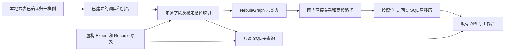

# 原人物表与三表图模型的端到端集成验证

日期：2026-11-05。对应主架构 v0.15。本轮将 v0.14 的独立三表实验接入现有 API 与工作台，继续全部使用虚构人物、日期、职位和经历，没有访问 Supabase。

## 实现与实际效果

新增显式原表模式：SQLAlchemy 子查询直接读取八张原表和三张词典／投影表，不建数据库视图，不增加 person／fact／relation 业务表，也不将数据重新装入 demo_* 查询表。复用现有查询接口、游标、关系说明、局部图、时间轴、条件保存与导出。SQL 日期转换为 YYYYMM，人物按来源命名空间保留。



连接链接口 `/api/v1/relations/paths` 在此模式始终由图计算关系、共同实体、月份交集和中间人物，SQL 只取人物及指定经历详情并检查属性一致性。其他人物／实体筛选、普通相关人物列表、专题、完整履历对比、展开和导出继续复用 SQL／Domain 规则；本轮不声称所有接口都已由图计算。

新人物标识为 p:expert:1、p:resume:8 等；实体接口 ID 是 BIGINT 的字符串表示，例如 307，图 VID 是 e:307。事实引用 slot:1001 对应映射主键 1001，也是图 Rank；来源记录为 experts_work_experience:1。原表字段、同条经历的职位及月份经适配后遵守现有接口契约。项目／专业边已经存储，但没有扩展为同项目／同专业人际查询或时间轴。

| 冻结样例 | 实际效果 |
| --- | --- |
| p:expert:1 与 p:resume:2 | 同公司同期 202101—202212，24 个月；可查看原表记录与未知教育时间 |
| p:expert:1 与 p:resume:3／4 | 非同期／日期未知不产生同期；同公司仍可查询 |
| p:expert:1 到 p:resume:8 | p:resume:7 为中间人物，两段分别 24／71 个月；图、逐段证据和原记录可联动 |
| 公司 307＋职位 316 | 同一经历匹配技术总监；p:resume:7 的公司与职位来自不同经历，不命中 |
| 公司 306 与 307 | 标准名相同仍保留不同 ID；选项附 ID，按源映射选择，不合并 |

## 隔离与发布

复用先前冻结的本机实验库 relationship_lab_handoff_aab83496cf21 和图空间 relationship_lab_three_6a9040da29b3，均只读，不增删改其中任何记录。源库仍为 11 张表、252 条槽位，图为 84 节点／246 有效边。API 的有效人物统计为 63，工作／教育经历为 119；这是按来源区分的样例记录数，不是跨库去重后的真实人数。

新入口 `scripts/source_api.py` 只接受本项目已验证实验，重新核对 SQL 完整摘要、来源／归属／字段／日期及完整槽位，再使用 GUEST 账号回读核对全部预期图顶点和边。全部成功后才在新目录写出 API 清单；旧 lab-manifest.json 仍不能直接加载为 API 配置。

API 使用 format_version=2、model=source-slots-v2 的独立清单和两项显式环境配置。图与 SQL 版本／摘要不符返回 409，图故障返回 503；不自动回退旧模型或 SQL 路径。稳定 Rank、来源表／行／字段、人物归属、目标、职位与日期均参与证据引用完整性检查。缺少清单、混用旧数据源配置会拒绝启动。

本轮没有更改原演示数据或 v1 图投影；旧模式无需新配置继续运行。前端首次打开会从当前数据源选择有效参考人物，修复旧固定人物 ID 导致新来源首次打开 404 的问题；元数据与页面也不再将 MySQL 原表模式标作 SQLite。

本机 MySQL 会话为只读、UTC、严格模式，图使用已有空间独立 GUEST 账号。凭据仅在忽略目录内以 600 权限保存，不在报告或命令中打印。尚未建设独立 MySQL 最小权限账号，不能将只读会话等同于生产权限隔离。

## 启动、停止及重现

先确保本机 MySQL 和既有 NebulaGraph 环境可用。切换模式前停止旧 API。已发布配置可直接使用：

```bash
unset RELATIONSHIP_SOURCE_RELEASE_STORE
unset RELATIONSHIP_DATABASE RELATIONSHIP_MYSQL_URL RELATIONSHIP_NEBULA_MANIFEST RELATIONSHIP_GRAPH_ENGINE
source data/source-api-trial/run-v2/api.env
bash scripts/dev.sh
```

页面为 http://127.0.0.1:5173，API 为 http://127.0.0.1:8000。Ctrl+C 回收本次前后端；不会停止 MySQL、图容器或其他服务。端口占用明确报错。

停服后切回原演示：

```bash
unset RELATIONSHIP_SOURCE_API_MANIFEST RELATIONSHIP_SOURCE_API_MYSQL_URL
bash scripts/dev.sh
```

重新发布到新目录，不覆盖已有文件或修改源库：

```bash
backend/.venv/bin/python scripts/source_api.py \
  --input data/projection-source-trial/run-v4 \
  --output data/source-api-trial/my-new-run \
  --reference-month 202611
```

原表模式拒绝 init/reset，也不会因启动原表模式而初始化默认 SQLite。停服后另建数据快照、图投影与新清单才能发布变化；本轮没有在线更新和增量 Worker。

## 验证范围与记录

新专项包含人工 24／71 个月控制、同名实体按映射选择、同条经历筛选、来源命名空间、全分页、完整履历／导出、图截断、配置隔离、图故障和批次保护。

独立基准从冻结原表 JSON 和映射逐条展开测试输入，以日历月份集合求交，不调用生产适配、SQL 查询、月份或关系函数。14 组条件核对全分页人物；6 组关系范围 × 3 种中间人物来源核对路径及每段证据。专项禁止 SQLPathReader 的 candidates／qualify_candidates／fact_views 被图路径调用。

浏览器四项验收核对两个入口、同名 ID 选项、列表与图、切换中心、分页、专题和条件恢复、履历对比及未知日期、两段路径／原记录、503 错误重试；最后一项通过模拟 HTTP 503 验证 UI，真实服务错误语义另由后端专项检查。截图为 [新模型路径与证据](source-api-preview.png)。

| 检查 | 实际结果 |
| --- | --- |
| 完整检查的后端原生回归 | 510 通过、74 按配置跳过，312.00 秒；启用 MySQL／NebulaGraph／旧图业务专项 |
| 新原表模式专项 | 60 通过、0 跳过，8.11 秒；包括 14 条件全分页与 6×3 路径／证据独立对照 |
| 最终常规后端 | 380 通过、206 外部配置专项跳过，16.21 秒；包含最终 CLI 防护及完整当前测试收集 |
| 静态、契约、前端 | Ruff、mypy 58 源文件、OpenAPI／TypeScript 生成、格式、类型与构建通过，构建 3.54 秒 |
| 原演示浏览器 | 18 通过、9 可选专项跳过，45.8 秒 |
| 最终新模式浏览器 | 4 通过、0 跳过，13.5 秒；使用最终发布配置 run-v2 |
| 只读终检 | SQL 完整摘要与 v0.14 冻结值相同；84 顶点及 246 条边的预期值完整回读一致，未写源库或图 |

完整检查的 74 跳过项是 28 条旧冻结来源配置专项和 46 条新原表模式专项；后者已在本轮 60 项中显式执行。完整检查收集后新增的两项 CLI 防护亦包含于 60 项。各批次存在重叠，不能把通过数相加；此前六表三模式专项记录保留，本轮未重复旧来源三模式观察。

原始记录：[完整检查后端](performance/source-api-full-backend.xml)、[最终常规后端](performance/source-api-ordinary.xml)、[新来源专项](performance/source-api-tests.xml)、[新来源浏览器](performance/source-api-browser.xml)、[环境与源代码摘要](performance/source-api-validation.json)。既有 G6 包体提示与 Starlette/httpx 弃用提示仍保留。测试结束回收前后端；已有数据库与图环境保留。

早期专项中的公司 ID 误选、测试辅助函数漏导入及浏览器错误按钮定位已修正；没有用查询输出自动改写期望，也没有改动样例数据来迎合测试。同名公司的正确目标由冻结源映射 1001→307、1002→316 手工核对。

## 临时选择与剩余范围

1. 本轮是候选结构的本地模拟集成，不是正式原库接入；Resume 结构仍按用户说明模拟，跨库身份映射由上游负责。
2. 发布和请求前后会读取 11 张表检查完整摘要，单表最多 10000 行，超出拒绝；这是小样本一致性保护，不是生产每请求扫描策略或容量证明。图候选采用六类边模型中的工作／教育关系匹配，仍需验证热门实体的实际展开量。
3. GUEST 图查询、每 RPC 建池、候选／证据预算和不可变快照约定保留；SDK 超时不保证服务端即时停止。普通 SQL 操作及连接等待也不构成硬 HTTP SLA。
4. UUID→BIGINT 持久桥接、合并消歧、可靠发布状态、增量和旧边清理仍未建设。当前接入只是使用已有稳定槽位，不承担上游归一和人物识别。
5. 未新增规模／并发实验，没有生产容量或图加速结论。下一轮可优先演练修正后完整重建与版本切换，再做新结构下的受控规模和并发；正式持续更新须先有完整来源契约。
