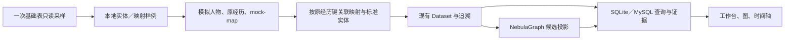
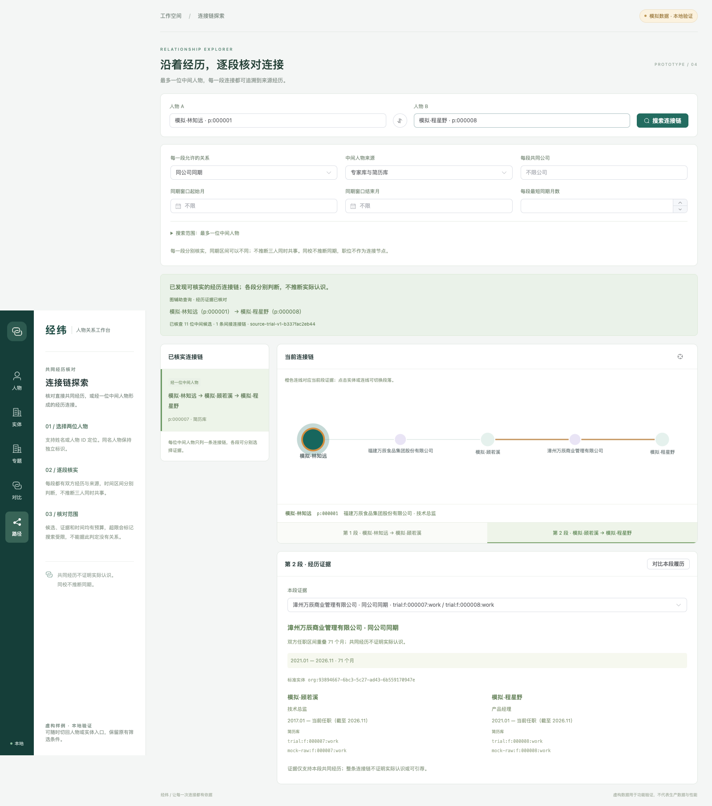

# v0.12 严格只读来源样例全流程验收

历史记录：v0.13 继续使用本地冻结样例，已将配置图后的路径默认引擎改为图内计算，本轮没有新的云端访问，见 [新验收](graph-native-validation.md)。本页图辅助数字保留作历史对照；复现旧辅助行为需显式设置 `RELATIONSHIP_GRAPH_ENGINE=candidates`。

日期：2026-11-04。当前归一库仍在处理，交付字段可能筛选。本轮只用少量形态样例检验逻辑关联和程序能力，不制定上游最终表结构。

## 结论

已经走通“冻结样例→本地虚构人物／原经历→模拟归一关联→查询事实→SQLite／MySQL→图投影→API→浏览器”。三个模式的专项接口和证据核对通过，浏览器各 3 项通过。发现并修复专题页默认实体依赖旧演示 ID 的问题。

本轮 Supabase 仅有 **1 次限定读取量的基础表 SELECT，0 次修改操作**，采样完成后没有再次访问云端。没有改动云端数据、结构、权限、配置或调用未知存储函数。后续所有纠正和负例都在本地内存／临时文件中执行。

## 云端边界与冻结样例

- 项目 company-resolution-test，采样时间 2026-11-04 11:24:17（北京时间）。
- [实际 SQL](examples/source-trial-sampling.sql)只引用 5 张基础表，映射最多 90 条，并补齐引用实体；实际取得公司 23、学校 8、专业 5、映射 84、组织关系 3。
- [本地快照](examples/source-trial-sample.json)的 SHA-256 为 `b337fac2eb44c8a63301c2072c24a51fbe7a239372b50097fffa19a45eb4b885`。
- [本轮调用记录](data-sources/source-trial-cloud-read.json)保留了实际执行语句和操作范围。它是本轮代理调用记录，不是全库服务端审计，不追踪同事的独立操作。
- 不通过前后源表数量相等来“证明没改库”，也不锁表、冻结或阻止同事继续处理。快照只在本地固定，重复生成无需 Supabase 账号或连接。

采样包含 37 条公司映射、35 条学校映射、12 条专业映射，79 条已匹配、5 条待确认。它是有界选择的样例，不代表全量质量分布或最终发布范围。

## 最小实现与实际关联

新增的准备脚本只接受本地 JSON 和新输出目录，复用现有模拟生成、数据预检及 SQLite 装载；未添加依赖、生产表、运行时 Supabase 客户端、PostgreSQL 查询仓储或新 API。

`source_trial.read_seed()` 是当前采样物理字段的唯一转换边界。无关字段可以筛掉，未知处理字段可忽略；所需实体标识／名称／目标关联仍需可表达。已测试删除文件定位、原库标识及可选别名等字段后，能继续生成本轮模拟源，并报告真实回连缺口；这不表示正式接入也不需要原记录键。

逻辑链路如下：



60 名演示人物名字带“模拟·”；人物 ID 保留原演示命名以复用工作台，原经历使用 mock-raw 前缀、模拟归一关联使用 mock-map 前缀、查询事实使用 trial 前缀。实际采样原库 ID 不作为这些人物的履历来源。

在本地 MockSource 中，原经历不携带公司／学校实体 ID，由 mock-map 的原经历键及目标键生成事实；因此测试的不只是替换名称。采样映射 UUID 如被保留，只说明模板线索，不证明虚构人物属于该真实原记录。

输出为 60 人（59 有效）、122 条事实、16 个查询实体（6 公司、5 学校、5 个虚构职位），版本 source-trial-v1-b337fac2eb44、基准月 202611。专业仅保留在样例材料中；母子／总分公司不合并任职关系。

相同原经历有重复同目标映射时，生成一条事实并保留全部映射追溯；多个不同目标则阻断，避免把相同岗位和时间复制给多家公司。缺失归一目标、原经历引用、错误类型、人物归属或矛盾日期均不能通过转换。输入错误在创建查询库前阻断。

## 测试、界面与完整性

独立人工预期记录在 backend/tests/fixtures/source-trial-cases.json，覆盖公司／职位同条经历、学校交集、专家筛选、无结果、24 个月同期、非同期、未知时间、跨年单月和当前任职。另复用测试专用的朴素月份集合基准核对完整分页、直接关系和两段路径；不调用生产关系计算生成期望。

| 检查 | 本轮实际结果 |
| --- | --- |
| 样例专项，三个模式 | 60 项通过，1.13 秒；包括输入只读、无网络准备、重复生成、异常和三模式查询 |
| SQLite 专项浏览器 | 3 项通过，7.2 秒 |
| MySQL 专项浏览器 | 3 项通过，6.6 秒 |
| MySQL＋图辅助专项浏览器 | 3 项通过，6.7 秒 |
| 静态检查 | Ruff 通过，mypy 45 个源文件通过 |
| 完整后端回归，原数据库专项开启 | 456 项通过、28 项本轮显式配置用例跳过，253.51 秒；本轮三模式已另行全部执行 |
| 前端契约、格式、类型和构建 | 通过，构建 3.48 秒 |
| 原演示浏览器 | 18 项通过，45.1 秒；5 项可选专项跳过 |

专项浏览器检查两入口、同条经历约束、真实采样名称和 UUID、模拟标识、图画布、专题默认选择、履历时间轴和路径逐段证据；图模式确认响应确实来自 nebula_sql。已查看三模式之一的完整路径截图，模拟提示、公司名称、段落和来源可见。

本轮 MySQL 库为 relationship_lab_20261104_6cbd6d68，输入摘要在导入前后相等。图空间为 relationship_lab_projection_61aa5f923bd0，122 条经历边、236 条辅助边；回读对账后发布，逻辑内容摘要为 `dba4cf434fbf2ace45b5da4a67cb6bb9bc13a1efd5c1b36143e00465a6aa495f`。导入首次观察 MySQL 279.33ms、图含 Schema／账号传播等待 23.44s，均不是持续导入吞吐。

新建对象与原演示库、原图投影相互独立。输入摘要和本轮 SQLite／MySQL 的最终只读核对见验收 JSON；没有重置旧库或停止其他服务。图发布中 GUEST 认证缓存传播的限时等待出现短暂提示，最终只读账号和 ready 校验通过，没有改云端或绕过认证。

最后另做 10 场景 × 3 模式的 30 次顺序 ASGI 请求，均为 200，去除运行统计与后端标志后响应语义摘要一致。样例、本轮 SQLite、默认演示文件在观察前后摘要不变，MySQL 逻辑内容摘要不变。同期路径单次观察为 SQLite 4.819ms、MySQL 10.494ms、图辅助 32.268ms，仅作功能耗时记录，不是性能目标或压测。原始 [观察记录](performance/source-trial-observation.json)、[专项 JUnit](performance/source-trial-tests.xml)、[准备记录](performance/source-trial-preparation.json)及 [图发布记录](performance/source-trial-projection.json)均保留。后端源码摘要为 `3f50bbc2b9158ff3dcda9574b5323a65c3f0d7ce158ae261dcf5e3fc7fda36f4`。



## 发现的问题及处理

| 分类 | 观察 | 本轮处理及后续含义 |
| --- | --- | --- |
| 上游处理中 | 5 条待确认、8 条缺原键／命名空间、2 个已合并实体、2 组重复映射 | 保留 source-issues；不视为上游设计错误，不修改、不猜测；采样子集不推算全库比例 |
| 必需逻辑关联 | 归一结果尚不能提供完整人物归属、任期、职位及失效；同一原文可能多实体 | 虚构补齐以验证程序；正式交付需能提供人物—经历—标准实体及来源追溯，不限定物理表名 |
| 程序缺陷，已修 | 专题页默认 org:0，新 UUID 样例下请求失败 | 专项先复现失败，后改为在当前实体选项中选择有效默认值，三个模式重测通过 |
| 后续程序改进 | 人物初始选择仍面向演示 ID；专业、组织关系及归一过程无完整专门详情模型 | 本轮不扩大范围；正式人物接入或有对应需求时再改契约和展示 |
| 后续接入设计 | 当前原记录多目标只阻断，不自动拆分事实；源 UUID 生命周期和完成版本未确认 | 正式数据评审时明确真实拆分依据和映射版本；本轮不得替上游决定 |

结构上的结论是：现有“人物—原经历—归一映射—标准实体”逻辑可以支持查询；并未证明当前五表就是充分的最终交付结构。专业不等于职位，组织关系不等于共同任职，未知日期不等于当前任职，归一成功不等于真实人物归属已核实。

## 复现与启动

项目根目录，已有 SQLite 演练可直接运行：

```bash
source data/source-trial/run-v2/.env
bash scripts/dev.sh
```

Ctrl+C 停服务后，切 MySQL：

```bash
source data/source-trial/run-v2/.env
source data/source-trial/mysql-v1/.env
bash scripts/dev.sh
```

再次停服后，图辅助使用同一 MySQL 快照：

```bash
source data/source-trial/mysql-v1/.env
export RELATIONSHIP_NEBULA_MANIFEST="$PWD/data/source-trial/graph-v1/manifest.json"
bash scripts/dev.sh
```

停止后 `unset RELATIONSHIP_DATABASE RELATIONSHIP_MYSQL_URL RELATIONSHIP_NEBULA_MANIFEST RELATIONSHIP_SOURCE_TRIAL_DIR` 可切回原演示。不要在 API 运行时原位纠正快照。

本地重新生成（新目录，不重新读取云端）：

```bash
backend/.venv/bin/python scripts/source_trial.py \
  --input docs/examples/source-trial-sample.json \
  --output data/source-trial/new-run

backend/.venv/bin/python scripts/mysql_lab.py \
  --input data/source-trial/new-run/query.sqlite \
  --output data/source-trial/new-mysql

backend/.venv/bin/python scripts/graph_projection.py \
  --input data/source-trial/new-run/query.sqlite \
  --output data/source-trial/new-graph
```

运行已有三模式专项：

```bash
source data/source-trial/mysql-v1/.env
export RELATIONSHIP_SOURCE_TRIAL_DIR="$PWD/data/source-trial/run-v2"
export RELATIONSHIP_NEBULA_MANIFEST="$PWD/data/source-trial/graph-v1/manifest.json"
backend/.venv/bin/pytest backend/tests/test_source_trial.py -q
```

浏览器专项在 frontend 目录执行 `CI=1 RELATIONSHIP_SOURCE_TRIAL_BROWSER=1 npm run test:e2e -- source-trial.spec.ts`，按上文配置分别启动；只运行此专项，原浏览器用例仍加载原演示，避免依赖真实采样名称。正常回归默认跳过三模式所需的外部连接和样例浏览器。

本轮没有生产负载、归一准确性、真实原经历回连或目标规模结论，也没有解决既有 18MB 极端对比响应。后续正式表到位时，只把可复用的规则与适配边界保留，按实际交付重新评审字段和完整性。
