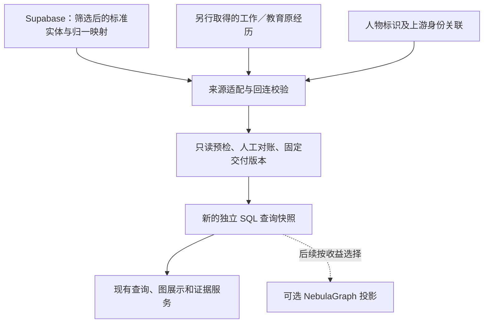

# Supabase 归一数据源接入评估

评估日期：2026-11-04。项目：company-resolution-test；范围：public 下 5 张业务表、5 个视图的只读结构检查及聚合统计。最后一组数量来自同一 SELECT 的读取快照，时间为北京时间 11:02:05；处理库持续更新，本文数量不是交付版本。

本次未修改云端表、数据、视图、权限或索引，未导入本地查询库，也未改业务运行方式。[结构与统计记录](data-sources/supabase-assessment-2026-11-04.json)不含凭据或人物明细。

后续说明：用户明确当前字段可能筛选，本页仅保留当时的只读观察，不作为上游最终结构要求。随后 v0.12 已用少量实体及映射形态构造 [本地模拟全流程](source-trial-validation.md)，不修改 Supabase，也不以模拟结果证明真实原经历关联。

## 1. 结论与条件

**作为公司／学校标准实体与经历归一映射的上游来源，可行性高；作为完整人物关系查询的唯一数据源，当前不满足条件。**

现有主键、唯一约束、外键、匹配状态和来源记录，使数据可以适配到项目的实体与事实模型。54,940 条映射已具备原库记录 ID，能够作为回连原工作／教育记录的候选键；实际主键匹配仍需原表验证。当前没有人物归属、任职时间、工作职位、人物有效性和完整来源身份数据。

用户已确认：**归一结果与原经历需要分别取得；职位归一是否另行交付尚未确定。** 因而接入方式应为“归一结果＋原经历＋人物／来源关联”的组合。表内已有的专业词典不能代替职位词典，原经历的 ID 也不能当作人物 ID。

本次没有证明归一结果语义准确、当前处理已完成、原库 ID 实际可回连、简历库覆盖、生产负载或 Supabase 应用连接可用。MCP 读取成功不等于 FastAPI 已获得独立运行凭据或 PostgreSQL 仓储能力。

## 2. 表的用途与当前数量

| 数据对象 | 同一读取快照的记录数 | 对本项目的作用 | 适配边界 |
| --- | ---: | --- | --- |
| company_standard | 10,283 | 标准公司 ID、名称、简称和历史名称 | 映射为 organization；保留子／分公司独立 ID |
| school_standard | 1,843 | 标准学校 ID、名称、历史名称 | 映射为 school；22 条标记为已合并 |
| major_standard | 701 | 专业词典及目录背景 | 当前 EntityType 不支持 major；8 条已合并；不映射为 role |
| name_mapping | 56,951 | 原始条目至标准实体的归一结果及处理状态 | 是映射记录，不是人物表或已确认的完整经历表 |
| company_relation | 149 | 公司母子／总分关系及依据 | 单独的组织关系，不等于同公司任职关系 |

三类标准实体以 UUID 为主键，另有标准编号及 entity_key；name_mapping 以 UUID 为主键，具备三类目标实体的外键。检查时匹配行目标类型正确、恰好关联一个目标，悬空目标外键为 0。这说明当前引用结构适合做适配，不证明名称判断本身正确。

源字段与项目模型的主要对应为：

| 源信息 | 项目目标／用途 | 处理原则 |
| --- | --- | --- |
| company_standard.id／school_standard.id | Entity.id 的来源键 | 保留来源、类型和 UUID 的稳定映射，不用可变名称当键 |
| standard_name／short_name／former_names | Entity.name／aliases | 按上游确认口径接收；歧义旧名不能自动决定经历归属 |
| name_mapping 对应类型的 company_id／school_id | Fact.entity_id 的归一依据 | 先定位原经历，再绑定标准实体 |
| source_namespace＋original_database_id | 回连原工作／教育记录 | 来源表命名空间必须明确，不能跨表只按数字 ID 连接 |
| source_file／source_sheet／source_row／source_id | 文件追溯信息 | 不能代替原库主键或人物身份 |
| mapping.id／item_no／item_id | 拆分条目追溯 | UUID 是当前主键；item_id 已有重复，不能单独作唯一键 |
| 原人物表和原经历（另取） | Person、Fact.person_id、时间、职位、状态、来源 | 尚未取得和验证，不从归一词典推断 |
| evidence／match_reason／confidence | 归一依据与可追溯信息 | 与人物任职证据分开；名称置信度不代表认识概率或公司关系置信度 |

当前 Fact 只有原经历来源定位，尚无完整归一过程的专门来源模型。正式适配时需保留映射 UUID、批次、原库命名空间、标准实体和原始文本等追溯信息，必要时增加旁路对照记录；不能把它们全部伪装成 source_record_id 或丢弃。

UUID 只能证明当前表内标识唯一，尚不能证明重跑清洗、重新导入或合并后保持不变。正式交付还需确认 UUID、entity_key 和标准编号各自的生命周期，及旧键重定向方式。

## 3. 归一状态与原记录回连

| 类型 | 映射总条数 | 已匹配 | 待确认 | 无有效名称 | 已匹配且有原库 ID |
| --- | ---: | ---: | ---: | ---: | ---: |
| 公司 | 32,414 | 17,911 | 11,915 | 2,588 | 16,487 |
| 学校 | 12,215 | 11,443 | 683 | 89 | 11,443 |
| 专业 | 12,322 | 7,939 | 1,129 | 3,254 | 7,939 |

这些是映射条数，包含原记录拆分，不能解释为人数、独立经历数、最终可发布条数或全库归一覆盖率。特别是“已匹配且有原库 ID”仍需验证原表存在、人物归属及拆分语义，才可进入经历事实。

- 有命名空间和原库 ID 的公司映射为 30,403 条，对应“专家工作表”30,084 个不同原记录；学校和专业分别对应“专家教育表”的 12,197 个原记录。来源标记中尚未看到简历命名空间，不能据此证明已覆盖简历库。
- 另有 2,011 条公司映射来自 entity_normalization_20261028 批次，未提供原库 ID 和命名空间，其中 1,424 条虽已匹配，也不能据此关联人物经历。可保留其标准实体价值，经历回连需上游补足依据。
- 非空 original_database_id 与 attributes.source_record_id 在本次检查中没有不一致；但列注释仍写“原数据库主键未包含”，与实际填充情况不同。正式交付需确认哪个字段为权威、原键是否来自实际业务表及其唯一范围。
- 12,197 个教育原记录同时出现学校和专业条目，具备按原教育记录回连的基础；部分记录已拆成多个实体，不能无条件将学校和专业列表做笛卡尔积，构造未经证明的就读对应。

## 4. 接入时必须处理的语义

### 4.1 发布筛选与状态

建议把“已匹配、目标存在且为上游允许的标准实体、来源记录可回连”作为初步候选条件，最终发布清单和规则由上游确认。待确认／无有效名称保留问题与追溯，不进入确定的公司／学校关系；不得按候选名称非空就认为匹配成功。

当前 name_mapping_export 的 ready_for_export 只判断 processing_status='已匹配'；standard_name 会回退到 attributes.candidate_standard_name，因此有标准名称文本并不证明已关联实体。company_relation_export 的 ready_for_export 只判断已核验，不检查生效日期。两者都不是完整人物查询快照的完成标记。

review_status 字段注释为兼容保留，本次看到的匹配行是“无需人工审核”。不能擅自要求全部 review_status='已通过'，否则会误排有效候选；也不能把表内备注当作新的产品需求。筛选语义需要与上游最终交付口径一致。

### 4.2 拆分和重复

在有原库 ID 的记录中，公司有 296 个原记录出现多条映射，其中 40 个对应多个非空目标；学校为 18／12 个，专业为 114／52 个。这一统计包含各处理状态，并不代表这些多目标都已获准作为最终事实。

同时观察到 159 组重复 item_id，以及 183 组相同批次／来源命名空间／原记录／类型／目标组合的重复映射。这些可能来自原文本拆分、别名或重复片段，尚不能判为错误。不能简单按 original_database_id 取第一条，也不能把每条映射都算作独立任职。

适配器应保留原事实与拆分条目的来源联系，只对上游确认的等价事实去重。若一条工作原文含多家公司，应先确认是否各自都有相同职位和时间依据，再生成独立事实；不能给所有拆分公司复制同一岗位和任期。工作职位与标准公司仍必须属于同条被确认的经历。

### 4.3 合并、组织层级与日期

- 标记已合并的学校 22 条、专业 8 条均有 merged_into_id，且目标在本次检查中存在。正式交付需核对重定向链、环、终点有效性和旧键保留；本次未穷尽这些检查。已匹配映射当前均指向已核验实体，仍需防止后续合并造成分裂。
- 母子公司及总分公司保留独立实体。将整个集团人员直接合并为“同公司”会改变现有关系含义。若以后需要“同集团”，应单独定义关系、日期和证据，不沿用 same_company。
- company_relation 有 139 条已核验子公司关系、7 条已核验分公司关系、3 条历史关系待确认；149 条的 valid_from／valid_to 均为空。它们不能证明任职期间的历史集团关系，也不能提供人物任职起止时间。
- company_standard 的父／子编号数组及展示视图用于组织信息呈现，不作为人物归属键；NULL、空集合和展示用的 0 需区别解析。
- major_standard 的目录教育层次只描述专业条目，不证明某个人的学历；公司名称和关系置信度也不用于人物关系综合评分。

### 4.4 稳定键与查询视图

适配优先读取基础表或上游冻结的发布视图。entity_name_comparison 的 comparison_no 来自 row_number，排序插入会使编号变化，不能作为稳定实体／映射 ID；name_normalization_groups 是聚合结果，会丢失逐经历来源，不适合作为事实来源。

视图中的候选文本、日期相关展示和聚合适合核对，不能直接替代项目的稳定分页及版本契约。5 张表的 updated_at 有更新触发器，但 21 个 batch_no 是处理分组，未见全局交付完成标记；硬删除也不能仅靠 updated_at 被发现。

## 5. 推荐接入路径

优先采用**冻结交付数据，经适配后生成独立查询快照**。这贴合现有不可变快照约定，可以复用预检、业务规则、分页与图投影，避免查询请求实时依赖仍在变化的清洗库。

初次对接先验证公司和学校两类。专业可以保存为额外归一信息，正式加入专业筛选或教育详情需要单独扩展契约；职位目前待确认，不用专业代替。若只拿到实体词典，可以单独验收实体搜索，不将其发布成完整人物查询数据集，也不和模拟人物混接后声称已经接通真实人物。

Supabase 是 PostgreSQL，本项目当前运行装配仅有 SQLite／本机 MySQL，不支持直接填一个 Supabase URL 即工作。若选择后端直连，需另行增加 PostgreSQL 驱动与仓储／方言、UUID／ARRAY／JSONB 转换、排序游标、日期／匹配和超时清理测试；保留现有 MySQL 实验连接保护。

另一个代码改动点是数据模式：当前 contracts.py 的 data_mode 只接受 mock，QueryService.metadata() 固定返回 mock，前端及导出也按模拟模式展示。真实接入前应共同修改数据模式、批次／来源标记和生成类型，并验证保存条件、导出与旧版本恢复行为；不能只将真实记录装进原模拟库。既有查询规则可复用，数据入口和发布契约仍需开发。

上游已有目标实体、处理状态和 batch_no／source_id 索引，未看到原库 ID 与命名空间的专门组合索引。若以后在源库大规模按原记录回连，再以正式查询和计划评估，当前不修改源库索引；冻结导出后本地适配也可避免运行查询反复访问清洗表。

独立读取凭据、网络可达性和权限仍需验证。长期 Python 后端可评估直接连接或 IPv4 环境的 session pooler，依据 [Supabase 官方连接指南](https://supabase.com/docs/guides/database/connecting-to-postgres)选择；当前 MCP 授权不作为应用运行时依赖。本次没有变更权限或建议把管理凭据交给前端。

这批约 5.7 万条映射适合继续做字段转换与抽样对账实验，但它不提供实际人物经历分布、热门实体人物度数或峰值查询负载，不能据此决定百万级索引、MySQL／图分工及容量。

## 6. 建议对接步骤与验收条件

| 顺序 | 工作 | 验收条件 |
| --- | --- | --- |
| 1 | 明确冻结的交付范围、筛选规则和完成版本 | 表／视图或文件内容固定，含标准实体与映射，状态数量可对账 |
| 2 | 分别取得原工作／教育与人物来源关联 | 原 ID 的表范围明确；抽样和全量引用检查可定位人物，不按姓名猜测 |
| 3 | 评审拆分、合并、职位、日期和失效语义 | 缺项有能力降级结论；缺 ID 的旧批次、待确认和多目标记录有明确处理清单 |
| 4 | 实现来源适配与追溯，进入只读预检 | 转成项目逻辑数据，阻断错误可定位，输入与上游不修改 |
| 5 | 新建独立查询快照，人工核对两个入口与证据 | 不覆盖演示库；公司／职位／时间同条事实正确，同校／同期无误推断 |
| 6 | 统计真实分布并验证计划、负载及更新 | 再决定查询读模型、生产 SQL／图、增量方案和资源 |

本轮只完成接入可行性与缺口评估，未实施以上运行时适配、正式导入或性能验证。主方案已记录为 v0.11.1 文档修订，业务代码仍为 v0.11。
