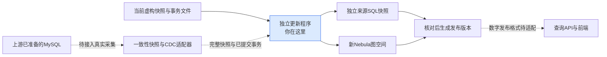

# 独立更新程序实现报告与维护说明

整理日期 2026-11-10 ｜更新模块 v0.35 ｜主方案当前 v0.35 ｜程序入口 relationship_query.update

## 当前实现范围

v0.35已实现numeric-authoritative-v1，直接消费同事维护的graph_edge_mapping，保留其id为图Rank并独立于旧name_mapping逻辑表。原numeric-v1及完整事务文件回放继续兼容。当前多个活跃目标占同一来源槽位仍拒绝，正式多目标语义由上游提供。

新增MySQLSource提供来源一致性初始化及真实binlog完整事务读取，使用锁定mysql-replication 1.0.16。协调连接持短全局读锁，读取连接建立RR视图及日志基线后释放锁；后续按完整事务交付、持久化后确认、按from_seq／to_seq构建。代码检查来源实例／列指纹、日志范围及事务预算，DDL和不支持事件阻断。当前要求ROW、FULL行镜像及列元数据、非压缩／非局部JSON，MySQL 8.4.13已实际验证。

实际入口示例为scripts/mysql_update_lab.py，通过UpdateProgram.bootstrap／capture／process及NebulaTarget运行。262名虚构人物、13表228列、五轮真实图与配套SQL核对、全图27607两跳三元组及11人工场景通过，初始化并发提交、构建期间持续采集、回滚、重放与读取器恢复均有记录。详情见[最新原生验证](mysql-latest-native-validation.md)。

现有claim固定from_seq／to_seq，_build从rows_at(to_seq)生成source.sqlite，后续微批使用本地基线与CDC历史。本轮增加真实采集适配，不要求同事每批导出SQL。上游名称JSON用于其生成映射表，内部JSONL仍为本项目离线回放协议。

数字模式完整HTTP／前端、无人值守调度、长期保留、续租、主从切换及生产容量仍待完成。下面处理及状态说明沿用既有核心，v0.30.1历史实测日期保留，代码入口与验证范围以本节及主架构v0.35为准。

## 一句话结论

更新程序将上游交付的全量和已提交变更保存为可追溯的来源状态，再按完整事务分批构建新SQL／图版本，核对成功后发布。

可以把它理解为接收台账加版本装订流程。来源变更先登记，某次构建只使用指定截止点之前的台账，候选版本核对成功后再交付查询系统。采集进度和已发布进度分别保存。

当前程序以Python命令行方式运行，状态由本地SQLite保存，图目标使用NebulaGraph。微批表示每次选择有限数量的完整事务，默认100个。当前每批使用截止点的完整状态重建SQL／图，后续事务可以继续接收。自动定时运行需要后续调度接入。

## 在系统中的位置



上游继续处理身份和实体归一。本项目消费稳定人物键、标准实体键和经历映射。当前输入适配器ReplaySource逐行读取事务文件，每一行代表完整已提交事务；未来实时采集器按同一ChangeSource接口交付事务并处理确认。

### 输入协议

| 输入 | 主要内容 | 用途 |
| --- | --- | --- |
| SourceContract | 物理表列映射、逻辑表、来源命名空间、字段类型和状态值 | 将可变的MySQL结构对应到稳定逻辑字段 |
| SourceSnapshot | generation、cursor、全部配置表的完整行 | 建立首次来源基线；当前游标由回放材料提供 |
| SourceTransaction | 事务ID、previous／cursor、event_count、完整事件列表 | 校验与上一提交位置的衔接、完整事务处理和去重 |
| RowChange | event_id、物理表、操作及before／after | 表达新增、修改、删除或DDL控制事件 |

三类输入及来源契约采用format_version=1并严格校验字段。generation区分不同全量基线所属的来源世代，cursor表示来源日志位置。更新核心验证位置连续衔接；真实MySQL快照与日志位置的一致性需要未来采集器保证并实测。

当前虚构来源契约覆盖11张逻辑表，包括专家／简历人物、工作、教育各两张，三类标准实体，以及边映射和名称映射各一张。配置中的mock表名、核验状态及命名空间均为演练材料，实际接入时对应真实DDL和状态约定。

## 核心流程

### 1. 校验并建立全量基线

bootstrap先检查契约、基准月、行数和业务引用。物理字段通过SourceContract转换成逻辑字段，BIGINT保留整数精度，配置的时间字段统一编码。预检通过后，将全量行及基线位置写入私有状态库，事务序号从0开始。

bootstrap负责基线导入，首次图构建由后续publish执行。真实来源的一致性读取仍需快照适配器实现。核心入口见[service.py](/Users/yuka/Developer/character_relationship_map/backend/src/relationship_query/update/service.py:54)。

### 2. 完整事务落地后再确认

capture依次核对来源世代、事务身份、前一个位置和事件数量。每个相关事件按配置转换字段，修改与删除还会检查before是否等于本地已知旧值。

事件、事务记录、行版本和新消费位点在同一个SQLite事务中提交。提交成功后调用来源的acknowledge，即通知采集器该事务已可靠接收。文件回放没有外部服务器确认，当前实现保留此回调接口。逻辑见[service.py](/Users/yuka/Developer/character_relationship_map/backend/src/relationship_query/update/service.py:62)和[store.py](/Users/yuka/Developer/character_relationship_map/backend/src/relationship_query/update/store.py:133)。

| 事件 | 本地处理 |
| --- | --- |
| INSERT | 检查目标主键是否已存在，再追加新行版本 |
| UPDATE | 核对旧值，追加新值；主键改变时同时记录旧键删除和新键写入 |
| DELETE | 核对旧值，追加删除标记，保留历史可追溯性 |
| DDL | 暂停采集和候选发布，保留最后完整提交位置 |

同一事务ID及相同内容再次到达时，返回精确重放结果。相同事务ID内容变化、事件ID冲突、位置断档、未知表或输入协议错误会阻断处理。事务中途失败时，已处理的同事务事件一起回滚。

### 3. 固定本次微批截止点

process读取已发布版本，领取下一段完整事务范围并生成本次租约令牌。租约是Worker暂时拥有该任务的凭证，当前默认300秒。重试会使用新的令牌和独立尝试目录，旧Worker令牌无法提交新尝试。同一目录通过发布文件锁串行构建。基准月推进可以生成空事务范围任务，以更新在职同期证据。

例如已经发布到事务20，接收到事务28，本批预算为5个事务，则本次范围为(20,25]。构建期间即使又接收到事务29，候选仍只使用截止25的完整状态。

rows_at按每个主键选择不超过截止点的最后行版本，并排除删除标记。因此采集可以继续推进，当前候选的来源保持固定。范围选择与历史读取见[store.py](/Users/yuka/Developer/character_relationship_map/backend/src/relationship_query/update/store.py:255)。

### 4. 生成事实并在新图中计算人物关系

NumericProjectionAdapter将规范化来源转换为允许入图的节点和经历事实，检查有效性、归属和标准目标引用。人物姓名留在来源SQL中，图中人物属性包含来源和业务编号。

实体VID使用e:company:1、e:school:1、e:major:1区分类别。事实Rank保留graph_edge_mapping.id。学校和专业来自同一教育行时共享experience_key，具体经历的职位、教育属性和月份随事实边保存。

NebulaTarget先记录本次空间创建意图，再创建新空间、写事实，随后调用nGQL生成四类人物关系。

| 人物关系 | 生成依据 |
| --- | --- |
| same_company | 两人有效工作事实指向同一标准公司 |
| company_overlap | 同公司工作事实存在可核实的月份交集，在职事实使用本批基准月 |
| same_school | 两人有效学校事实指向同一标准学校 |
| same_major | 两人有效专业事实指向同一标准专业 |

派生人物边保存标准实体及左右事实Rank，以便回查证据。Python负责适配、编排及写入图计算结果。图中全部节点、事实和人物边回读匹配后，再创建GUEST只读账号，并实际核对其完成标记。实现见[projection.py](/Users/yuka/Developer/character_relationship_map/backend/src/relationship_query/update/projection.py:113)和[target.py](/Users/yuka/Developer/character_relationship_map/backend/src/relationship_query/update/target.py:91)。

### 5. 完整核对后原子发布

候选目录写入来源SQL、事实计划、资源日志、只读凭据及摘要清单。发布前重新检查租约、已发布修订号和采集状态，然后使用原子文件替换更新active.json，最后补记任务published状态。

原子替换使读取者看到完整的旧指针或新指针。若指针替换后、控制状态提交前中断，下次运行会校验激活文件并补记已发布任务。图构建或核对失败时，候选保留错误及诊断文件；重试使用独立资源。发布入口见[service.py](/Users/yuka/Developer/character_relationship_map/backend/src/relationship_query/update/service.py:180)。

## 控制状态与发布产物

### 五张本地状态表

| 表 | 保存什么 | 作用 |
| --- | --- | --- |
| rq_cdc_checkpoint | 基线位置、已接收位置、世代、契约摘要、采集状态 | 确定从哪里接续 |
| rq_cdc_transaction | 事务ID、事务序号、摘要、前后位置 | 整事务去重和提交顺序 |
| rq_cdc_event | 稳定事件ID、事务内顺序及行镜像 | 事件追踪与冲突检查 |
| rq_source_row | 逻辑表、主键、事务序号和行内容／删除标记 | 重现任意已捕获截止点 |
| rq_projection_batch | 范围、基准月、状态、租约令牌和产物目录 | 跟踪构建与发布尝试 |

独立程序采用update-state-v1本地状态格式，控制存储选择SQLite。既有MySQL控制库DDL仍保留其部署设计，未来更换存储需显式迁移并保持事务约束。上游graph_sync_batch的职责保持在同事的数据同步链路。

### publish成功后的尝试目录

```text
<独立状态目录>/
  state.sqlite
  active.json
  releases/<batch_id>/<token>/
    source-snapshot.json
    source.sqlite
    graph-plan.json
    build-resource.json
    reader-credentials.json
    manifest.json
```

source.sqlite保存逻辑表、主键及JSON行，是本项目的规范化来源快照，只保存配置映射字段，真实查询筛选与详情所需列须在接入时核对。manifest.json记录来源、契约、截止点、基准月、图结果和文件摘要。build-resource.json记录本次图空间名，便于失败追踪。plan产物只包含候选计划和planned清单，publish才执行真实图目标并具备激活条件。

独立发布格式为standalone-update-v1，当前历史UUID查询API需要后续适配才能消费这一格式。该程序使用独立active.json发布目录。

状态目录采用700权限，状态及私有产物采用600权限。来源快照保留显示及证据所需的SQL信息，图人物节点遵循姓名禁入规则。

## 一个具体更新场景

专家原工作经历指向公司A，上游确认应改为公司B，并在一个事务内同步修改原经历职位、边映射和名称映射。

1. 更新程序完整接收该事务，核对旧值，三处变化共同提交并推进消费位置。
2. 下一微批固定截止点，适配器得到指向公司B的工作事实，保留原事实Rank及经历归属。
3. 在新空间重新写入该截止点的全部有效事实，并用nGQL重新生成关系，公司A旧事实支持的关系随新版本结果退出，公司B的关系按实际事实产生。
4. 完整回读、GUEST核对和发布检查成功后，新激活指针指向这一版本。

如果三个修改分散在不同源事务，中间状态可能出现名称与边目标不一致，候选构建会失败。后续纠正事务到达后，可以在同一发布基线上扩大失败批次范围重新构建，仍需满足完整性及预算条件。

## 对外命令与关键入口

| 命令 | 核心入口 | 当前作用 |
| --- | --- | --- |
| validate-contract | SourceContract、NumericProjectionAdapter初始化 | 核对配置及必需字段，输出契约摘要 |
| bootstrap | UpdateProgram.bootstrap | 校验并导入全量基线 |
| capture | UpdateProgram.capture | 接收完整事务，持久化后确认 |
| plan | UpdateProgram.process，图目标为空 | 生成固定截止点的来源SQL和事实计划 |
| publish | UpdateProgram.process、NebulaTarget | 构建真实新图并核对发布 |
| status | UpdateStore.status、load_active | 查看接收进度、任务和本地激活文件完整性 |

status反映本项目本地记录和发布文件状态。真实远程连接健康、复制延迟及长期运行指标需要后续采集与监控实现。

## 代码边界

| 模块 | 职责 | 来源变更时的维护位置 |
| --- | --- | --- |
| update/models.py | 完整事务、快照、游标和图结果协议 | 仅传输协议变更时升版本 |
| update/contract.py | 物理表／列到逻辑字段映射，整数和时间规范化，配置指纹 | 表名、字段名、表示方式和状态值变化集中配置 |
| update/projection.py | numeric-v1业务适配，生成白名单节点与事实 | 拆表／合表、关联及业务含义变化时更新适配器 |
| update/source.py | ChangeSource接口及ReplaySource | 对接具体MySQL／CDC传输协议 |
| update/store.py | 本地SQLite状态、行历史、事件与断点原子持久化、任务租约 | 控制存储或状态格式迁移 |
| update/service.py | 接收后确认、微批编排、故障与发布协调 | 不访问物理业务字段 |
| update/target.py | GraphTarget接口及Nebula实现 | 图协议和模型变更 |
| update/artifacts.py | 候选SQL、计划、文件摘要及原子激活指针 | 发布格式迁移 |
| update/cli.py | 参数解析与结构化结果输出 | 命令入口调整 |


## 无数据库的运行方法

以下命令在项目根目录执行，Python统一使用backend/.venv。示例实体、人物、状态和事务均为虚构，具体状态值与命名空间不作为上游事实。

```bash
backend/.venv/bin/python -m relationship_query.update validate-contract \
  --contract docs/examples/update-contract-v1.json

backend/.venv/bin/python -m relationship_query.update bootstrap \
  --contract docs/examples/update-contract-v1.json \
  --state data/update-program/my-new-run \
  --input docs/examples/update-baseline-v1.json \
  --reference-month 202611

backend/.venv/bin/python -m relationship_query.update capture \
  --contract docs/examples/update-contract-v1.json \
  --state data/update-program/my-new-run \
  --input docs/examples/update-transactions-v1.jsonl

backend/.venv/bin/python -m relationship_query.update plan \
  --contract docs/examples/update-contract-v1.json \
  --state data/update-program/my-new-run \
  --reference-month 202611 --max-transactions 100

backend/.venv/bin/python -m relationship_query.update status \
  --contract docs/examples/update-contract-v1.json \
  --state data/update-program/my-new-run
```

bootstrap要求新状态目录，已有文件拒绝覆盖。plan保存候选来源SQL、事实计划和planned清单，图收据为空，激活指针不会产生。重复plan会保留相同事务范围并创建新的尝试目录，便于以后由publish处理同一候选范围。

有独立本机图环境时，可以显式使用publish替代plan，另传--graph-credentials指定已有私有图凭据文件。该适配器仅创建随机relationship_lab_sync_新空间，未完成核对的空间保留为候选诊断资源；当前环境方法支持本机实验图，虚构数字样例已完成原生验证。可重复检查及本次资源回收使用scripts/update_program_lab.py，详见审计报告。

## 修改MySQL结构时如何维护

来源配置样例为docs/examples/update-contract-v1.json。physical填写实际schema.table，columns的键是稳定逻辑字段，值是物理字段；source_table_value用于明确边映射中的原经历表值，可以与测试物理表名分别配置。

例如测试工作表改名、人物外键改名，只需在新版本配置中修改对应部分。

```json
{
  "physical": "test_schema.renamed_employment",
  "columns": {
    "id": "id",
    "person_id": "owner_id"
  }
}
```

示意仅列两项，实际配置应保留全部必需字段。整数列在integer_fields列出，时间列在datetime_fields列出；时间统一为UTC微秒ISO表示，避免快照与CDC对同一日期使用不同编码而发生旧值误判。BIGINT可以由整数或十进制字符串传入，禁止浮点与布尔转换标识，保留有符号64位精度。

| 改动 | 处理方式 |
| --- | --- |
| 行镜像增加未使用列 | 行规范化忽略未映射字段，图计划保持相同 |
| 物理表／列改名 | 新配置显式改映射和version，重新预检并建立新基线 |
| 有效／无效／匹配状态枚举变化 | 显式修改状态集合；未知状态阻断构建，避免静默删除关系 |
| ID或字段类型改变 | 类型声明及数字适配器预检会阻断；核对新身份和契约后建立新基线 |
| 拆表、合表、关联规则改变 | 在ProjectionAdapter边界编写新适配逻辑，再绑定新契约版本 |
| 收到DDL事件 | 当前实现一律暂停并保留原消费位点，核对后在新目录建立基线 |

配置fingerprint绑定字段、类型转换、命名空间和状态规则。已有状态目录中的契约变化会返回CONTRACT_CHANGED，历史事件不按新映射重新解释。此版采用显式新基线处理结构迁移，尚未提供原地自动升级状态库。增加未使用列的行兼容与DDL控制事件处理分别按上表执行。

实体VID为e:company:1／e:school:1／e:major:1，人物仍按来源隔离。graph_expert_name_mapping可以消费resume命名空间，映射物理DELETE会移除对应事实支持；不增加is_deleted。事实Rank保留graph_edge_mapping.id，教育学校／专业共用原教育行experience_key。人物图属性只有来源与业务编号，姓名留在来源SQL。

## 预算与验证范围

默认总快照行数10000、单事务事件数10000、单事务8MiB、文件全量64MiB、微批100个事务。图构建复用现有10000条关系证据预算。预算耗尽明确失败，完整事务及完整关系条件继续有效。保留的事件与行历史尚未自动清理，长期运行与容量需增加保留／压实策略并测试。

专项为backend/tests/test_update_program.py，覆盖正常CLI、数字隔离与精度、字段映射、日期规范化、状态变化、固定截止点、重放、事务回滚、租约、图目标调用和发布恢复。离线图目标使用测试替身，另有独立本机真实图验证；关系计算始终由nGQL执行。实际全量一致性读取、实时CDC连接、API新模式与生产负载仍待联调。

## v0.30初次离线验证记录

2026-11-09执行40项离线专项全部通过，完整后端468通过、240跳过，跳过项含依赖外部MySQL／图环境的测试。全后端Ruff lint与Mypy通过，新增12个Python文件格式检查通过。全仓格式探测另发现test_graph_projection.py及test_native_graph_paths.py已有格式差异，保留原文件。

独立CLI在data/update-program-trial/run-v2-final执行契约核对、全量导入、3条完整事务采集和计划生成，截止tx_seq=3，计划含7节点／6事实，graph为空、active_revision=0。记录见[data-sources/update-program-v1-validation.json](data-sources/update-program-v1-validation.json)。本轮结果为离线正确性验证，真实快照一致性、CDC日志衔接、原生图、查询发布兼容及容量仍待实际环境验收。

## v0.30.1审计与本机真实运行

54项更新专项、后端482通过／240跳过，Ruff lint及Mypy通过。本机真实Nebula完成全量、三次事务微批和跨月核对，事实数6／6／5／6／6，人物关系证据数4／2／1／3／3。实际只读账号可读且写入被拒绝，旧图结果保持，精确重放未重复应用。六处审计修复、运行耗时与边界见[审计报告](update-program-audit.md)。

```bash
backend/.venv/bin/python scripts/update_program_lab.py \
  --output data/update-program-audit/my-new-run
```

该命令需要可用的本机实验图和私有凭据。脚本在新目录运行并最终回收本次空间／账号，激活文件退役为retired-active.json。保留报告和诊断文件供核对，重跑应使用新目录。
